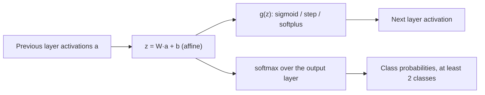

# Activation Function

## Definition

An **activation function** `g` is the non-linear map applied to the weighted sum
computed by a neuron, turning `z = W a + b` into the activation `a = g(z)` that the next
layer sees.

## Why it matters

Without it, a stack of layers collapses: a composition of affine maps is a single affine
map, and a deep [[neural-network]] would be no more expressive than multiple linear
regression. The activation is the only thing that makes [[deep-learning]] non-linear —
and its shape decides whether gradients survive the trip back through
[[backpropagation]].

## Details

**Sigmoid** — the default in the notes, and the reason a neuron "holds a number in
`[0,1]`":

```text
σ(x) = 1 / (1 + e^(−x))
```

The notes annotate it with *"we are only ≥ 0"* — the sigmoid maps any real weighted sum
into a positive, bounded activation, so the threshold condition
`w₁a₁ + … + w_n a_n ≥ x` becomes a smooth, differentiable decision.

**The alternatives named in the notes**

| Function | Use |
|---|---|
| **Sigmoid** | the baseline; smooth `[0,1]` output |
| **Binary step** | hard threshold; not differentiable, so unusable with gradient descent |
| **Softplus** | smooth, unbounded above |
| **Softmax** | *"when you want your output to be the probability of being a particular class"* — **needs at least two classes** |

Softmax is applied to a whole output **layer** rather than a single neuron: it
normalises the layer's values into a probability distribution over the classes, which is
why the predicted class of a classifier is simply its largest output.

## Diagram


The activation function sits between the affine transform and the next layer; softmax is the special case applied to the output layer.

## Relations

- [[neural-network]] — every layer is an affine transform followed by an activation.
- [[deep-learning]] — the non-linearity is what distinguishes it from linear regression.
- [[backpropagation]] — the derivative `g'(z)` appears in every term of the chain rule;
  saturating functions like the sigmoid are the origin of the vanishing-gradient problem
  that residual connections address.
- [[convolutional-neural-network]] — the **detector stage** of a convolutional block is
  exactly the activation function.
- [[cost-function]] — softmax outputs are what a probabilistic loss is computed against.
- [[statistical-testing]] — a softmax output is a score that still needs a cutoff, which
  is what the [[roc-curve]] sweeps.
- [[pooling-layer]] — pooling follows the activation inside a convolutional block.

## Appears in

- [[M2L06-deep-learning]]

## Sources

- `raw/module2/csb_3.pdf`, p. 2 — the sigmoid, the threshold condition and the bias.
- `raw/module2/csb_3.pdf`, p. 3 — binary step, softplus and softmax, and the remark that
  softmax needs at least two classes.
- `raw/module2/csb_3.pdf`, p. 6 — the detector stage of a convolutional block.
