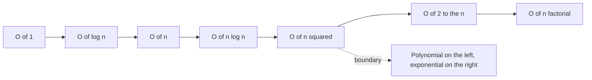

# Algorithmic Complexity

## Definition

Algorithmic complexity describes how the resources an algorithm consumes — chiefly
running time — grow as a function of input size, expressed asymptotically with the
`O`, `Ω` and `Θ` notations.

## Why it matters

Biological inputs are large: a human genome is ≈ 3 · 10⁹ bases. The difference between a
polynomial and an exponential algorithm decides whether a method is usable at all — which
is the whole argument for the Eulerian formulation in [[de-bruijn-assembly]] over the
Hamiltonian formulation implied by [[greedy-assembly]].

## Details

**Bounds**

| Notation | Meaning | Condition |
|---|---|---|
| `O(g(x))` | upper bound | `f(x) ≤ c · g(x)` for all `x ≥ x₀` |
| `Ω(g(x))` | lower bound | `f(x) ≥ c · g(x)` for all `x ≥ x₀` |
| `Θ(g(x))` | tight bound | `f = O(g)` **and** `f = Ω(g)` |

**Growth hierarchy**

`O(1) < O(log n) < O(n) < O(n log n) < O(n²) < O(2ⁿ) < O(n!)`

- **Polynomial** runtime: `O(nᵖ)` — tractable.
- **Exponential** runtime: `O(pⁿ)` — intractable beyond small *n*.

**Calculation rules** (as corrected on the exercise sheet)

- `O(f + g) = O(max{f, g})` — **not** `O(f) + O(g)`.
- `O(f · g) = O(f) · O(g)` — correct.
- Transitivity requires the middle function to match: `g = O(f)` and `f = O(h)`
  ⟹ `g = O(h)`. The variant "`g = O(f)` and `h = O(f)` ⟹ `g = O(h)`" is **false**.
- Constant factors and logarithm bases vanish: `log₃ n` and `log₂ n` differ by a constant,
  so `n log₃ n + n log₂ n = O(n log n)`.

**Correctness**

- Correct: **for all** inputs the output is correct.
- Incorrect: **there exists** an input whose output is wrong.

**Design patterns**

- **Dynamic programming** — break the problem into subproblems and store repeated
  computations in a DP table. Used by optimal [[sequence-alignment]].
- **Divide and conquer** — split, solve recursively, merge; typically `O(n log n)`.

**Caveat**: asymptotics describe the limit. For a bounded input size the algorithm with
the worse asymptotic bound may still be faster — demonstrated numerically in
[[E04-complexity-and-majority-element]].

## Diagram

The growth hierarchy, with the practical tractability boundary between polynomial and exponential cost.

## Relations

- [[de-bruijn-assembly]] — polynomial Eulerian traversal.
- [[greedy-assembly]] — quadratic overlap computation plus a locally optimal heuristic.
- [[sequence-alignment]] — the dynamic-programming example of the course, realised in
  [[needleman-wunsch]] and [[smith-waterman]] at `O(m · n)`.
- [[string-matching]] — the `O(m · n)` brute force that [[knuth-morris-pratt]] reduces to
  `O(m + n)` and that [[boyer-moore-string-search]] makes sub-linear on average.
- [[boyer-moore-majority-vote]] — a linear-time, constant-space algorithm derived from a
  divide-and-conquer predecessor.
- [[suffix-tree]] and [[suffix-array]] — `O(n²)` preprocessing of the text bought back by
  `O(|P|)` queries; the array trades the tree's memory for integer columns.
- [[position-weight-matrix]] — the `O(M · N)` sliding window, cut down by lookahead
  scoring and column reordering.
- [[haplotype-phasing]] — exponential `O(2^h)` enumeration versus linear trio phasing.
- [[dynamic-programming]] — the design pattern named here; it replaces an exponential
  enumeration of candidates by a polynomial table fill.
- [[hamiltonian-and-eulerian-paths]] — the NP-hard versus polynomial contrast that
  decides which formulation of assembly is usable.
- [[de-bruijn-graph]] — the structure that makes the polynomial Eulerian formulation
  available in the first place.
- [[shotgun-sequencing]] — its all-against-all overlap computation is `O(n²)` in the
  number of reads.
- [[next-generation-sequencing]] — read mapping buys an `O(N)` index build instead of
  the `O(n · k · N)` of naive scanning.
- [[principal-component-analysis]] — `O(m·n²)` for the covariance matrix plus `O(n³)`
  for the eigenvalue decomposition.
- [[qq-plot]] — `O(n log n + m log m)`, dominated by the two sorts.
- [[genome-wide-association-study]] — `O(k · n)` per scan: cheap per test, so its real
  cost is statistical rather than computational.
- [[multiple-testing-correction]] — `O(N)` for Bonferroni, `O(M log M)` for
  Benjamini–Hochberg, dominated by the sort.
- [[wright-fisher-model]] — computing the transition matrix exactly costs `O(T · N²)`,
  which is why simulation is preferred for realistic `N`.
- [[travelling-salesman-problem]] — the module-2 reference NP-hard problem;
  brute force is `O(n!)`, exact dynamic programming `O(n² · 2ⁿ)`.
- [[planted-motif-problem]] — brute-force motif search costs `O(4^l · m · n · d)`:
  exponential in the motif length, which is why EM and sampling are used instead.
- [[ant-colony-optimization]] — a polynomial-per-run metaheuristic that trades
  optimality guarantees for tractability on exactly these problems.
- [[keypathwayminer]] — extracting maximal connected subnetworks under a cardinality
  constraint is NP-hard, hence the metaheuristic.
- [[expectation-maximization]] — polynomial per iteration, but with no bound on the
  number of iterations and no guarantee of a global optimum.
- [[transclust]] — its weighted transitive graph projection is NP-hard, which is why module 2 stacks four heuristics in front of the exact solver.
- [[decision-tree]], [[support-vector-machine]] — the training costs quoted on those pages are stated in this vocabulary.
- [[phylogenetic-tree]] — tree counting grows factorially, which is why [[maximum-parsimony]]'s exhaustive topology search is intractable while [[upgma]] and [[neighbor-joining]] stay `O(n³)`.
- [[network-alignment]] — MCES generalises subgraph isomorphism and is therefore NP-hard.
- [[graph-edit-distance]] — the dual objective, equally intractable to optimise exactly.
- [[cytomcs]] — an iterated local search used because the exact problem is out of reach.
- [[evolutionary-algorithm]] — the population-based heuristic answer to the same intractability.

## Appears in

- [[L04-genome-assembly]]
- [[L07-algorithms-and-complexity]]
- [[L08-exact-string-matching]]
- [[L09-sequence-alignment-and-homology]]
- [[L13-suffix-trees-and-arrays]]
- [[L17-markov-chains-and-hidden-markov-models]]
- [[E04-complexity-and-majority-element]]
- [[E07-alignment-and-homology]]
- [[M2L01-enrichment-analysis]]
- [[M2L02-sequence-motifs-and-motif-discovery]]
- [[M2L04-clustering]]
- [[M2L10-network-alignment]]

## Sources

- `raw/module1/gsb_part1.pdf`, pp. 27–29.
- `raw/module1/gsb_part2.pdf`, pp. 1–15 — the string-matching and alignment cost
  arguments.
- `raw/module1/gsb_3.pdf`, pp. 9, 13–15 — the cost of PWM scanning and of suffix-tree
  construction.
- `raw/module1/gsb_part4.pdf`, pp. 14, 17 — the `O(L · |Q|²)` HMM trellis replacing an
  exponential enumeration of state paths, in [[forward-algorithm]] and
  [[viterbi-algorithm]].
- `raw/module2/csb_1.pdf`, pp. 9, 11, 18 — NP-hard combinatorial search answered by a
  metaheuristic, and the `O(4^l · m · n · d)` brute-force motif bound.

- `raw/module2/csb_4.pdf`, pp. 11–12 — NP-hardness of the maximum common edge subgraph problem.
