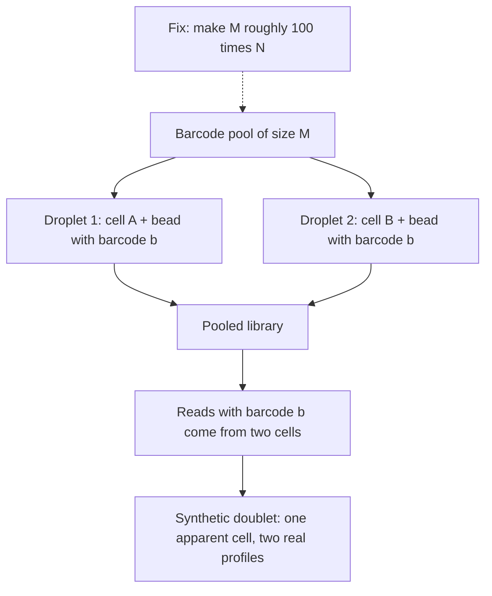

# Barcode Collision

## Definition

**Barcode collisions arise when two cells are separately encapsulated with beads
carrying the same barcode.** The two cells are then indistinguishable after pooling and
are merged into one apparent cell — a **synthetic doublet**.

## Why it matters

A cell barcode is the *only* record of which cell an mRNA came from in
[[single-cell-rna-seq]]. If the barcode is not unique, the cell identity is silently
wrong: two profiles are summed, and the result looks like a genuine cell with an
intermediate phenotype. Unlike a technical [[doublet]], nothing in the droplet was
abnormal, so no wet-lab control catches it — only the **ratio of cells to barcodes**
does.

## Details

**Barcode collision rate** — *the expected proportion of assayed cells that did not
receive a unique barcode*. With `N` assayed cells and `M` barcodes:

```text
                 E(cells with a unique barcode)            ⎛ M − 1 ⎞^(N−1)
collision rate = 1 − ────────────────────────────  = 1 −   ⎜ ───── ⎟
                            # cells                        ⎝   M   ⎠
```

The reasoning: fix one cell. Each of the other `N − 1` cells independently avoids its
barcode with probability `(M−1)/M`, so the chance that this cell's barcode is unique is
`((M−1)/M)^(N−1)`; one minus that, averaged over cells, is the collision rate.

**Consequence**: collisions **lead to synthetic doublets**.

**Avoidance**: a **small ratio `N/M`**, i.e. **relative barcode diversity high** — the
notes recommend the barcode pool be about **100 times larger** than the number of cells.

**The three kinds of merged profile**, for contrast:

| Kind | Cause | Detectable by a barnyard plot? |
|---|---|---|
| **Technical [[doublet]]** | two or more cells in one drop with one bead | yes |
| **Synthetic doublet** | **barcode collision** between two separate drops | yes |
| **Biological doublet** | two cells never separated during dissociation | **no** |

## Diagram


Two separate droplets drawing the same barcode merge into a single apparent cell downstream.

## Relations

- [[doublet]] — the broader category; a barcode collision produces the *synthetic*
  variety.
- [[droplet-based-single-cell-methods]] — the encapsulation step where barcodes are
  assigned.
- [[single-cell-rna-seq]] — the method whose cell identities are at stake.
- [[unique-molecular-identifier]] — the *other* tag: the UMI distinguishes molecules
  within a cell, the barcode distinguishes cells.
- [[probability-distribution]] — the derivation is an independent-trials / birthday-problem
  argument, the same style as the Poisson loading calculation.
- [[batch-effect]] — like a batch effect, a collision is a measurement artefact that
  looks exactly like biology until you ask where it came from.

## Appears in

- [[M2L07-single-cell-rna-seq]]
- [[M2E07-single-cell-rna-seq-and-dimensionality-reduction]]

## Sources

- `raw/module2/csb_3.pdf`, p. 14 — the definition, the collision-rate formula
  `1 − ((M−1)/M)^(N−1)`, synthetic doublets, and the "about 100 times larger" barcode
  diversity rule.
