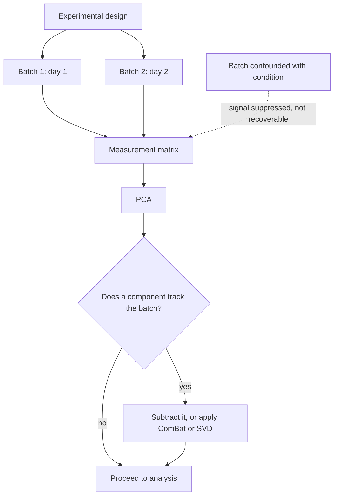

# Batch Effect

## Definition

A **batch effect** is a biased measurement caused by the circumstances of the experiment
rather than by biology — for example day-to-day variation between processing runs, a
change of reagent lot, or a change of personnel.

## Why it matters

Batch effects are one of the big challenges in biomedical research and a classic source
of **misinterpretation**. The danger is not noise as such but **confounding**: when the
batch structure correlates with the outcome of interest, the bias can suppress the real
signal or manufacture a false one.

Two consequences stated in the notes:

- **Normalization does not remove batch effects** ([[data-normalization]] rescales
  values; it cannot undo a systematic shift tied to a processing group).
- **Combining different datasets introduces batch effects** — merging two studies merges
  two measurement regimes.

## Details

**Avoiding the influence — experimental design**

- Distribute batches and other sources of experimental variation **across** the
  biological groups, so that no batch coincides with a condition; this minimises
  confounding.
- Record changes of personnel and of protocol as covariates.
- Keep healthy and unhealthy samples equally distributed over processing times.

**Statistical approaches** (applied after the fact)

- **[[principal-component-analysis]]** — identify the component that represents the
  batch effect and subtract it.
- **SVD** (singular value decomposition) — the underlying linear-algebra machinery.
- **ComBat** — a dedicated batch-adjustment method.
- **Standardization** — per-batch centring and scaling.

## Diagram

Batch structure enters at design time; statistics can only repair what design did not confound away.

## Relations

- [[data-normalization]] — necessary but **not sufficient**: it does not remove batch
  effects.
- [[principal-component-analysis]] — the standard diagnostic and the usual removal tool.
- [[microarray-expression-analysis]] — array experiments processed on different days are
  the textbook case.
- [[rna-seq]] — library preparation and sequencing runs are batches.
- [[genome-wide-association-study]] — population structure is the genetic analogue of a
  batch effect: a confounder that must be matched or corrected for.

- [[epigenome-wide-association-study]] — methylation arrays are run in plates, so batch
  and cell-type composition are its dominant confounders.
- [[population-genetics]] — population structure is the genetic analogue of a batch
  effect, and is corrected with the same PCA machinery.
- [[z-score]] — standardizing values rescales them, but a bias tied to a processing group
  survives the rescaling.

- [[enrichment-analysis]] — functional interpretation downstream inherits whatever batch structure survives correction.
- [[overfitting]] — a model that latches onto a batch has learned the batch, not the biology; it is the machine-learning face of this problem.
- [[single-cell-analysis-workflow]] — batch correction (ComBat) is step 3 of the single-cell pipeline, now at the resolution of individual cells; see [[M2L07-single-cell-rna-seq]].
- [[single-cell-rna-seq]], [[highly-variable-genes]], [[doublet]], [[barcode-collision]] — single-cell data carries batch effects on top of its own technical artefacts.
- [[rna-interference]] — genome-wide RNAi screens list batch-effect correction among their core bioinformatics tasks.

## Appears in

- [[L06-expression-profiling]]
- [[L11-normalization-pca-and-batch-effects]]
- [[L16-epigenetics]]
- [[M2L09-non-coding-rnas]]

## Sources

- `raw/module1/gsb_3.pdf`, p. 4.
- `raw/module1/gsb_part4.pdf`, p. 9 — downstream comparison of groups, where the same
  confounding applies.

- `raw/module2/csb_4.pdf`, p. 3 — batch effect correction in the RNAi screening analysis stack.
