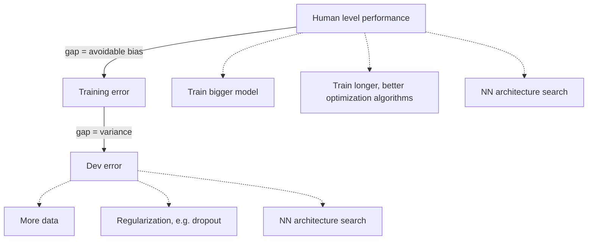

# Bias–Variance Trade-off

## Definition

The **bias–variance trade-off** splits a model's error into two parts that are fixed by
*different* interventions: **avoidable bias**, the gap between human-level performance
and the training error, and **variance**, the gap between the training error and the
development (held-out) error.

## Why it matters

The notes record this under the heading *"Andrew Ng tips"* as a **diagnostic**: measure
the two gaps first, then pick the fix. Without it, every disappointing model invites the
same reflex — more data — which only helps one of the two cases. It is the practical
companion of [[overfitting]]: overfitting says *what* goes wrong, this says *which knob
to turn*.

## Details

Three numbers are measured, in order:

```text
human level          ⟵ the benchmark
   ⇅  avoidable bias
training error       ⟵ error on data the model has seen
   ⇅  variance
dev error            ⟵ error on held-out data
```

**Reducing avoidable bias** — the model is not even fitting its training data:

- **train a bigger model**
- **train longer / better optimization algorithms**
- **NN architecture search**

**Reducing variance** — the model fits training data much better than new data:

- **more data**
- **regularization** — e.g. [[dropout]], batch normalization
- **NN architecture search**

Note that **NN architecture search appears on both lists**: the shape of the network can
be either the bottleneck or the excess.

## Diagram


Measure the two gaps first; the larger gap decides which column of fixes applies.

## Relations

- [[overfitting]] — a large variance gap *is* overfitting; a large bias gap is
  underfitting, the opposite failure.
- [[cross-validation]], [[bootstrapping]] — how the dev error is estimated honestly when
  there is not enough data for a clean held-out split.
- [[deep-learning]], [[neural-network]] — the context the notes give the recipe in.
- [[dropout]] — the regularization named on the variance side.
- [[gradient-descent]] — "train longer / better optimization algorithms" is a statement
  about the optimiser, on the bias side.
- [[random-forest]] — an ensemble is a pure variance-reduction device: averaging many
  high-variance trees leaves the bias unchanged.
- [[roc-curve]] — the dev-set measurement that the whole diagnostic is run on.
- [[convolutional-neural-network]] — weight sharing is a bias that buys lower variance.
- [[evolutionary-distance]] — richer substitution models trade bias for variance in the distance estimate.
- [[kimura-two-parameter-model]] — its extra parameter lowers bias at the cost of variance.

## Appears in

- [[M2L06-deep-learning]]
- [[M2L03-machine-learning-and-classification]] — the diagnostic behind under- and overfitting of classifiers.

## Sources

- `raw/module2/csb_3.pdf`, p. 6 — "Andrew Ng tips": human level / training error / dev
  error, avoidable bias versus variance, and the two lists of fixes.
