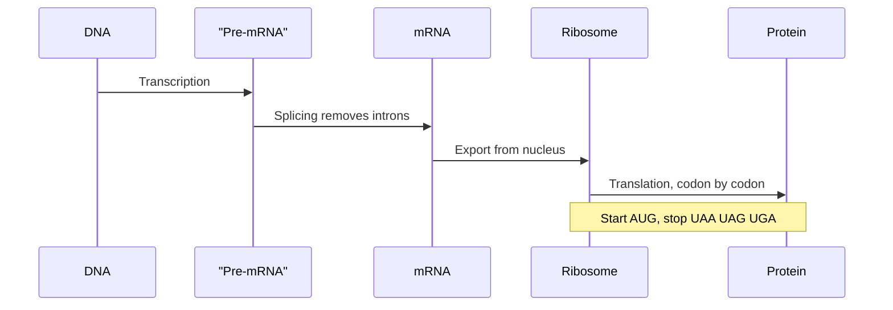

# Central Dogma

## Definition

The central dogma of molecular biology (zentrales Dogma) states that genetic information
flows **DNA → mRNA → protein**: DNA is **transcribed** into messenger RNA, and mRNA is
**translated** into a polypeptide chain.

## Why it matters

Every data type the module handles sits at one station of this chain — genome sequence at
the DNA station, [[microarray-expression-analysis|microarray]] and [[rna-seq]] data at
the mRNA station, and protein structure/interaction data at the protein station. Knowing
which station a measurement belongs to determines how it may be interpreted.

## Details

- **Transcription** copies a gene into pre-mRNA inside the nucleus (in eukaryotes).
- **Splicing** removes introns and joins exons, producing mature mRNA (see
  [[genome-organization]]).
- **Translation** reads mature mRNA in non-overlapping triplets called **codons**.
  - **Start codon**: `AUG` (also codes methionine).
  - **Stop codons**: `UAA`, `UAG`, `UGA` — translation terminates, no amino acid is added.
- RNA uses uracil (`U`) where DNA uses thymine (`T`); a coding DNA strand `…GAT…` becomes
  `…GAU…` in mRNA.
- DNA is synthesised during **replication**, not during transcription — a distinction the
  exercise sheet tests explicitly.
- Because the code is read in triplets, an insertion or deletion whose length is not a
  multiple of three shifts the reading frame and can change everything downstream; see
  [[dna-mutation]].

## Diagram

The ordered molecular process from gene to protein, including the eukaryotic splicing step.

## Relations

- [[genome-organization]] — supplies the exon/intron substrate that splicing acts on.
- [[homology]] — third-codon-position changes are often synonymous, which is why protein
  comparison can beat DNA comparison.
- [[sequence-alignment]] — compares sequences at either the DNA or the protein station of
  this flow.
- [[gene-regulation]] — controls how much transcription happens in the first place.
- [[dna-mutation]] — perturbs the information before it reaches the protein.
- [[rna-seq]] and [[microarray-expression-analysis]] — measure the mRNA station.
- [[genetic-code]] — the triplet rule by which the translation step of this flow is
  carried out.
- [[splicing]] — the eukaryotic processing step that turns the pre-mRNA into the mature
  mRNA that is translated.
- [[promoter]] — the element at which the transcription step of this flow is started.

- [[M2L02-sequence-motifs-and-motif-discovery]] — module 2 reuses this diagram to locate transcription-factor binding sites upstream of transcription.
- [[non-coding-rna]] — most transcripts never become protein; ncRNAs are the part of the transcriptome the classical dogma leaves out.

## Appears in

- [[L01-bioinformatics-and-the-cell]]
- [[L02-gene-expression-and-regulation]]
- [[L06-expression-profiling]]
- [[L09-sequence-alignment-and-homology]]
- [[E01-cell-biology-and-gene-expression]]
- [[M2L09-non-coding-rnas]]

## Sources

- `raw/module1/gsb_part1.pdf`, pp. 2, 10–11.
- `raw/module1/gsb_part2.pdf`, p. 12 — protein versus DNA comparison and the genetic
  code's redundancy.

- `raw/module2/csb_4.pdf`, p. 1 — the split of RNA into protein-coding mRNA and non-coding RNA.
