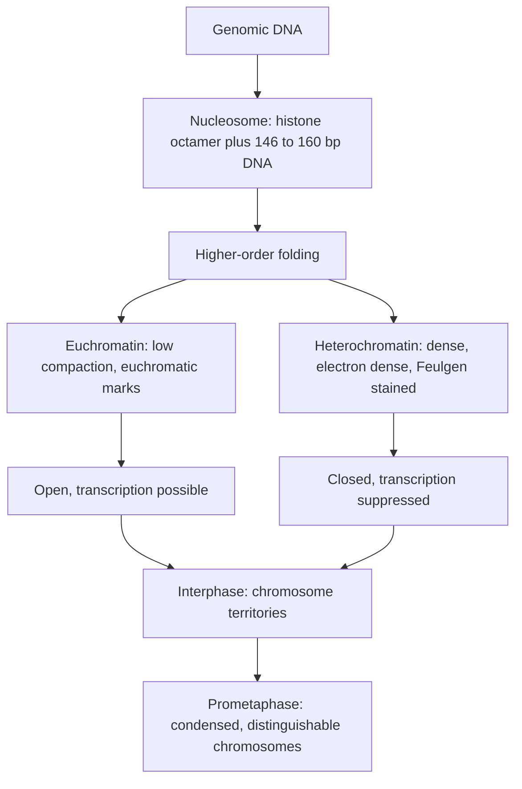

# Chromatin

## Definition

Chromatin (Chromatin) is the complex of DNA and protein that packages the genome inside
the nucleus. Its basic unit is the **nucleosome**: a histone octamer with DNA wrapped
around it. Chromatin in the nucleus is organized into areas with **different condensation
states**.

## Why it matters

Every cell of an organism carries the *same* DNA sequence, yet expresses different genes.
The difference is carried by chromatin state rather than by sequence — this is the
structural basis of [[epigenetics]] and a second regulatory layer on top of
[[gene-regulation]]. How tightly a region is packed decides whether the transcription
machinery can reach it at all.

## Details

### The nucleosome

- **Nucleosome = basic unit of chromatin.**
- Consists of a **histone octamer** with DNA wrapped around it.
- The notes give the wrapped length twice: **146 bp** of DNA around the core histone
  complex (p. 1) and **160 bp** (p. 2). Both readings are kept here.

> [!note] Added beyond lecture notes
> Source: general domain knowledge (standard molecular-biology textbook material). Not
> from the UHH handwritten notes.
>
> The standard reconciliation of the two figures: the **nucleosome core particle**
> contains **~147 bp** wrapped in ~1.65 left-handed superhelical turns around the
> histone octamer (the notes' 146 bp is the same number, from the original crystal
> structure). Adding the **linker DNA** between consecutive cores gives the
> **nucleosome repeat length**, typically **~160–200 bp** depending on cell type — the
> notes' 160 bp. So 146/147 bp is the *core-wrapped* length and 160 bp is the
> *core + linker* length; the commonly quoted single figure is **147 bp**.

- Nucleosomes give chromatin its stability and structure; above them comes
  **higher-order folding** into the condensed fibre.
- **Histone tails can be chemically modified**, which alters the chemical properties of
  the histones. See [[histone-modification]].

### Euchromatin versus heterochromatin

| | Euchromatin | Heterochromatin |
|---|---|---|
| Packing | less densely packed | more densely packed |
| Electron microscopy | less electron dense | electron dense |
| Staining | — | intensively stained by Feulgen |
| Histone marks | euchromatic modifications | specific heterochromatic modifications |
| Activity | active chromatin, low level of compaction in the interphase nucleus | silenced |

The exercise sheet gives the two definitions in exactly this compact form: *euchromatin
is active chromatin with a low level of compaction in the interphase nucleus*;
*heterochromatin is chromatin which is more densely packed than euchromatin*.

### Interphase versus prometaphase

- **Interphase nucleus** — chromosomes are **difficult to distinguish** from each other,
  but they do occupy a discrete space inside the nucleus (chromosome territories).
- **Prometaphase nucleus** — the chromosome territories transform into **highly condensed
  chromosomes**, which can then be easily distinguished.

### Nucleosome dynamics

Opened chromatin is **active**, closed chromatin is **deactivated**. Three mechanisms
change the histone content of chromatin, all described on p. 3 and covered in detail in
[[histone-modification]]: assembly by general histone chaperones, exchange of modified
dimers or tetramers by specific chaperones, and **nucleosome remodeling** — sliding
nucleosomes along the DNA to release or hide particular sequences.

> [!note] Added beyond lecture notes
> Source: general domain knowledge (Clapier & Cairns, *Annu. Rev. Biochem.* 78:273, 2009
> on remodeller families; Lieberman-Aiden et al., *Science* 326:289, 2009 and Dixon et
> al., *Nature* 485:376, 2012 on genome compartments and TADs). Not from the UHH
> handwritten notes.
>
> **Who does the remodelling.** The notes name nucleosome remodeling as a mechanism but
> not the machinery. Remodelling is carried out by **ATP-dependent chromatin remodelling
> complexes**, all built around a related ATPase motor, in four families:
>
> | Family | Typical complex | What it mainly does |
> |---|---|---|
> | SWI/SNF | BAF, PBAF | **slides and ejects** nucleosomes — creates open, nucleosome-free regions |
> | ISWI | NURF, CHRAC | **spaces** nucleosomes evenly, maturing newly assembled chromatin |
> | CHD | NuRD | slides and ejects; NuRD also carries HDAC activity, so it **represses** |
> | INO80 / SWR1 | INO80, SWR1 | **exchanges histone variants**, e.g. H2A for H2A.Z |
>
> These complexes are what physically produce the nucleosome-free regions that
> [[atac-seq]] measures, and the fourth row is the mechanism behind the "histone
> variants" the notes mention in [[histone-modification]]. SWI/SNF subunits are among
> the most frequently mutated genes in human cancer, which is why chromatin structure is
> treated as a driver and not merely a consequence.
>
> **Above the fibre: compartments, domains and loops.** The notes stop at "higher-order
> folding". Chromosome-conformation capture (**Hi-C**) resolves that level into a
> hierarchy:
>
> - **A and B compartments** — megabase-scale alternation between gene-rich, active,
>   accessible chromatin (A, broadly euchromatin) and gene-poor, repressed, lamina-
>   associated chromatin (B, broadly heterochromatin). This is the molecular measurement
>   of the euchromatin/heterochromatin distinction tabulated above.
> - **Topologically associating domains (TADs)** — sub-megabase regions that contact
>   themselves far more than their neighbours, bounded by **CTCF** sites. Enhancers act
>   almost exclusively on [[promoter|promoters]] inside their own TAD, so a broken
>   boundary can connect an enhancer to the wrong gene.
> - **Loop extrusion** — the **cohesin** ring reels chromatin through itself until it is
>   stopped by convergently oriented CTCF sites, which is the current explanation for
>   both loops and TAD boundaries.
>
> **Chromosome territories**, which the notes do describe for the interphase nucleus, are
> the top of this same hierarchy.

## Diagram

From naked DNA to the two condensation states and on to the condensed prometaphase chromosome.

## Relations

- [[epigenetics]] — chromatin state is the physical carrier of the epigenetic signal.
- [[histone-modification]] — the chemical marks on the histone tails that set the state.
- [[dna-methylation]] — the second mark type; CpG-poor promoters are silenced together
  with a closed chromatin structure.
- [[genome-organization]] — chromatin packing is what turns metres of DNA into a nucleus-
  sized object.
- [[chip-seq]] — chromatin immunoprecipitation reads which histones carry which mark.
- [[peak-calling]] — histone-mark chromatin domains are called as **broad** peaks.
- [[gene-regulation]] — accessibility decides whether a regulatory input can act at all.
- [[atac-seq]] — measures accessibility directly, Tn5 reaching only nucleosome-free DNA.
- [[cpg-island]] — CpG density decides which promoters methylation can drive into the
  closed state.
- [[promoter]] — how tightly a promoter is packed decides whether RNA polymerase can
  reach it.

## Appears in

- [[L16-epigenetics]]
- [[E12-epigenetics-and-peak-calling]]

## Sources

- `raw/module1/gsb_part4.pdf`, pp. 1–4 (chromatin, nucleosome, condensation states),
  p. 11 (euchromatin/heterochromatin definitions from the exercise sheet).
