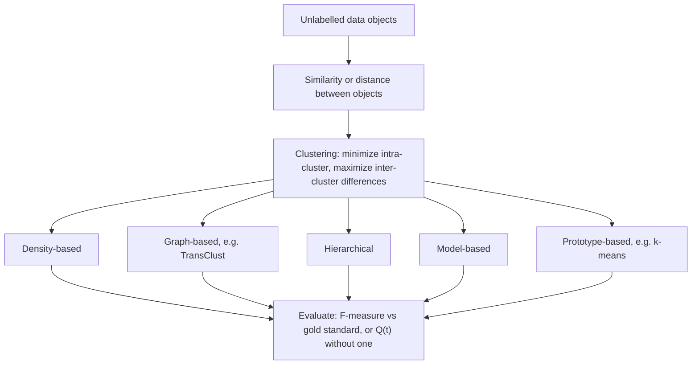

# Cluster Analysis

## Definition

**Clustering** is **unsupervised learning**: there are **no labels**. **Clusters** are
groups of data objects that are **more similar to each other than to objects from other
groups**. The supervised/unsupervised split itself, and the rest of the learning
taxonomy, is treated on [[machine-learning]].

## Why it matters

Clustering a dataset can reveal **hidden relationships** between the observations and the
features. In module 2 it is the route from an expression matrix to patient subtypes: it
is what [[transclust]] does on a similarity graph, what [[k-means]] does on feature
vectors, and what [[grandforest]] and [[bicon]] do under a network constraint to produce
[[endophenotype|endophenotypes]].

## Details

**Clustering goal**

> Given a set of **unlabelled** data objects, group them into clusters such that the
> **intra-cluster differences are minimized** and the **inter-cluster differences are
> maximized**.

Equivalently: objects in one group are **highly similar**, objects in different groups
are **highly dissimilar**.

**Families of clustering methods** named in the notes

| Family | Idea | Example here |
|---|---|---|
| **Density-based** | Clusters are dense regions separated by sparse ones | — |
| **Graph-based** | Cluster the nodes of a similarity graph | [[transclust]] |
| **Hierarchical** | Build a nesting of clusters | — |
| **Model-based** | Fit a generative model per cluster | — |
| **Prototype-based** | Each cluster is represented by one prototype | [[k-means]] |

**Evaluation** is by [[f-measure]] against a gold standard, or by a threshold quality
measure `Q(t)` when no gold standard exists; the number of clusters itself can be chosen
by the **elbow method** on the sum of squared error (see [[k-means]]).

## Diagram

The clustering goal, the five method families and how the result is judged.

## Relations

- [[machine-learning]] — clustering is the unsupervised half of it.
- [[k-means]] — the prototype-based representative taught in detail.
- [[transclust]] — the graph-based representative, clustering by transitive graph
  projection.
- [[f-measure]] — how a clustering is compared against a gold standard.
- [[bicon]] — bi-clustering under a network constraint: clusters of patients *and* genes
  at once.
- [[grandforest]] — clusters the input on the genes of a discovered module to get de novo
  endophenotypes.
- [[principal-component-analysis]] — the other unsupervised module-1 technique; it
  reduces dimensions, clustering assigns groups, and they are routinely used together.
- [[interaction-network]] — the structure that turns plain clustering into network-
  constrained clustering.
- [[enrichment-analysis]] — what one runs on a cluster once it exists, to find out what
  it means.
- [[upgma]] — agglomerative average-linkage clustering, reused as a phylogenetic method where the merge height is read as evolutionary time.
- [[neighbor-joining]] — agglomerative clustering with a corrected linkage criterion.
- [[single-cell-analysis-workflow]], [[single-cell-rna-seq]] — clustering is how cell types are called from a count matrix.
- [[t-sne]], [[umap]] — embeddings often mistaken for clusterings; they visualise, they do not partition.
- [[autoencoder]] — a learned non-linear embedding that clustering can be run on.
- [[doublet]] — doublets distort clusters and must be removed before clustering.
- [[kaplan-meier-plot]] — survival curves are the clinical validation of patient clusters.

## Appears in

- [[M2L04-clustering]]
- [[M2L05-network-based-disease-modules]]
- [[M2E04-k-means-and-transclust]]

## Sources

- `raw/module2/csb_part2.pdf`, p. 12 — unsupervised learning, clusters, the clustering
  goal, why clustering, the five method families.
