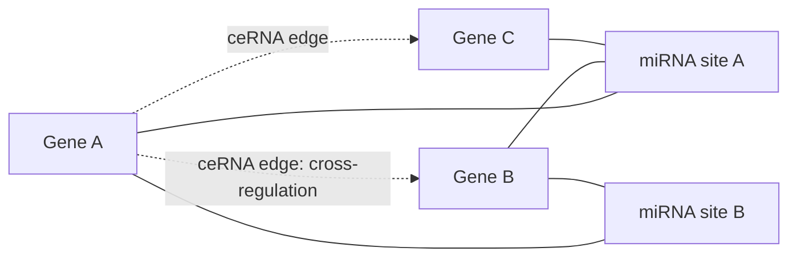

# Competing endogenous RNA

## Definition

Competing endogenous RNAs (ceRNAs) are transcripts that **share binding sites for the
same [[microrna]]** and therefore **compete for it**. Because the miRNA pool is finite,
a rise in one transcript sequesters miRNA away from the others — so ceRNAs
**cross-regulate each other** without ever touching.

## Why it matters

A miRNA binding site is not a private channel: the notes state the problem as *"a miRNA
binding site [exists] for multiple genes"*. The consequence is a whole **ceRNA network**
laid over the transcriptome, in which an edge between two genes means "these two compete
for the same miRNA". It is a regulatory network that cannot be measured directly and must
be **inferred** from expression data — by [[mutual-information|conditional mutual
information]] or by [[sensitivity-correlation]], the latter being what [[sponge]] does
genome-wide.

## Details

**miRNA response elements.** The miRNA binding sites that create the competition are
called **miRNA response elements (MREs)**. A gene carrying several MREs for the same
miRNA family competes more strongly.

**The ceRNA hypothesis.** According to the ceRNA hypothesis, **miRNAs act in trans** —
their effect is not confined to the transcript they bind, but propagates to every other
transcript that was competing for them.

**Where the competition comes from.** It arises purely from **shared competition for
binding to the same sequences**: Gene A, Gene B and Gene C may each carry MREs of types
A, B, C; wherever two genes share an MRE type, an edge appears in the ceRNA network.

**The three models.** The notes distinguish three ways of modelling the data, with ○ for
a gene and □ for a miRNA:

1. **Gene–gene correlation** — `(X)—(Y)`. Ignores the miRNA entirely; any co-expression
   counts, whatever causes it.
2. **Gene–miRNA interactions only** — `(X)—□—(Y)`. Models who binds what, but not
   whether the competition has an effect.
3. **Gene–gene–miRNA triplets** — the triangle `(X)—(Y)` with □ attached to both. This
   is the model that can actually express competition, and it is the one
   [[sensitivity-correlation]] is built for.

**Inference.** A ceRNA edge can be inferred using **conditional mutual information (CMI)**
or **sensitivity correlation**. The tool **[[sponge]]** — *Sparse Partial correlation ON
Gene Expression* — generalises the latter to **multiple sensitivity correlation**, giving
**genome-wide analysis**, **reduced runtime** and support for **multiple miRNAs** per
gene pair at once.

## Diagram

Genes sharing miRNA response elements compete for the same miRNA and therefore become linked in a ceRNA network.

## Relations

- [[microrna]] — the shared resource the transcripts compete for.
- [[non-coding-rna]] — the wider class.
- [[sensitivity-correlation]] — the statistic that quantifies a ceRNA edge.
- [[mutual-information]] — the information-theoretic alternative, and its limits.
- [[sponge]] — the genome-wide inference tool built on multiple sensitivity correlation.
- [[mirna-target-prediction]] — supplies the candidate MREs that the competition runs on.
- [[interaction-network]] — a ceRNA network is another biological network, inferred
  rather than measured.
- [[fishers-exact-test]] — Fisher's method for combining the per-triplet p-values is one
  of the things that makes CMI-based inference lose power.

## Appears in

- [[M2L09-non-coding-rnas]]
- [[M2E09-non-coding-rnas-and-sponge]]

## Sources

- `raw/module2/csb_4.pdf`, p. 5 — ceRNA network figure, cross-regulation, the three ceRNA
  models, and SPONGE as the tool.
- `raw/module2/csb_4.pdf`, p. 10 — miRNA response elements and "miRNAs act in trans"
  (exercise).
