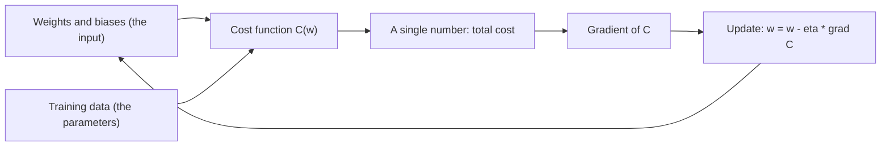

# Cost Function

## Definition

A **cost function** (loss function) maps a network's weights and biases to a single
number measuring how badly its predictions match the truth. Training is the search for
the weights that minimise it.

## Why it matters

The cost function is the only place where "what we want" enters a
[[neural-network]]. Everything else — [[gradient-descent]], [[backpropagation]] — is
mechanics for walking downhill on this one surface. The notes put the goal plainly:

> **reduce the distance between predicted and real.**

## Details

**The squared-error cost of one input**, as written in the notes:

```text
Cost(input) = (out₁ − real₁)² + … + (out_n − real_n)²
```

and then the cost of the model is the **average cost over all training data**:

```text
C(w) = (1/n) · Σ_{k=1..n} Cost(input_k)
```

The notes label the pieces explicitly:

| Role | What it is |
|---|---|
| **In** | weights and biases |
| **Out** | the cost |
| **Parameters** | the training data |

So `C` is a function of the **weights**, not of the data: the data is fixed and the
weights are the variables. The target is the `w` with `dC/dw (w) = 0`.

**Different cost functions.** The notes list **MSE, L2, L1 and Euclidean distance** as
alternatives. The choice encodes how outliers are treated: L2/MSE squares the residual
and so chases large errors, L1 does not.

**Local versus global minimum.** The notes draw a wiggly one-dimensional `C(w)` with
many dips and annotate it:

> Local minimum: **okay**. Global minimum: **hard!**

This is the same resignation already met in [[expectation-maximization]] and
[[k-means]]: iterative local optimisation finds *a* good answer, not *the* answer, and
the result depends on the random initialisation.

## Diagram


The cost function takes the weights as its argument and the training data as fixed parameters; its gradient drives the update.

## Relations

- [[gradient-descent]] — minimises this function.
- [[backpropagation]] — computes `∇C` efficiently through the layers.
- [[neural-network]] — the model whose parameters are being fitted.
- [[deep-learning]] — training is defined as finding the minimum of the cost function.
- [[expectation-maximization]], [[k-means]] — the same local-versus-global-optimum
  problem, met earlier in module 2.
- [[descriptive-statistics]] — MSE is a mean of squared deviations; L1 is a mean
  absolute deviation.
- [[overfitting]] — a cost driven to zero on the training set is the definition of the
  problem, not of success.
- [[activation-function]] — the non-linearity shapes the cost landscape that training must descend.
- [[autoencoder]] — the reconstruction error is the autoencoder's cost.
- [[generative-adversarial-network]] — the minimax objective is the GAN's cost.
- [[t-sne]] — the KL divergence between neighbour distributions is t-SNE's cost.

## Appears in

- [[M2L06-deep-learning]]
- [[M2E06-deep-learning]]

## Sources

- `raw/module2/csb_3.pdf`, p. 3 — the squared-error cost, averaging over all training
  data, in/out/parameters, `dC/dw(w) = 0`, local versus global minimum.
- `raw/module2/csb_3.pdf`, p. 5 — "cost function / different cost functions: MSE, L2,
  L1, Euclidean distance"; the goal of reducing the distance between predicted and real.
