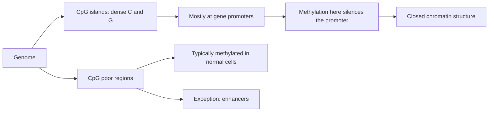

# CpG island

## Definition

A **CpG site** is a cytosine followed by a guanine along one strand (`5'-CG-3'`; the
"p" stands for the phosphate between them). A **CpG island** (CpG-Insel) is a **dense
region of C and G** — a stretch in which CpG dinucleotides occur much more frequently
than elsewhere in the genome.

## Why it matters

CpG sites are **not equally distributed** over the genome, and the islands they form sit
disproportionately at **gene promoters**. Since [[dna-methylation]] is almost exclusively
confined to the CpG context, the distribution of CpG islands determines where the
methylation machinery can act at all, and therefore which promoters can be epigenetically
switched.

## Details

- CpGs are **not equally distributed**; dense regions of C and G form the islands.
- Islands are **often associated with gene promoters**.
- **CpG-poor regions**, with the exception of **enhancers**, are **typically methylated**
  in normal cells.
- **CpG-poor promoters** are **silenced** by DNA methylation and exhibit a **closed
  chromatin structure** ([[chromatin]]).
- Gene expression correlates with **high levels of gene-body (genic) methylation**.
- The exercise sheet gives the short definition: *CpG islands are stretches of CpGs that
  are constantly methylated*, i.e. regions where a C followed by a G occurs frequently.

> [!note] Added beyond lecture notes
> Source: general domain knowledge (standard molecular-biology textbook material). Not
> from the UHH handwritten notes.
>
> The two statements in the notes — "islands sit at promoters" and "islands are
> constantly methylated" — pull in opposite directions. The standard resolution is that
> promoter-associated CpG islands are normally **un**methylated in healthy tissue, which
> keeps the promoter available; their **hyper**methylation is the pathological state
> (e.g. silencing of a tumour suppressor). The "constantly methylated" phrasing of the
> exercise sheet is best read as "constitutively carrying a methylation state that is
> maintained through mitosis".

### Why study methylation

The notes give three motivations: it is an **epigenetic mark with mitotic inheritance**,
it underlies **genomic imprinting**, and it is implicated in **inflammation**.

> [!note] Added beyond lecture notes
> Source: general domain knowledge (Gardiner-Garden & Frommer, *J. Mol. Biol.* 196:261,
> 1987; Takai & Jones, *PNAS* 99:3740, 2002; Irizarry et al., *Nat. Genet.* 41:178, 2009
> on shores). Not from the UHH handwritten notes.
>
> **A computable definition.** The notes define an island only qualitatively ("a dense
> region of C and G"), which is not something an algorithm can scan for. The standard
> operational criteria apply a sliding window and keep a region when all three hold:
>
> ```text
> CPG-ISLAND?(window w):
>   len    ← |w|
>   GC     ← ( count(w, 'C') + count(w, 'G') ) / len
>   obsExp ← ( count(w, "CG") · len ) / ( count(w, 'C') · count(w, 'G') )
>   return len ≥ 200 and GC ≥ 0.50 and obsExp ≥ 0.60      // Gardiner-Garden & Frommer
> ```
>
> The stricter Takai–Jones parameters — `len ≥ 500`, `GC ≥ 0.55`, `obsExp ≥ 0.65` — were
> introduced precisely because the original thresholds also capture *Alu* repeats, which
> are GC-rich but not promoters.
>
> **Why the observed/expected ratio is the discriminating term.** In a random sequence
> with the observed base composition, `CG` would occur as often as any other dinucleotide,
> so `obsExp ≈ 1`. Across the human genome it is only about **0.2**: CpG is roughly
> five-fold **depleted**. The cause is methylation itself. 5-methylcytosine deaminates
> spontaneously to **thymine**, and a `T:G` mismatch is repaired far less reliably than
> the `U:G` mismatch produced by deamination of unmethylated C. Over evolutionary time the
> methylated CpGs of the genome have therefore been eroded to `TpG`/`CpA`. The islands are
> exactly the stretches that escaped, because they were kept **unmethylated** — which is
> the deeper reason why "island" and "unmethylated promoter" coincide, and the resolution
> of the contradiction above seen from the sequence side. The same mechanism makes
> methylated CpG the genome's strongest C→T mutation hotspot, as
> [[transition-and-transversion]] notes.
>
> **CpG island shores.** Much of the tissue-specific and cancer-associated methylation
> difference does **not** sit in the island itself but in the ~2 kb flanking it, the
> **shores** (and the further **shelves**). An analysis restricted to islands misses most
> of the differential signal that [[bisulfite-sequencing]] can detect — a practical point
> for how a DMR scan is windowed.


## Diagram


CpG density partitions the genome into islands at promoters and a methylated CpG-poor background.

## Relations

- [[dna-methylation]] — the chemical mark that acts almost exclusively in this context.
- [[bisulfite-sequencing]] — reads the methylation state of every individual C.
- [[chromatin]] — silenced CpG-poor promoters come with closed chromatin.
- [[gene-regulation]] — promoters and enhancers are the elements whose CpG content
  decides their regulatability.
- [[genome-organization]] — CpG islands are one of the non-uniform features of genomic
  composition.
- [[epigenetics]] — islands are the sequence context of DNA methylation, one of its two
  mark types.
- [[promoter]] — islands sit disproportionately at promoters and decide whether they can
  be methylated at all.
- [[expectation-maximization]] — module 2 names **discovering CpG islands** as one of
  the two standard applications of EM: the island/non-island label of each window is the
  latent variable, and the two base-composition models are the parameters. This is the
  same latent-state framing that [[hidden-markov-model]] gives the problem, with
  [[baum-welch-algorithm]] as the EM instance.
- [[transition-and-transversion]] — methylated CpGs are the genome's strongest transition hotspots, and [[jukes-cantor-model]]'s "one rate for all positions" assumption fails there first.

## Appears in

- [[L16-epigenetics]]
- [[E12-epigenetics-and-peak-calling]]
- [[M2E02-motif-discovery-and-expectation-maximization]]

## Sources

- `raw/module1/gsb_part4.pdf`, p. 8 (distribution, promoters, CpG-poor regions, why study
  methylation), p. 12 (exercise definition).
- `raw/module2/csb_1.pdf`, p. 27 — CpG-island discovery named as an application of
  expectation maximization.
