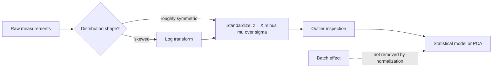

# Data Normalization

## Definition

**Data normalization** reshapes measured values so that they meet the assumptions of the
statistical models applied to them — most often the assumption that the data are
**normally distributed** — and so that different variables or samples become comparable
on a common scale.

## Why it matters

Statistical models usually expect normally distributed data. Real omics measurements are
frequently **skewed**: an exponential-looking distribution has many extreme values far
away from the mean, and on such data it is hard to run a useful statistical test
([[statistical-testing]]). Normalization is therefore the step between raw measurement
and analysis in every expression pipeline
([[microarray-expression-analysis]], [[rna-seq]]).

## Details

**Skewed distributions**

- A skewed [[probability-distribution|distribution]] — e.g. an exponential one — has a
  long tail: many observations sit far from the mean.
- Consequence: tests designed for the normal case lose their validity.

**Log transform**

- Applying the logarithm to a right-skewed variable pulls the long tail in and yields an
  approximately normal distribution.
- This is the standard first move for intensity and count data.

**Outliers**

- Extreme values that do not fit the bulk of the distribution. They dominate mean and
  variance and must be identified before modelling — e.g. in the projection produced by
  [[principal-component-analysis]].

**z-score (standard score)**

The z-score is the number of standard deviations by which an observation deviates from
the mean; replacing a value by its z-score is called **standardizing** or **normalizing**:

```text
z = (X - μ) / σ
```

After standardization every variable has mean 0 and standard deviation 1, which makes
variables with different units directly comparable — a precondition for
[[principal-component-analysis]], whose input is scaled vectors.

**What normalization does *not* do**

Normalization rescales values; it does **not** remove a systematic [[batch-effect]].
A bias that correlates with the outcome of interest survives any rescaling and has to be
handled separately.

## Diagram


From raw values to a model-ready matrix, and the one problem normalization cannot fix.

## Relations

- [[descriptive-statistics]] — defines mean, standard deviation and the z-score that
  normalization uses.
- [[probability-distribution]] — the normal target shape and the skewed shapes that
  motivate transformation.
- [[qq-plot]] — the graphical check of whether the transform actually worked.
- [[batch-effect]] — the systematic bias that normalization leaves behind.
- [[principal-component-analysis]] — consumes normalized vectors.
- [[microarray-expression-analysis]] — normalisation is a named pipeline stage there.
- [[z-score]] — standardizing each value by its z-score *is* the normalization step,
  applied after the log transform.

- [[enrichment-analysis]] — normalized expression is the input to every enrichment test.
- [[single-cell-analysis-workflow]] — normalization is step 2 of the single-cell pipeline; [[unique-molecular-identifier]]s remove amplification bias before it.
- [[single-cell-rna-seq]], [[highly-variable-genes]] — what normalized single-cell counts are used for.
- [[gradient-descent]] — feature scaling is the optimisation-side reason the same operation matters in [[deep-learning]].
- [[rna-interference]] — normalization is one of the listed bioinformatics tasks of a genome-wide RNAi screen.
- [[chip-seq]] — its read counts are compositional in the same way, which is why a genome-wide shift in a histone mark is only visible with a spike-in.

## Appears in

- [[L06-expression-profiling]]
- [[L10-biostatistics-and-statistical-testing]]
- [[L11-normalization-pca-and-batch-effects]]
- [[E08-test-errors-and-z-score]]
- [[M2L09-non-coding-rnas]]
- [[M2L04-clustering]] — clustering in module 2 consumes normalized expression matrices.
- [[M2L07-single-cell-rna-seq]] — normalization is the mandatory first analytic step of the module-2 single-cell workflow.

## Sources

- `raw/module1/gsb_3.pdf`, p. 1.

- `raw/module2/csb_4.pdf`, p. 3 — normalization in the RNAi screening analysis stack.
