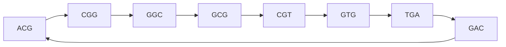
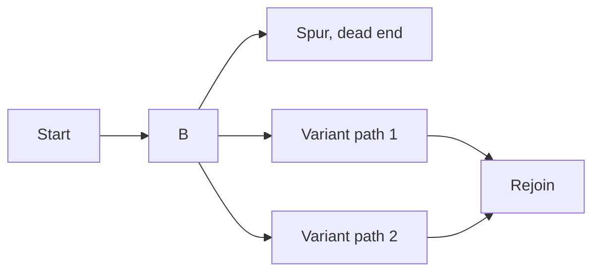

# De Bruijn Graph

## Definition

A de Bruijn graph of dimension *n* over an alphabet of *m* symbols is the graph with
`mⁿ` nodes in which a directed edge runs from node *u* to node *v* whenever *v* is
obtained from *u* by shifting one character to the left and appending a new character.
In assembly the nodes are (k−1)-mers and each edge is a *k*-mer observed in the reads.

## Why it matters

It converts assembly from a node-visiting problem (Hamiltonian path, NP-hard) into an
edge-visiting problem (Eulerian path, polynomial). That single change of representation
is what makes short-read assembly computationally feasible — see [[de-bruijn-assembly]]
and [[algorithmic-complexity]].

## Details

- With DNA, `m = 4` (A, C, G, T).
- Example edge: the node `ACG` connects to `CGA` via the 4-mer `ACGA` — drop the first
  character, append the new one.
- Reads are decomposed into *k*-mers and the **multiplicity** of each *k*-mer is counted;
  the count becomes the edge multiplicity, which carries the coverage information.
- Assembling the genome then means **traversing every edge exactly once** — an Eulerian
  path.
- An Eulerian path exists under simple degree conditions and can be found in polynomial
  time, unlike a Hamiltonian path.

**Characteristic artifacts**

| Artifact | Shape | Cause |
|---|---|---|
| **Spur** | short dead-end branch | sequencing error at the end of a read |
| **Bubble** | paths diverge then reconverge | true variant, mid-read sequencing error, or PCR artifact |
| **Cycle** | path returns to an earlier node | a repeat |
| **Frayed rope** | paths converge then diverge | repeated elements shared by distinct contexts |

## Diagram

A de Bruijn graph on 3-mers whose Eulerian traversal reconstructs the sequence; the back-edge to ACG is a cycle caused by a repeat.

A spur and a bubble in the same neighbourhood of an assembly graph.

## Relations

- [[de-bruijn-assembly]] — the algorithm built on this structure.
- [[greedy-assembly]] — the alternative overlap-graph formulation it replaces.
- [[algorithmic-complexity]] — explains why Eulerian beats Hamiltonian here.
- [[dna-mutation]] — repeats and variants are what create cycles and bubbles.
- [[hamiltonian-and-eulerian-paths]] — its edges are the *k*-mers that an Eulerian
  traversal must use exactly once.
- [[interaction-network]] — the module's other use of graphs, on molecules rather than
  on sequence.
- [[graph-neural-network]] — module 2's deep-learning treatment of graph-structured data; the Laplacian `L = D − A` is built from the same adjacency structure.
- [[umap]] — builds a `k`-nearest-neighbour graph from point data and embeds it spectrally.
- [[phylogenetic-tree]] — another combinatorial structure over biological sequences, with its own counting problem.

## Appears in

- [[L04-genome-assembly]]
- [[E02-greedy-assembly]]
- [[E03-de-bruijn-assembly]]

## Sources

- `raw/module1/gsb_part1.pdf`, pp. 19–23.
