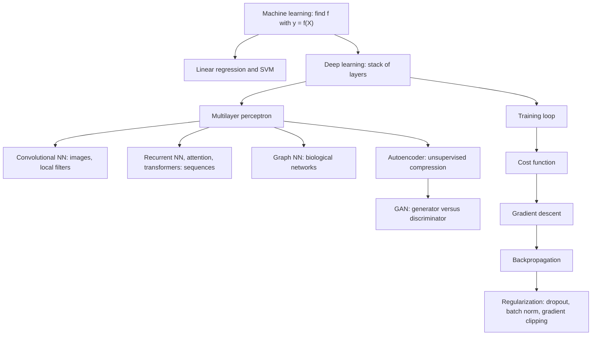

# Deep Learning

## Definition

**Deep learning** is the branch of [[machine-learning]] that fits a model made of
**many stacked layers of simple units** — a [[neural-network]] — so that each layer
transforms the representation produced by the layer below it. The notes describe the
whole enterprise bluntly as *"a tool to find an approximate function that describes the
dataset"*, or, less kindly, *"a glorified curve-fitting problem"*.

## Why it matters

Module 2 has so far fitted models whose shape was fixed in advance: a hyperplane
([[support-vector-machine]]), a set of axis-parallel cuts ([[decision-tree]],
[[random-forest]]). Deep learning drops that restriction — the network **learns the
function as well as its parameters** — which is what makes it the default tool for
image, sequence and omics data where no one can write the right feature transform by
hand.

## Details

**The learning problem, restated**

The notes open from classical regression:

```text
f(X) = β₀ + β₁·X₁ + … + β_p·X_p
```

> We want to find a function `f` such that `y ≈ f(X)` for any observation `(X, y)`.

with

- `X_i` — **features / variables** (the input),
- `y` — the **label**, i.e. the target / outcome variable.

Examples given:

| Model | Form |
|---|---|
| Linear regression | `f(x) = w·x + b` |
| Multiple linear regression | `f(x₁,…,x_n) = Σ (w_i · x_i) + b` |
| [[support-vector-machine]] | the same, solved with a more complex function |
| Neural network | a stack of the above, each wrapped in a non-linearity |

A single artificial neuron is exactly multiple linear regression followed by an
[[activation-function]]:

```text
y_i = f( Σ_{j=1..N} w_j^i · x_j^i(x) + b^i )
```

**Training data in, parameters out.** The notes draw the training loop as
*training data + test data → parameters*, where finding the parameters means
*finding the minimum of the [[cost-function]]* by [[gradient-descent]], with the
gradients supplied by [[backpropagation]].

**The family of architectures covered**

| Architecture | What it adds | Page |
|---|---|---|
| Multilayer perceptron | the baseline: fully connected layers | [[neural-network]] |
| Convolutional NN | local connections, weight sharing, translational equivariance | [[convolutional-neural-network]] |
| Autoencoder | unsupervised: compress to a latent layer and reconstruct | [[autoencoder]] |
| Recurrent NN / transformer | variable-length sequences, memory, attention | [[recurrent-neural-network]] |
| Graph NN | learning on graphs, e.g. an [[interaction-network]] | [[graph-neural-network]] |
| GAN | two networks in an adversarial game, generating new data | [[generative-adversarial-network]] |

**VGG and ResNets.** The notes note only that **residual connections / shortcut
connections help with the vanishing and exploding gradient problem** — a deep stack
otherwise loses or amplifies the signal travelling backwards through it.

## Diagram


The architectures and the training machinery that the deep-learning lecture covers.

## Relations

- [[neural-network]] — the basic object: structure, neurons, weights and biases.
- [[machine-learning]] — deep learning is the non-linear end of the same spectrum;
  the notes introduce it directly from multiple linear regression.
- [[cost-function]], [[gradient-descent]], [[backpropagation]] — the three pieces of the
  training loop.
- [[activation-function]] — what makes a stack of layers more than one big linear map.
- [[overfitting]] — more hidden layers fit more complex functions and overfit more
  easily; [[dropout]] is the countermeasure taught here.
- [[bias-variance-tradeoff]] — Andrew Ng's recipe for deciding *which* fix to apply.
- [[support-vector-machine]], [[random-forest]] — the shallow classifiers deep learning
  is contrasted with in [[M2L03-machine-learning-and-classification]].
- [[single-cell-rna-seq]] — the kind of high-dimensional data these models are aimed at
  in the following lecture.
- [[data-normalization]] — feature scaling is a precondition for stable network training.
- [[grandforest]] — an alternative network-aware learner to graph neural networks.

## Appears in

- [[M2L06-deep-learning]]
- [[M2E06-deep-learning]]

## Sources

- `raw/module2/csb_3.pdf`, p. 1 — machine learning as function fitting, features and
  labels, linear and multiple linear regression, neural networks as "glorified curve
  fitting", the neuron equation.
- `raw/module2/csb_3.pdf`, p. 7 — VGG and ResNets; residual/shortcut connections against
  vanishing and exploding gradients.
