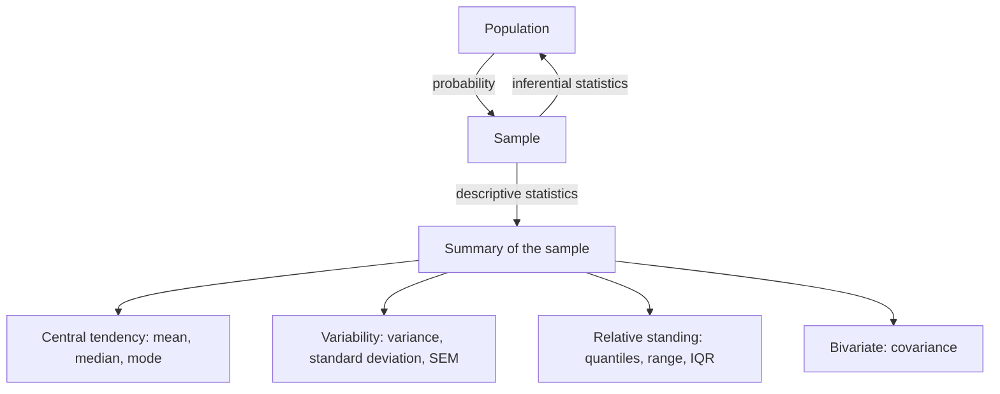

# Descriptive Statistics

## Definition

**Descriptive statistics** summarise an observed **sample** — its centre, its spread and
the relative standing of individual values — without yet drawing conclusions about the
population it came from. Drawing those conclusions is the job of **inferential
statistics** and [[statistical-testing]].

## Why it matters

Every omics dataset is a sample: a handful of patients, a few replicates, one run of an
[[rna-seq]] experiment. Different samples can lead to different results, so before any
gene is called differentially expressed its values must be described — and the
description is what a test statistic is later computed from.

## Details

**Data vocabulary**

| Term | Meaning |
|---|---|
| **Data** | the observed values of a variable |
| **Variable** | a characteristic of a population, e.g. one gene |
| **Values of the variable** | the range of possible values |
| **Dimension** | the number of variables: univariate (one per subject), bivariate (two), multivariate (many) |

**Data types**

- **Quantitative** — *discrete* (counts, e.g. an RNA-Seq read-count matrix) or
  *continuous* (gene expression, metabolite concentration).
- **Categorical / qualitative** — *binary* (0/1 metadata), *nominal* (order unimportant:
  single, married), *ordinal* (order important: low < medium < high; healthy/disease).

**Three families of descriptors**

| Family | Question | Measures |
|---|---|---|
| **Central tendency** | where is the centre / location? | mean, median, mode |
| **Variability** | how wide is the spread? | variance, standard deviation |
| **Relative standing** | where does a value sit within the spread? | quantiles, range, IQR |

**Formulas**

```text
mean        x̄   = (1/n) · Σ xᵢ
variance    σ²  = (1/(n-1)) · Σ (xᵢ − x̄)²        // sample variance
std. dev.   σ   = sqrt( Σ (xᵢ − μ)² / N )        // population form
SEM         SEM = σ / sqrt(n)                    // precision of the mean
covariance  cov(X,Y) = (1/n) · Σ (xᵢ − E(X)) · (yᵢ − E(Y))
z-score     z   = (x − μ) / σ
```

- The **median** is the middle value of the ordered data, the **mode** the most frequent
  one; both are robust against outliers, the mean is not.
- **SEM** is not the spread of the data but the precision with which the **mean** is
  known; it shrinks with `√n`.
- **Covariance** measures how two variables change together — the bivariate descriptor.
- The **z-score** expresses how many standard deviations a value lies away from the mean,
  which makes values from different scales comparable (used in
  [[E08-test-errors-and-z-score]]).

**Quantiles**

The `x %`-quantile is the value `k` such that `x %` of the values are smaller than `k`
and `100 − x %` are larger. **Quartiles** are the special cases 25 %, 50 % (the median)
and 75 %; the **interquartile range (IQR)** is the distance between the first and third
quartile.

**Univariate statistics** compare different means for a single variable, assuming equal
variance, and are visualised by plotting the frequency of the values — the bell curve of
a [[probability-distribution|normal distribution]].

## Diagram


Sampling, the two directions of statistics, and the three families of sample descriptors.

## Relations

- [[probability-distribution]] — the shapes these descriptors summarise.
- [[statistical-testing]] — turns descriptors into a test statistic and a decision.
- [[qq-plot]] — a graphical use of quantiles.
- [[rna-seq]], [[microarray-expression-analysis]] — the data these describe.
- [[data-normalization]] — standardizing a variable by its z-score is the normalization
  step built directly on the mean and standard deviation defined here.
- [[principal-component-analysis]] — diagonalises the covariance matrix.
- [[z-score]] — the relative-standing measure built directly from the mean and standard
  deviation defined here.
- [[k-means]] — a centroid is nothing but the mean of its cluster, recomputed every iteration.
- [[node-impurity]] — Gini and entropy summarise a label distribution in one number, the way a moment summarises a sample.
- [[cost-function]] — MSE, L1 and L2 costs are the same summary statistics used as optimisation targets.
- [[pooling-layer]] — max and average pooling are summary statistics applied over a spatial window.
- [[highly-variable-genes]] — mean–variance summaries used as a feature-selection criterion.
- [[sensitivity-correlation]] — partial correlation and its difference from plain correlation.

## Appears in

- [[L10-biostatistics-and-statistical-testing]]
- [[L11-normalization-pca-and-batch-effects]]
- [[E08-test-errors-and-z-score]]
- [[M2L07-single-cell-rna-seq]] — mean and variance per gene drive module-2 highly variable gene selection.

## Sources

- `raw/module1/gsb_part2.pdf`, pp. 19–22.
- `raw/module1/gsb_3.pdf`, p. 1 — the z-score as the standardizing/normalizing transform.

- `raw/module2/csb_4.pdf`, p. 7 — the partial correlation formula and sensitivity correlation.
