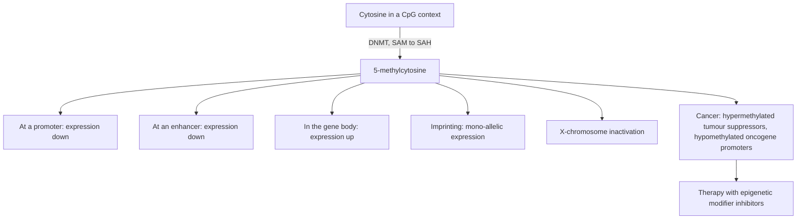

# DNA methylation

## Definition

DNA methylation (DNA-Methylierung) is the enzymatic addition of a methyl group to a
cytosine base. It **does not affect base pairing** — the sequence is unchanged — but it
changes how the sequence is read, which makes it the archetypal epigenetic mark.

## Why it matters

The notes list four roles:

- **maintenance of genome stability and integrity**;
- **control of developmental processes** (differentiating cells);
- **control of tissue-specific expression**;
- **imprinting** and **X-chromosome inactivation**.

It is also *the* mark to study computationally, because it is an epigenetic mark with
**mitotic inheritance** and can be read base by base with [[bisulfite-sequencing]].

## Details

### The enzymatic reaction

```text
cytosine + SAM --DNMT--> 5-methylcytosine + SAH
```

- **DNMT** = DNA methyltransferase, the enzyme.
- **SAM** = S-adenosylmethionine, the methyl donor; it becomes **SAH** after donating.
- The methyl group **does not affect base pairing**.

> [!note] Added beyond lecture notes
> Source: general domain knowledge (Jones, *Nat. Rev. Genet.* 13:484, 2012; Tahiliani et
> al., *Science* 324:930, 2009 on TET; Bird, *Genes Dev.* 16:6, 2002 on MBD readers).
> Not from the UHH handwritten notes.
>
> **Writers.** "DNMT" is three enzymes with two jobs:
>
> - **DNMT1** — the **maintenance** methyltransferase. Together with its targeting factor
>   **UHRF1** it recognises the **hemimethylated** CpG produced when a symmetrically
>   methylated site is replicated, and restores the mark on the new strand. This is the
>   molecular reason the notes can call methylation mitotically inherited, and it is why
>   the symmetry of the CpG context matters.
> - **DNMT3A** and **DNMT3B** — the ***de novo*** methyltransferases, with the catalytically
>   inactive cofactor **DNMT3L**. They establish patterns where none existed, during
>   gametogenesis and early development.
>
> **Erasers.** Methylation is not a one-way reaction. Loss can be **passive** — DNMT1
> failing to act, so the mark is diluted out over successive divisions — or **active**,
> via the **TET** dioxygenases (TET1/2/3). TET oxidises 5-methylcytosine stepwise:
>
> ```text
> 5mC --TET--> 5hmC --TET--> 5fC --TET--> 5caC --TDG + BER--> unmodified C
> ```
>
> `5hmC` (5-hydroxymethylcytosine) is abundant in brain and in stem cells and is now
> treated as a mark in its own right, not merely an intermediate. This matters for the
> assay: [[bisulfite-sequencing]] **cannot separate 5mC from 5hmC**, because both resist
> the deamination. *TET2* is one of the most frequently mutated genes in myeloid
> malignancy.
>
> **Readers.** The mark is interpreted by two kinds of protein:
>
> - the **methyl-CpG-binding domain (MBD) family** — **MeCP2**, MBD1–4 — which bind
>   methylated CpGs and recruit HDAC-containing corepressor complexes, converting the DNA
>   mark into a repressive chromatin state ([[chromatin]], [[histone-modification]]).
>   Mutations in *MECP2* cause Rett syndrome.
> - **methylation-sensitive transcription factors**, which simply fail to bind their site
>   when it is methylated — the mechanism already described for **CTCF** at imprinted loci
>   below.
>
> **Non-CpG methylation.** The notes' "almost exclusively CpG" is accurate for most
> somatic tissue, but methylation in the **CpH** context (H = A, C or T) is substantial in
> **neurons** and in **embryonic stem cells**, where it is laid down by DNMT3A and read by
> MeCP2. It is the main exception to the rule.


### Sequence context

- Methylation is **base specific**: it occurs in a sequence context.
- It is usually **symmetrical on both strands** — which is exactly what allows it to be
  copied to the daughter strand after replication.
- It is **almost exclusively confined to the CpG sequence context** (a C followed by a G
  along one strand). See [[cpg-island]].

### Where methylation does what

The exercise sheet summarises the effect by genomic compartment:

| Region | Effect of methylation |
|---|---|
| promoter region | **decreases** gene expression |
| enhancer region | **decreases** gene expression |
| gene body | **increases** gene expression |

Consistently, the lecture notes state that gene expression is correlated with **high
levels of gene-body (genic) methylation**, while CpG-poor promoters are **silenced** by
methylation and exhibit a **closed chromatin structure** ([[chromatin]]).

**Apparent contradiction with "CpG islands are constantly methylated".** The exercise
sheet defines a [[cpg-island]] as a stretch of CpGs that is *constantly methylated*,
while the same notes say islands sit at promoters and that methylation at promoters
*decreases* expression — which would silence most genes. Both readings are kept on this
wiki; the reconciliation is given once, in [[cpg-island]]: promoter-associated islands
are normally **un**methylated in healthy tissue, and "constantly methylated" is best read
as "carrying a methylation state that is stably maintained through mitosis". The
compartment table above is the reading to use for exam purposes.

### Imprinting and X inactivation

- **Imprinting** (genomische Prägung) — epigenetic marking of a locus **on the basis of
  parental origin**, resulting in **mono-allelic gene expression**: only the maternal or
  only the paternal copy is expressed.
- **X-chromosome inactivation** — gene expression on one of the two female
  X chromosomes is inactivated. The visible consequence given in the notes is the
  **calico cat**, whose coat patches reflect which X was silenced in each clone of cells.

> [!note] Added beyond lecture notes
> Source: general domain knowledge (standard molecular-biology / epigenetics textbook
> material). Not from the UHH handwritten notes.
>
> **How imprinting is marked and read.** The notes describe imprinting only by its
> effect. The mechanism has three stages:
>
> 1. **Erasure** — in the primordial germ cells of the embryo, the existing imprints are
>    genome-wide demethylated, so the parental marks of the previous generation are
>    wiped.
> 2. **Establishment** — during gametogenesis, *de novo* methyltransferases
>    **DNMT3A/DNMT3B** with their cofactor **DNMT3L** methylate a small set of
>    **imprinting control regions (ICRs)**, differently in sperm and in oocytes. The
>    pattern laid down is therefore sex-of-parent specific.
> 3. **Maintenance and reading** — after fertilisation the ICR methylation survives the
>    global reprogramming of the zygote and is copied to each daughter strand by
>    **DNMT1** acting on the hemimethylated CpG (this is what the symmetry of CpG
>    methylation is for). The mark is then *read* by methylation-sensitive
>    DNA-binding proteins: the classic example is **CTCF**, which binds the
>    *unmethylated* maternal ICR at the *H19/Igf2* locus and acts as an insulator
>    blocking the enhancers from reaching *Igf2*; on the methylated paternal allele CTCF
>    cannot bind, the insulator is absent, and *Igf2* is expressed. The same logic —
>    a methylation-switchable protein-binding site — produces mono-allelic expression at
>    the other imprinted loci.
>
> **X-chromosome inactivation** uses a different reader: the long non-coding RNA **XIST**
> is transcribed from the future inactive X, coats it in *cis*, and recruits
> Polycomb-type repressive [[histone-modification|histone modifications]] (H3K27me3)
> plus DNA methylation of CpG-island promoters, locking the chromosome into
> heterochromatin ([[chromatin]]).

### Methylation and cancer

- **Hypermethylation** of **tumour-suppressor genes** (switching the brakes off) and
- **hypomethylation** of **oncogene promoters** (switching the accelerator on)

are both associated with cancer. Because the marks are reversible, **therapy** can target
them with **epigenetic modifier inhibitors**.

> [!note] Added beyond lecture notes
> Source: general domain knowledge (Baylin & Jones, *Nat. Rev. Cancer* 11:726, 2011;
> Toyota et al., *PNAS* 96:8681, 1999 on CIMP; Horvath, *Genome Biol.* 14:R115, 2013 on
> the multi-tissue methylation clock). Not from the UHH handwritten notes.
>
> **The cancer methylome has two opposite halves at once.** The notes list hyper- and
> hypomethylation as separate facts; in a tumour they occur together in the same cell:
>
> - **Focal hypermethylation** of CpG-island promoters ([[cpg-island]]) switches off
>   tumour suppressors — the brake-release the notes describe. Where it affects a DNA
>   repair gene such as *MLH1* or *MGMT* it also creates a therapeutically exploitable
>   dependency.
> - **Global hypomethylation** of the CpG-poor bulk of the genome — repeats, transposons,
>   pericentromeric satellite DNA — which **destabilises the genome** and de-represses
>   transposable elements. This is the genome-wide background against which the focal
>   hypermethylation sits, and it is the larger quantitative change of the two.
>
> **CIMP.** A subset of tumours (notably colorectal, glioma, leukaemia) shows the
> **CpG-island methylator phenotype**: coordinate hypermethylation of a large panel of
> islands at once, often driven by an *IDH1/2* mutation whose oncometabolite
> 2-hydroxyglutarate inhibits the **TET** enzymes. CIMP status is used clinically as a
> molecular subtype.
>
> **Epigenetic clocks.** Because methylation at some sites drifts with age in a highly
> reproducible way, a weighted sum of a few hundred CpG levels predicts chronological age
> to within a few years across tissues. The gap between predicted "DNAm age" and real age
> — **age acceleration** — is itself associated with mortality and disease risk, and is
> now a standard derived phenotype in an
> [[epigenome-wide-association-study]]. It is the clearest demonstration that an
> epigenetic mark is a *quantitative*, longitudinal variable, unlike a genotype.


## Diagram


One chemical reaction with very different consequences depending on where in the genome it happens.

## Relations

- [[epigenetics]] — DNA methylation and [[histone-modification]] are its two mark types.
- [[cpg-island]] — the sequence context in which methylation is read out.
- [[bisulfite-sequencing]] — the assay that measures it at single-base resolution.
- [[chromatin]] — methylated CpG-poor promoters come with a closed chromatin structure.
- [[gene-regulation]] — methylation is a regulatory layer above promoters and enhancers.
- [[epigenome-wide-association-study]] — methylation is the quantifiable mark that EWAS
  associates with a phenotype.
- [[atac-seq]] — the complementary readout: it measures the packaging rather than the
  DNA-level mark.
- [[promoter]] — methylation of a promoter decreases expression, and CpG-poor promoters
  are silenced outright.

## Appears in

- [[L16-epigenetics]]
- [[E12-epigenetics-and-peak-calling]]

## Sources

- `raw/module1/gsb_part4.pdf`, pp. 7–8 (roles, reaction, context, imprinting, cancer),
  p. 12 (effect by genomic compartment, from the exercise sheet).
