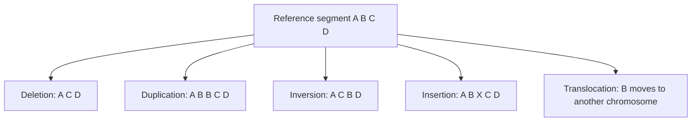

# DNA Mutation

## Definition

A DNA mutation (Mutation) is any change to the genomic sequence — from a single
substituted base to the rearrangement of whole chromosome segments.

## Why it matters

Structural mutations are a hallmark of cancer genomes, and they are also the reason
[[L04-genome-assembly|assembly]] is sometimes needed locally even when a reference genome
exists: a region containing an insertion or deletion cannot simply be mapped.

## Details

**Structural classes named in the notes**

| Mutation | Effect on the sequence |
|---|---|
| **Deletion** | a segment is lost |
| **Duplication** | a segment is present in extra copies |
| **Inversion** | a segment is reversed in orientation |
| **Insertion** | new sequence is added |
| **Translocation** | a segment moves to a different chromosome |

**Effect depends on where the mutation falls**

- **Promoter** — changes transcription-factor binding sites, so expression increases or
  decreases ([[gene-regulation]]).
- **Exon** — may change the amino-acid sequence of the protein, including introducing a
  premature stop codon ([[central-dogma]]).
- **Intron** — usually no effect, unless a splice site is hit.

**Consequences for sequence analysis**

- Insertions and deletions (In/Dels) force gapped [[sequence-alignment]].
- Duplications and translocations create repeated or relocated sequence, which is exactly
  what breaks [[greedy-assembly]] and produces cycles and frayed ropes in a
  [[de-bruijn-graph]].

## Diagram

The five structural mutation types applied to the same reference segment.

## Relations

- [[genome-organization]] — defines the promoter, exon and intron contexts that determine
  the impact of a mutation.
- [[substitution-matrix]] — substitutions and indels are scored there.
- [[homology]] — mutations are what make homologous sequences diverge.
- [[gene-regulation]] — promoter mutations act through this mechanism.
- [[central-dogma]] — exonic mutations propagate to the protein through it.
- [[sequence-alignment]] — the computational tool that detects them.
- [[next-generation-sequencing]] — the experimental route by which they are observed.
- [[greedy-assembly]] and [[de-bruijn-assembly]] — are confounded by repeat-creating
  mutations.
- [[population-genetics]] — a mutation that persists in a population becomes an allele;
  a single-base one becomes an **SNP**.
- [[expression-qtl]] — the original mutation event defines the causal polymorphism of an
  eQTL.
- [[genome-wide-association-study]] — SNPs are the variants a GWAS tests.
- [[snp]] — a single-base mutation that persists in a population is a SNP.
- [[genetic-code]] — the triplet reading rule that makes an indel a frameshift and an
  exonic substitution a missense or premature stop.
- [[splicing]] — an intronic mutation is harmless unless it hits a splice site.
- [[promoter]] — a promoter mutation changes transcription-factor binding, so expression
  level rather than protein sequence.
- [[string-matching]] — divergence by substitutions and indels is why exact pattern
  search fails on biological sequence.
- [[hamiltonian-and-eulerian-paths]] — repeats and duplications are what create the
  cycles and bubbles an assembly traversal has to resolve.
- [[transition-and-transversion]] — module 2 subdivides point substitutions into the two chemical classes, and [[kimura-two-parameter-model]] gives them separate rates.
- [[molecular-evolution]] — mutations read as edit operations accumulating over evolutionary time.
- [[gene-tree-and-species-tree]] — duplication and loss, with their phylogenetic consequences.
- [[M2E08-phylogenetics]] — mutation, recombination and gene flow as the reasons genes evolve.
- [[crispr-cas9]] — deliberately introduces a double-strand break so that a programmed sequence can be inserted.

## Appears in

- [[L01-bioinformatics-and-the-cell]]
- [[L02-gene-expression-and-regulation]]
- [[L04-genome-assembly]]
- [[L05-sequence-comparison-and-networks]]
- [[L09-sequence-alignment-and-homology]]
- [[L14-population-genetics]]
- [[E01-cell-biology-and-gene-expression]]

## Sources

- `raw/module1/gsb_part1.pdf`, pp. 9, 11, 15.
- `raw/module1/gsb_part2.pdf`, p. 12 — substitution, deletion and insertion as the
  variation an alignment must model.
- `raw/module1/gsb_3.pdf`, pp. 20, 28 — SNPs as polymorphisms traceable to a mutation
  event.

- `raw/module2/csb_4.pdf`, pp. 3–4 — the four steps of CRISPR–Cas9 editing.
