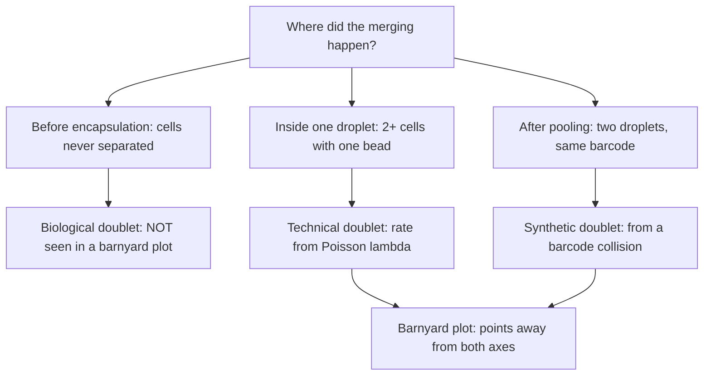

# Doublet

## Definition

A **doublet** is a single barcoded profile in a [[single-cell-rna-seq]] experiment that
actually came from **two or more cells**. The notes distinguish three kinds by where the
merging happened.

## Why it matters

A doublet is not noise: it is a *plausible-looking* cell whose expression profile is the
sum of two real ones. In [[cluster-analysis]] it lands between two genuine clusters and
is readily mistaken for a transitional cell type or an intermediate differentiation
state — exactly the biology single-cell experiments are run to find. Removing doublets is
therefore the first job of quality control.

## Details

**Technical doublets** — *two or more cells inside one drop with a bead*. The rate
follows directly from the Poisson loading of cells at rate `λ`:

```text
                        1 − e^(−λ) − λ·e^(−λ)
technical doublet rate = ───────────────────────
                              1 − e^(−λ)
```

i.e. `P(≥ 2 cells | ≥ 1 cell)` — the same conditional form as the cell duplication rate
in [[droplet-based-single-cell-methods]], with cells in place of beads.

**Synthetic doublets** — produced by a [[barcode-collision]], when two *separately*
encapsulated cells receive beads with the same barcode.

**Biological doublets** — *arise when two cells form a discrete unit that does not break
apart during the disruption used to form a suspension*. They were a doublet before the
droplet existed.

**Doublet detection — the barnyard plot.** Mix cells from two species and plot, for each
barcode, the **number of transcripts assigned to species 1** against the **number
assigned to species 2**:

- barcodes on the species-1 axis → pure species-1 cells;
- barcodes on the species-2 axis → pure species-2 cells;
- barcodes **in the middle, with substantial counts of both** → **doublets**.

The method's limit is important: it only sees doublets of **different** species.
Same-species doublets — and therefore **biological doublets, which are not detected via
the barnyard plot** — stay invisible and must be caught by count-depth thresholds
instead (see [[single-cell-analysis-workflow]]).

## Diagram


The three kinds of doublet, classified by the stage at which two cells were merged, and which of them a barnyard plot can see.

## Relations

- [[droplet-based-single-cell-methods]] — the Poisson loading that sets the technical
  rate; raising the cell rate `λ` to capture more cells raises it too.
- [[barcode-collision]] — the origin of synthetic doublets.
- [[single-cell-rna-seq]] — "**no doublets**" is one of the eleven wishes on the notes'
  single-cell wish list.
- [[single-cell-analysis-workflow]] — quality control filters barcodes with
  unexpectedly high counts and many detected genes as likely doublets.
- [[cluster-analysis]] — doublets masquerade as intermediate clusters.
- [[probability-distribution]] — the Poisson distribution behind the rate formula.
- [[batch-effect]] — another artefact that becomes indistinguishable from biology once
  it is in the matrix.

## Appears in

- [[M2L07-single-cell-rna-seq]]
- [[M2E07-single-cell-rna-seq-and-dimensionality-reduction]]

## Sources

- `raw/module2/csb_3.pdf`, p. 14 — technical doublets and their rate formula, the
  barnyard plot, biological doublets and the note that they are not detected by it;
  synthetic doublets from barcode collisions.
- `raw/module2/csb_3.pdf`, p. 16 — doublets in quality control: unexpectedly high counts
  and many detected genes, filtered by count-depth thresholds.
- `raw/module2/csb_3.pdf`, p. 12 — "no doublets" on the single-cell wish list.
