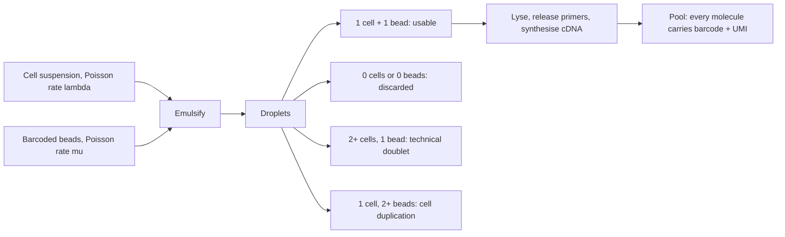

# Droplet-Based Single-Cell Methods

## Definition

**Droplet-based methods** capture single cells by emulsifying a cell suspension together
with barcoded beads, so that each nanolitre droplet ideally contains **one cell and one
barcode**. inDrops, 10X and Drop-seq are the three platforms named in the notes.

## Why it matters

The whole statistical character of [[single-cell-rna-seq]] follows from how droplets are
filled: cells and beads arrive **at random**, so the loading is **Poisson**, and the two
quantities a protocol is judged by — how many cells are captured and how many get
confused with each other — are both read straight off that distribution.

## Details

**The inDrops cycle**, in three steps from the notes:

1. **One drop contains: one cell, one barcode.**
2. The cell meets a **barcoded hydrogel bead**; the barcoded primers are **released**,
   then **cDNA synthesis** happens inside the drop.
3. Every molecule leaves the drop tagged as **`barcode + cDNA`**, so after pooling, the
   barcode says which cell each mRNA came from.

**Droplet theory.** Two independent Poisson processes:

```text
beads loaded into drops at Poisson rate μ
cells loaded into drops at Poisson rate λ

P(a droplet has j beads) = e^(−μ) · μ^j / j!
P(a droplet has k cells) = e^(−λ) · λ^k / k!
```

**The two rates that matter**

| Rate | Definition in the notes | Formula |
|---|---|---|
| **Cell capture rate** | the probability that a drop has **at least one bead** | `1 − e^(−μ)` |
| **Cell duplication rate** | the rate at which captured single cells are associated with **two or more barcodes** | `(1 − e^(−μ) − μ·e^(−μ)) / (1 − e^(−μ))` |

The capture rate is one minus `P(0 beads)`. The duplication rate is the conditional
probability of *two or more* beads **given at least one**: the numerator removes both the
empty and the single-bead cases from the total, and the denominator conditions on the
drop having been captured at all.

> ⇒ there is a **trade-off between the two rates**: raising `μ` captures more cells and
> simultaneously puts more of them under two barcodes.
>
> **1 barcode = 1 cell (optimal).**

**Choosing a system.** The notes give a decision tree over cell numbers, cost sensitivity,
the need for custom protocols and required sensitivity, whose leaves are **inDrops**,
**10X** and **Drop-seq**; it is reproduced in [[single-cell-rna-seq]].

**3' bias.** Droplet methods *are a 3' technology*, because the barcoded primer anchors
at the poly-A tail; coverage falls off with distance from the 3' end, so **more
information is available there** and full-length transcript identification is impossible.

## Diagram


Random Poisson loading of cells and beads produces four kinds of droplet; only one of them is usable.

## Relations

- [[single-cell-rna-seq]] — the method these protocols implement.
- [[doublet]] — what happens when a droplet receives more than one cell.
- [[barcode-collision]] — what happens when two droplets receive the same barcode.
- [[unique-molecular-identifier]] — the second tag carried alongside the cell barcode.
- [[probability-distribution]] — the Poisson distribution supplying both formulas.
- [[statistical-testing]] — the capture and duplication rates are complementary
  probabilities computed from the same distribution, the same arithmetic as sensitivity
  and specificity.
- [[next-generation-sequencing]] — the pooled library is sequenced conventionally, and
  inherits its biases.
- [[rna-seq]] — poly-A selection and the 3' end are already familiar from bulk
  protocols.
- [[single-cell-analysis-workflow]] — the wet-lab stage that produces the workflow's input.

## Appears in

- [[M2L07-single-cell-rna-seq]]
- [[M2E07-single-cell-rna-seq-and-dimensionality-reduction]]

## Sources

- `raw/module2/csb_3.pdf`, p. 13 — droplet methods as a 3' technology, the three inDrops
  steps, the Poisson loading rates `μ` and `λ`, the cell capture rate, the cell
  duplication rate, the trade-off, "1 barcode = 1 cell (optimal)".
- `raw/module2/csb_3.pdf`, p. 15 — the inDrops / 10X / Drop-seq decision tree.
- `raw/module2/csb_3.pdf`, p. 21 — the exercise restatement of both rates.
