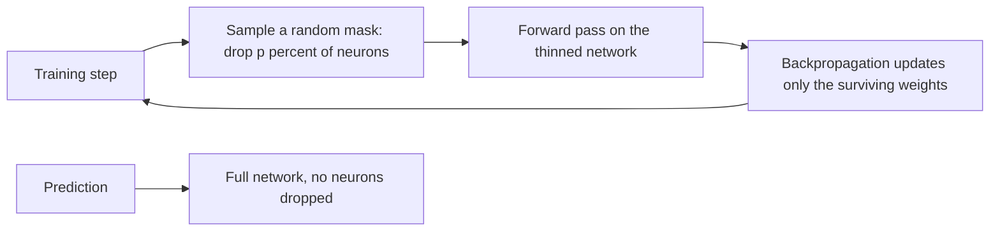

# Dropout

## Definition

**Dropout** is *a regularization technique* in which the network **randomly deactivates
(sets to 0) a percentage of the neurons during training**. A different random subset is
dropped at every training step; at prediction time the full network is used.

## Why it matters

It is the cheapest and most effective defence against [[overfitting]] in a
[[neural-network]]. Because no neuron can rely on any particular other neuron being
present, the network cannot build fragile co-adapted chains of units and is forced to
spread the representation out. The notes list it first among the regularization tips:

> **Dropout layers**: while training randomly drops connections with a certain
> probability.

## Details

```text
DROPOUT(a, p):            // a = activations of a layer, p = drop probability
  if training:
    for each unit i:
      m[i] ← 0 with probability p, else 1      // fresh random mask every step
    a ← (a ⊙ m) / (1 − p)                      // rescale so the expected sum is unchanged
  return a                                      // at test time: return a unchanged
```

The drop probability `p` is a hyper-parameter: too small and nothing is regularised, too
large and the network cannot learn at all.

**Dropout among the notes' regularization tips**

| Problem | Tip |
|---|---|
| Overfitting | **start with normalized data**, **dropout layers** |
| Fails to learn | change the learning rate, change the architecture |
| Slope to 0 | **batch normalization**, residual connections |
| Gradient explosion | **gradient clipping** |

In the Keras sketch of the notes, `Dropout` sits between `Conv1D` and `MaxPooling1D`
inside the [[convolutional-neural-network]] stack.

## Diagram


A fresh random subset of neurons is removed at every training step; prediction uses the whole network.

## Relations

- [[overfitting]] — the failure mode dropout exists to prevent.
- [[neural-network]], [[deep-learning]] — where it is applied.
- [[convolutional-neural-network]] — a `Dropout` layer appears in the notes' CNN stack.
- [[random-forest]] — the same idea one level up: deliberately hiding part of the
  information from each learner so that no single feature dominates.
- [[bootstrapping]] — another randomised-subset defence against an over-confident model.
- [[bias-variance-tradeoff]] — dropout is a **regularization** move, so it treats
  variance, not avoidable bias.
- [[grandforest]] — both are randomisation-based regularizers, one by feature subsampling, one by unit masking.
- [[pooling-layer]] — both shrink a representation, one deterministically, one stochastically.
- [[single-cell-rna-seq]] — technical dropout is the characteristic noise of the single-cell count matrix.

## Appears in

- [[M2L06-deep-learning]]
- [[M2E06-deep-learning]]

## Sources

- `raw/module2/csb_3.pdf`, p. 5 — dropout layers among the regularization tips, with
  batch normalization, gradient clipping and architecture changes.
- `raw/module2/csb_3.pdf`, p. 10 — the exercise definition: a regularization technique
  randomly deactivating a percentage of neurons during training.
- `raw/module2/csb_3.pdf`, p. 11 — `Dropout` in the Keras `Sequential` stack.
