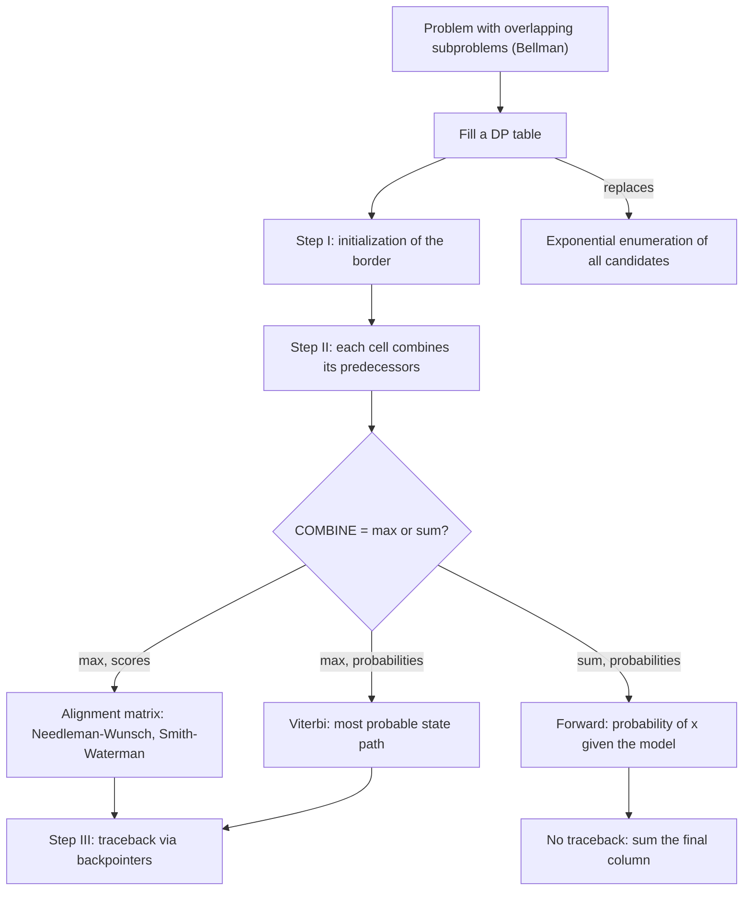

# Dynamic programming

## Definition

**Dynamic programming** is an algorithm design pattern that breaks a problem into
subproblems, solves them, and keeps track of repeated computation in a **dynamic
programming table**. It is applicable only when the overlapping-subproblems property
(**Bellman's principle**) holds, i.e. when an optimal solution is built from optimal
solutions of smaller instances.

## Why it matters

The problems it is applied to in this module — optimal [[sequence-alignment]] and the
evaluation and decoding of a [[hidden-markov-model]] — all have an exponential number of
candidate solutions: every possible alignment of two sequences, or every possible state
path through a model. Filling a table instead of enumerating candidates collapses that
exponential search into a polynomial one, which is the difference between a usable and
an unusable method on genome-sized input ([[algorithmic-complexity]]).

## Details

**The pattern**, as stated in [[L07-algorithms-and-complexity]]: break the problem into
subproblems and solve them, storing repeated computations in a table so that each
subproblem is solved once. It is one of the two design patterns the lecture names, the
other being **divide and conquer** (split, solve recursively, merge, typically
`O(n log n)`).

**Generic skeleton**

```text
DYNAMIC-PROGRAM(input):
  // Step I: initialization — the border cells, which depend on no subproblem
  INITIALIZE(T, border cells)

  // Step II: fill — every cell combines already-computed neighbours
  for i ← 1 to n:
    for j ← 1 to m:
      T[i,j] ← COMBINE over predecessors p of ( T[p] (*) local_score(i, j, p) )
      B[i,j] ← the predecessor that was chosen          // backpointer, if a path is wanted

  // Step III: traceback — follow the backpointers from the designated start cell
  return READ-OFF(T, B)
```

`COMBINE` is a `max` when a single optimal solution is wanted and a **sum** when a total
probability is wanted; `(*)` is `+` for scores and `·` for probabilities (or `+` again
once probabilities are taken to log space).

**The four instances used in this course**

| Instance | Table cell means | COMBINE | Answer read off |
|---|---|---|---|
| [[needleman-wunsch]] | `S(i,j)` = score of the optimal **global** alignment of the prefixes `x₁…x_i` and `y₁…y_j` | `max` over diag / up / left | corner `S[m,n]`, traceback to the origin |
| [[smith-waterman]] | `S(i,j)` = score of the optimal **local** alignment **ending** at `x_i`, `y_j`, clamped at 0 | `max` over 0 / diag / up / left | maximum entry of the whole matrix, traceback to the first 0 |
| [[forward-algorithm]] | `f_q(i) = P(x₁…x_i, X_i = q \| model)` — probability of having emitted the first `i` symbols **and** sitting in state `q` | **sum** over predecessor states | `Σ_q f[q,L] · T(qEnd \| q)` = `P(x \| model)` |
| [[viterbi-algorithm]] | `P_ℓ(i,x)` = probability of the **most probable path** ending in state `ℓ` after `i` observations | `max` over predecessor states | last maximum entry, backtrack the backpointers to the start |

The first two fill a matrix indexed by the two sequence positions; the last two fill a
**trellis** indexed by sequence position and state. Forward and Viterbi are the *same*
recursion and differ only in sum versus max — Forward answers "how likely is this
sequence at all", Viterbi "which path produced it".

**The three steps** are named explicitly in the alignment notes: **I Initialization**,
**II Score calculation**, **III Traceback**. Initialisation is where the four alignment
types differ (global charges border gaps `i·d`; local, semi-global and free-end-gaps set
the border to zero), and the traceback start cell differs with them.

**Cost**

- Alignment: `O(m · n)` time and space — one constant-time maximum per cell — against the
  exponential cost of enumerating all alignments.
- HMM trellis: `O(L · |Q|²)` time, `O(L · |Q|)` space — one column per observation, each
  of the `|Q|` cells combining over `|Q|` predecessors — against the naive `O(|Q|^L)`
  path enumeration.
- Space can be reduced to one column when only the final value is needed; the full table
  is required whenever a traceback has to be performed.

**Pitfalls**

- **Ties** in the `max` give several equally optimal tracebacks: the optimal solution
  need not be unique, so a fixed tie-breaking rule is needed.
- **Numerical underflow** in the probabilistic instances: long products of probabilities
  vanish, so the recursion is run in **log space**, where products become sums and the
  `max` is unchanged because `log` is monotonic.
- An asymptotically better bound is not automatically faster on bounded input — the
  caveat demonstrated numerically in [[E04-complexity-and-majority-element]].
- The heuristic [[blast]] exists precisely because even an `O(m · n)` dynamic program is
  too slow against a whole database.

## Diagram


One pattern, two combine operators, and the four course instances that follow from them.

## Relations

- [[algorithmic-complexity]] — names dynamic programming as a design pattern and supplies the polynomial-versus-exponential argument that justifies it.
- [[sequence-alignment]] — the hub page whose single recursion all four alignment types share; the course's standard dynamic-programming example.
- [[needleman-wunsch]] — the global alignment instance, with full fill-and-traceback pseudocode.
- [[smith-waterman]] — the local instance: the same recursion with zero border and clamping at zero.
- [[forward-algorithm]] — the summing instance, solving the HMM evaluation problem over a trellis.
- [[viterbi-algorithm]] — the maximising instance, solving the HMM decoding problem; the same DP skeleton as Needleman–Wunsch with probabilities instead of similarity scores.
- [[hidden-markov-model]] — the model whose evaluation and decoding problems the two trellis instances solve.
- [[blast]] — the heuristic used when even a quadratic dynamic program is too expensive.
- [[substitution-matrix]] — supplies the local score `r(a,b)` and gap penalty `g` that the alignment recursion combines.
- [[maximum-parsimony]] — Fitch's post-order pass is dynamic programming over a tree rather than a matrix.
- [[backpropagation]] — reuses each layer's intermediate result exactly once, the same overlapping-subproblem saving.
- [[upgma]] — the contrasting greedy strategy, and the correctness it gives up off-clock.

## Appears in

- [[L07-algorithms-and-complexity]]
- [[L09-sequence-alignment-and-homology]]
- [[L17-markov-chains-and-hidden-markov-models]]
- [[E04-complexity-and-majority-element]]
- [[E07-alignment-and-homology]]
- [[E13-markov-chains-and-viterbi]]
- [[M2L08-molecular-evolution-and-phylogeny]] — module 2 reuses it for [[maximum-parsimony]] scoring on a tree.

## Sources

- `raw/module1/gsb_part1.pdf`, p. 27 — dynamic programming as a design pattern, Bellman's principle and the DP table.
- `raw/module1/gsb_part2.pdf`, pp. 13–16, 18 — the alignment recursion, the three steps and the global/local variants.
- `raw/module1/gsb_part4.pdf`, pp. 14, 17 — the forward and Viterbi recursions over the trellis, log space and backtracking.
- Consolidated from [[algorithmic-complexity]], [[sequence-alignment]], [[needleman-wunsch]], [[smith-waterman]], [[forward-algorithm]] and [[viterbi-algorithm]]; see those pages for the original `raw/` page references.
