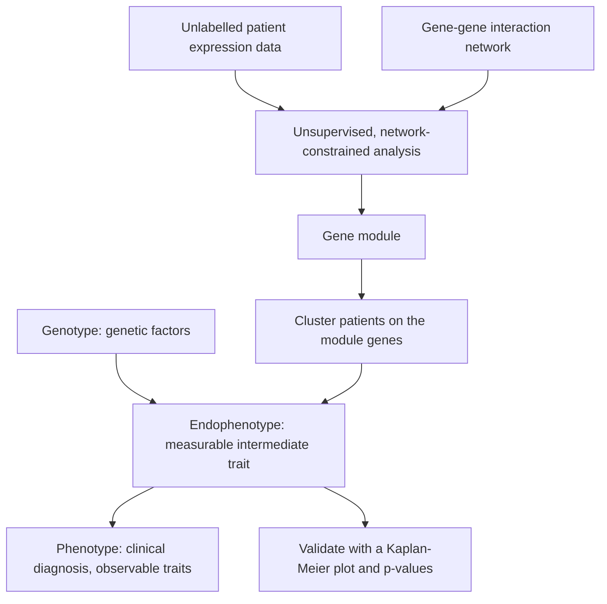

# Endophenotype

## Definition

A **phenotype** is the set of **observable characteristics or traits** of an organism —
hair colour, for example. An **endophenotype** is a **measurable trait thought to be
more closely linked to the genetic factors underlying a disorder** than the clinical
diagnosis is.

## Why it matters

Supervised methods are **biased to current disease definitions**: they can only learn the
labels a clinician already assigned. But **disease subtypes may exist**, **different
mechanotypes require different treatments**, and **shelved drugs might be effective
and/or repurposable** for a subtype nobody has named yet. Endophenotypes are the
intermediate layer between genotype and diagnosis where those subtypes become visible.

## Details

**De novo endophenotyping** (`de novo` = **new**) refers to the process of **identifying
and characterizing newly recognized or previously unknown measurable traits** that are
believed to be **intermediate markers of the underlying genetic factors of a disorder**.

Operationally, in this module, de novo endophenotyping means running an **unsupervised**
analysis on unlabelled patient data constrained by an [[interaction-network]], and
reading the resulting patient groups as candidate endophenotypes:

- [[grandforest]] in unsupervised mode — generate a background, train the model to
  separate foreground from background, extract an important gene module, then **cluster
  the input only on the genes in that module** → de novo endophenotypes.
- [[bicon]] — bi-cluster patients and genes jointly so that the gene side induces a
  **connected subnetwork** → patient subgroups plus the biomarkers that define them.

**Validation.** Because the groups have no labels, they are validated clinically: a
[[kaplan-meier-plot]] of the subgroups, with p-values, shows whether the discovered
split corresponds to a difference in survival.

## Diagram

The endophenotype sits between genotype and diagnosis; de novo endophenotyping discovers it from unlabelled data.

## Relations

- [[grandforest]] — produces de novo endophenotypes in unsupervised mode.
- [[bicon]] — network-constrained bi-clustering explicitly aimed at de novo
  endophenotypes.
- [[kaplan-meier-plot]] — how a candidate endophenotype is shown to matter clinically.
- [[cluster-analysis]] — the unsupervised machinery that produces the groups.
- [[machine-learning]] — supervised learning cannot find an endophenotype, because it
  can only reproduce the labels it is given.
- [[expression-qtl]] — the module-1 notion closest to this: a molecular trait standing
  between genotype and organismal phenotype.
- [[population-genetics]] — supplies the genotype end of the chain.
- [[keypathwayminer]] — the other de novo network method; it extracts a module but does
  not go on to subtype the patients.
- [[single-cell-rna-seq]] — single-cell resolution is what makes cell-type-specific intermediate phenotypes measurable at all.

## Appears in

- [[M2L05-network-based-disease-modules]]
- [[M2E05-grandforest-and-bicon]]
- [[M2L04-clustering]] — clusters of patients are read as endophenotypes.

## Sources

- `raw/module2/csb_part2.pdf`, p. 23 — the motivation: bias to current disease
  definitions, subtypes, mechanotypes, drug repurposing.
- `raw/module2/csb_part2.pdf`, p. 24 — the definitions of de novo, phenotype,
  endophenotype and de novo endophenotyping as given in the exercise.
