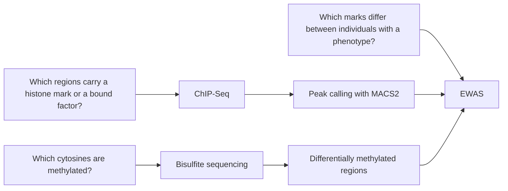
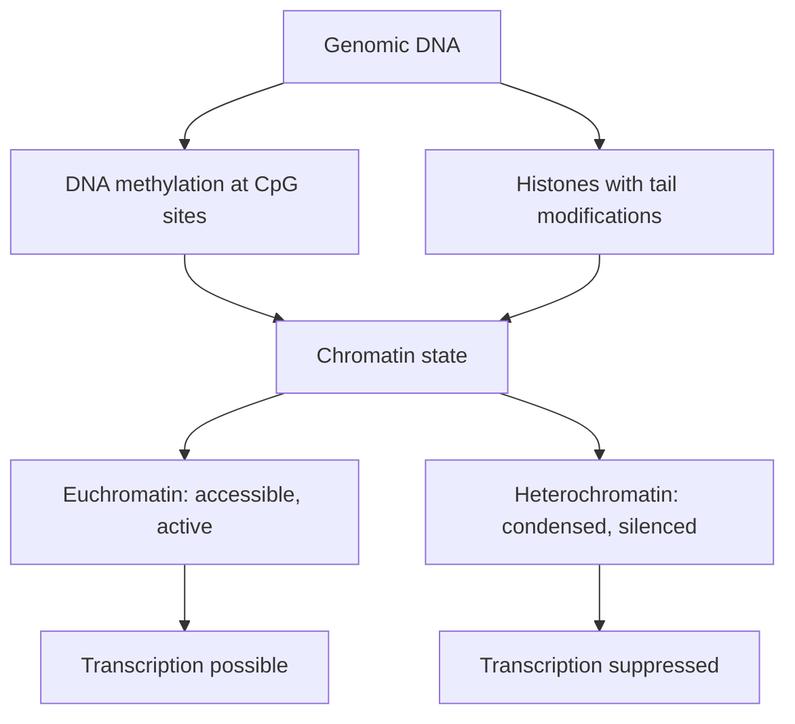

# Epigenetics

## Definition

Epigenetics (Epigenetik) studies **how environmental influences on developmental events
can affect the phenotype** — the alteration of gene function **without changes in the DNA
sequence itself**, which may nevertheless lead to functional changes. The information is
carried by **chemical modifications of the DNA or of the histones** instead:
[[dna-methylation]] and [[histone-modification]], both read out through the state of
[[chromatin]].

## Why it matters

Every cell of an organism has the **same DNA sequence**, yet a liver cell is not a
neuron: expression is **tissue-specific**. That difference has to be stored somewhere
other than in the sequence, and epigenetic marks are where. The field therefore sits
directly above [[gene-regulation]] as a second regulatory layer, and it supplies the
mechanism behind imprinting, X-chromosome inactivation, developmental differentiation and
a large part of cancer biology.

The handwritten notes also reach it from the technology side: [[chip-seq]] is described
as "a key technology of epigenetics" because it detects histone modifications, and
long-read sequencing ([[next-generation-sequencing]]) is valued because it can detect base
modifications directly.

## Details (from the lecture notes)

### Stability and inheritance

- **Mitotic stability** — epigenetic marks are stable and are **transmitted to the
  daughter cells**, which is how a differentiated cell type perpetuates itself.
- **Meiotic stability** — marks can reach the next generation, but there is
  **reprogramming in the gametes**, which erases most of them.
- The consequence drawn in the notes: *the DNA sequence is the same* in every tissue, so
  tissue-specific expression must be epigenetic.

### The structural substrate

- **Packing of DNA**: a **nucleosome** is **146 bp of DNA wrapped around a core histone
  complex**, giving chromatin its stability and structure, followed by **higher-order
  folding**. Full treatment in [[chromatin]], including euchromatin versus
  heterochromatin and the interphase/prometaphase contrast.

### The two mark types

| Mark | Carrier | Page |
|---|---|---|
| Histone modifications — methylation, acetylation, phosphorylation of histone tails | protein | [[histone-modification]] |
| DNA methylation — 5-methylcytosine, almost exclusively in the CpG context | DNA | [[dna-methylation]], [[cpg-island]] |

Both are **written, read and erased** by dedicated enzymes, which is what makes the layer
regulatory rather than merely structural.

### How it is measured

The three questions of epigenomics and the assay that answers each.

- **[[chip-seq]]** detects both transcription-factor binding sites (TFBS) and **histone
  modifications**, by sequencing genomic fragments that co-precipitate with a DNA-binding
  protein; its reads are turned into regions by [[peak-calling]].
- **[[bisulfite-sequencing]]** reads the methylation status of every individual cytosine
  and yields **differentially methylated regions (DMRs)**.
- **Western blot** and **indirect immunofluorescence** answer the cell-level question
  "is the mark present at all"; ChIP-Seq answers the region-level question.
- **[[epigenome-wide-association-study]]** is the population-scale design built on top of
  these assays.
- **Long-read platforms (PacBio SMRT)** sequence single molecules without amplification
  and can therefore **detect epigenetic modifications** of the bases, which
  amplification-based short-read chemistries erase. Short reads cannot do this, and
  additionally struggle to phase alleles — relevant because epigenetic marks are often
  allele-specific.

> [!note] Added beyond lecture notes
> Source: general domain knowledge (standard molecular-biology textbook material). Not
> from the UHH handwritten notes.
>
> Part 4 of the notes covers most of what was previously missing here. The following
> items are still supplied from outside the notes:
>
> - **Which mark means what.** H3K27ac marks active enhancers, H3K4me3 active promoters,
>   and H3K27me3 and H3K9me3 repressed or heterochromatic regions. The notes give the
>   nomenclature ([[histone-modification]]) but not the functional assignment of the
>   individual marks.
> - **The four core histones** are H2A, H2B, H3 and H4, two copies of each forming the
>   octamer; the modifiable residues sit on their N-terminal tails.
> - **Maintenance methylation.** Because CpG methylation is symmetrical on both strands,
>   the hemimethylated site produced by replication is recognised by the maintenance
>   methyltransferase DNMT1, which restores the mark on the new strand. This is the
>   mechanism behind the "mitotic stability" the notes assert, and the counterpart to the
>   question the notes raise but leave open for histone marks.
> - **Reversibility.** Epigenetic marks are mitotically heritable yet reversible, which
>   is why they can both maintain cell identity and be reprogrammed during development —
>   and why epigenetic modifier inhibitors are a viable therapeutic strategy.

### Reprogramming during development

> [!note] Added beyond lecture notes
> Source: general domain knowledge (Reik, *Nature* 447:425, 2007; Waddington, *The
> Strategy of the Genes*, 1957; Takahashi & Yamanaka, *Cell* 126:663, 2006). Not from the
> UHH handwritten notes.
>
> The notes mention "reprogramming in the gametes" in one clause. There are in fact **two
> genome-wide waves of erasure** per generation, and the distinction matters because only
> one of them is complete:
>
> 1. **Primordial germ cells.** As the germ line is set aside in the embryo, methylation
>    is erased almost completely, **including imprints**. The parental imprints are then
>    re-established during gametogenesis, sex-specifically — the cycle described in
>    [[dna-methylation]].
> 2. **The zygote, after fertilisation.** The paternal genome is demethylated rapidly and
>    actively (TET3), the maternal genome passively over the cleavage divisions. This wave
>    resets the two gametic epigenomes to a common totipotent ground state — but
>    **imprinted loci are protected and survive it**, which is precisely why imprinting
>    works at all.
>
> Some marks escape both waves; this incomplete erasure is the mechanistic basis claimed
> for **transgenerational epigenetic inheritance**, which is well established in plants
> and *C. elegans* and remains contested in mammals.
>
> **The Waddington landscape** is the standard picture of what the marks then do: a cell
> rolls downhill through a branching valley, each branch a lineage decision, and the
> epigenetic marks are what make the valley walls steep — i.e. what makes a differentiated
> state stable rather than merely current. **Induced pluripotency** (OSKM reprogramming)
> is the demonstration that the landscape can be climbed back up, and therefore that no
> DNA-sequence change was involved.

### Non-coding RNA as a targeting system for chromatin marks

> [!note] Added beyond lecture notes
> Source: general domain knowledge (Rinn & Chang, *Annu. Rev. Biochem.* 81:145, 2012;
> Matzke & Mosher, *Nat. Rev. Genet.* 15:394, 2014 on RNA-directed DNA methylation;
> Aravin et al., *Science* 318:761, 2007 on piRNAs). Not from the UHH handwritten notes.
>
> Writers such as PRC2 and the DNMTs have little intrinsic sequence specificity, so
> something must tell them *where* to act. [[non-coding-rna]] is one of the answers, and
> it is the point at which module 1's epigenetics and module 2's RNA layer meet:
>
> - **Long non-coding RNAs in *cis*.** *XIST* is the worked example already given in
>   [[dna-methylation]]: transcribed from the future inactive X, it coats that chromosome
>   and recruits Polycomb machinery, so an RNA transcript defines the territory a mark is
>   applied to. *AIRN* and *KCNQ1OT1* do the same locally at imprinted clusters.
> - **RNA-directed DNA methylation.** Small RNAs base-pair with a nascent transcript and
>   recruit *de novo* methyltransferases to the matching locus. In mammals the clearest
>   case is the **piRNA** pathway, which methylates and silences **transposable elements**
>   in the germ line — epigenetic genome defence.
> - **The contrast with [[rna-interference]].** Classical RNAi degrades or blocks a
>   transcript *after* it is made. The pathways above instead act on the template,
>   producing **transcriptional** rather than post-transcriptional silencing, and —
>   unlike RNAi — the result is heritable through division because it is written into
>   chromatin.

## Diagram

The two chemical mark types determine chromatin state and therefore whether a gene can be transcribed; the chromatin-state detail is from the "Added beyond lecture notes" section.

## Relations

- [[chromatin]] — the structure that stores the signal; nucleosomes and condensation
  states.
- [[histone-modification]] — one of the two chemical mark types.
- [[dna-methylation]] — the other mark type, with [[cpg-island]] as its sequence context.
- [[chip-seq]] — the experimental method that reads histone marks and TFBS.
- [[peak-calling]] — turns ChIP-Seq reads into the regions that carry a mark.
- [[bisulfite-sequencing]] — the assay for methylation at single-base resolution.
- [[epigenome-wide-association-study]] — associates marks with phenotypes across
  individuals.
- [[gene-regulation]] — epigenetic state biases which regulatory inputs can act.
- [[genome-organization]] — chromatin packing is what the marks modulate.
- [[next-generation-sequencing]] — long reads can detect base modifications directly.
- [[atac-seq]] — the antibody-free accessibility assay of the field; its peaks are
  open-chromatin regions.
- [[non-coding-rna]] — the other answer to the same question: how identical genomes give rise to different cell types and tissues.
- [[rna-interference]] — post-transcriptional silencing, complementing the transcriptional silencing that DNA methylation achieves.

## Appears in

- [[L01-bioinformatics-and-the-cell]]
- [[L03-sequencing-and-genomics]]
- [[L05-sequence-comparison-and-networks]]
- [[L16-epigenetics]]
- [[E12-epigenetics-and-peak-calling]]
- [[M2L09-non-coding-rnas]]

## Sources

- `raw/module1/gsb_part1.pdf`, pp. 9, 13 (lecture-derived content).
- `raw/module1/gsb_part4.pdf`, pp. 1–9 (definition, stability, chromatin, both mark
  types, assays and downstream analysis), pp. 10–12 (exercise definitions).
- Supplementary material marked with the "Added beyond lecture notes" callout is general
  domain knowledge, permitted for epigenetics by `CLAUDE.md` §1.
- `raw/module2/csb_4.pdf`, p. 1 — non-coding RNA posed as a second regulatory layer behind cell-type differences.
