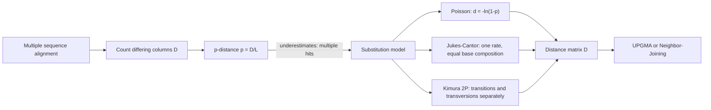

# Evolutionary Distance

## Definition

The **evolutionary distance** between two sequences is the **number of substitutions that
actually occurred** since their last common ancestor, per site. It cannot be observed —
only the **number of positions that now differ** can be — so it must be **estimated** by
a substitution model.

## Why it matters

Every distance-based reconstruction method — [[upgma]], [[neighbor-joining]] — takes a
matrix `D` of pairwise distances as its *only* input. The tree can be no better than that
matrix, and the matrix is exactly where the modelling happens.

## Details

### The starting point

```text
Starting point:  sequence differences = evolutionary changes
Looking for:     a measure of the evolutionary distance between two sequences
Ideally:         the number of mutations since the last common ancestor
                 → NOT POSSIBLE to observe
Solution:        an estimation model, based on a correct alignment of
                 homologous sequences
```

### P-distance — the raw observation

```text
p = D / L

D = number of positions at which the two aligned sequences differ
L = total alignment length
```

In the exercise, an MSA of length `L = 50` with three mismatching columns between `S1`
and `S2` gives

```text
p(S1, S2) = 3 / 50 = 0.06
```

**The flaw**, stated plainly in the notes:

> **The p-distance underestimates the real number of mutations.**

Because of **multiple hits**: a site can be substituted twice and revert, or be
substituted twice and show only one difference. The more time has passed, the more such
hidden events there are, and `p` **saturates** — for random sequences over four bases it
approaches `0.75`, never 1.

### Poisson distance — the first correction

Model the number of substitutions at a site as a Poisson process; the probability of at
least one visible difference is `1 − e^(−d)`, so inverting gives

```text
d_P = − ln( 1 − p )
```

This corrects for multiple hits, but still treats all substitutions as equivalent.

### The model hierarchy

| Model | Free rate parameters | Base composition | Distance |
|---|---|---|---|
| **P-distance** | — | — | `p = D/L` (biased low) |
| **Poisson** | 1 | ignored | `d_P = −ln(1 − p)` |
| **[[jukes-cantor-model]]** | 1 (`α`) | 1:1:1:1 assumed | corrects for 4 bases |
| **[[kimura-two-parameter-model]]** | 2 (`α`, `β`) | 1:1:1:1 assumed | `d = −½ln(1−2P−Q) − ¼ln(1−2Q)` |
| **Felsenstein** | — | free | **not presented in the lecture** |

Each step down the table buys realism with a parameter that must be estimated from the
same finite alignment — the same bias–variance trade-off as in
[[bias-variance-tradeoff]].

## Diagram


Observed differences are corrected by a substitution model into a distance matrix, which is the sole input to the distance-based tree methods.

## Relations

- [[jukes-cantor-model]], [[kimura-two-parameter-model]] — the two rate matrices
  developed in the lecture.
- [[upgma]], [[neighbor-joining]] — the consumers of the resulting distance matrix.
- [[maximum-parsimony]] — the alternative that works on the alignment columns directly
  and needs **no** distance and **no** explicit model.
- [[molecular-evolution]] — the process being estimated.
- [[transition-and-transversion]] — `p = P + Q`.
- [[sequence-alignment]] — the required input; the lecture's distance matrices are built
  from a multiple sequence alignment.
- [[substitution-matrix]] — PAM/BLOSUM scores are log-odds built from the same kind of
  substitution process.
- [[needleman-wunsch]] — the alignment that produces the aligned columns `p` is counted
  over.
- [[markov-chain]] — the substitution models are continuous-time Markov chains on the
  four bases.
- [[graphlet-degree-signature-distance]] — a distance between network nodes rather than between sequences, used for the same purpose: deciding what corresponds to what.
- [[bootstrap-tree-assessment]] — resampled columns give resampled distance matrices, hence resampled trees.
- [[molecular-clock]] — the clock assumes distance grows linearly with time.
- [[phylogenetic-tree-reconstruction]] — the input to all distance-based reconstruction methods.

## Appears in

- [[M2L08-molecular-evolution-and-phylogeny]]
- [[M2E08-phylogenetics]]

## Sources

- `raw/module2/csb_3.pdf`, p. 27 — the modelling programme: starting point, goal, and
  why the true count is unobservable.
- `raw/module2/csb_3.pdf`, p. 28 — the P-distance `p = D/L`, its underestimation, and the
  Poisson distance `d_P = −ln(1−p)`.
- `raw/module2/csb_3.pdf`, p. 37 — the exercise list of quantitative models, with
  Felsenstein named as not presented.
- `raw/module2/csb_3.pdf`, p. 38 — using an MSA to build the distance matrix, with
  `p(S1,S2) = 3/50`.
- `raw/module2/csb_4.pdf`, p. 16 — graphlet degree signature distance.
