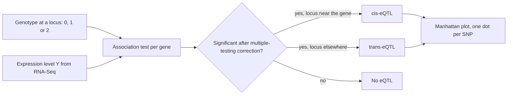

# Expression Quantitative Trait Locus (eQTL)

## Definition

An **expression quantitative trait locus (eQTL)** is a polymorphic locus at which an
experimental exchange of one allele for another produces, **on average**, a change in the
expression of a gene:

```text
A1 → A2  ⇒  ΔY          // different allelic controls, mean shift in expression Y
```

Equivalently: different allelic states at a specific locus alter a measured expression
variable in a tissue population under a given set of conditions. The unit of analysis is
the **pair** *(genotype, expression)* — a genotype–expression association.

## Why it matters

Most disease-associated variants found by a [[genome-wide-association-study]] are not in
coding sequence; they change *how much* of a gene is made. Quantifying the amount of RNA
in a particular tissue under specific conditions ([[rna-seq]]) is therefore highly
informative: the eQTL is the mechanistic bridge between a statistical association and
[[gene-regulation]].

## Details

**Quantitative traits (QTs)**

- Examples: height, longevity, gene expression.
- QTs are usually determined by an interplay of **environment and genetics**.
- **Many genetic loci** contribute to the heritability of a QT — hence the
  genome-wide scan and its **Manhattan plot**, in which each dot is a SNP, ordered along
  the chromosomes, plotted against its significance.
- **QTLs (QT loci)** are the loci that control quantitative traits.
- An **eQTL analysis** is an independent GWAS for the expression of *each* gene.

**cis and trans**

- **cis-eQTL** — the position of the eQTL maps **near** the physical position of the gene
  whose expression it controls.
- **trans-eQTL** — the position of the eQTL does **not** map near the gene.

**Supporting definitions from the notes**

- **Expression** — the number of RNA molecules deriving from a position in the genome.
- **Polymorphism** — the presence of at least two allelic states in a population at a
  specific locus in the genome, where the existence of one of the alleles can be traced
  back to a **mutation event** ([[dna-mutation]]).
- The allelic states defined by the original mutation event define the **causal
  polymorphism** of the eQTL.
- The test is an association between genotypes; nearby genotypes are usually related
  (linkage), so the analysis must decide which markers to assume related and which not.

## Diagram


An eQTL analysis is one genome-wide association scan per gene, classified by distance to that gene.

## Relations

- [[genome-wide-association-study]] — an eQTL study is a GWAS with expression as the
  phenotype.
- [[rna-seq]] — supplies the expression values being associated.
- [[multiple-testing-correction]] — one test per SNP per gene makes correction
  unavoidable.
- [[gene-regulation]] — a cis-eQTL often *is* a regulatory variant, e.g. in a
  [[transcription-factor-binding-site]].
- [[population-genetics]] — supplies the genotype vocabulary and the linkage caveat.
- [[snp]] — SNPs are the genotypes whose allelic states an eQTL scan associates with
  expression.
- [[promoter]] — a cis-eQTL is typically a regulatory variant in the promoter of the gene
  it controls.
- [[endophenotype]] — an eQTL's expression trait is the module-1 counterpart of module 2's intermediate, measurable trait.
- [[epigenome-wide-association-study]] — the methylation analogue, the **meQTL**, plays the same instrumental role there that an eQTL plays here.

## Appears in

- [[L06-expression-profiling]]
- [[L15-gwas-eqtl-and-multiple-testing]]
- [[M2L05-network-based-disease-modules]]

## Sources

- `raw/module1/gsb_3.pdf`, pp. 27–28.
