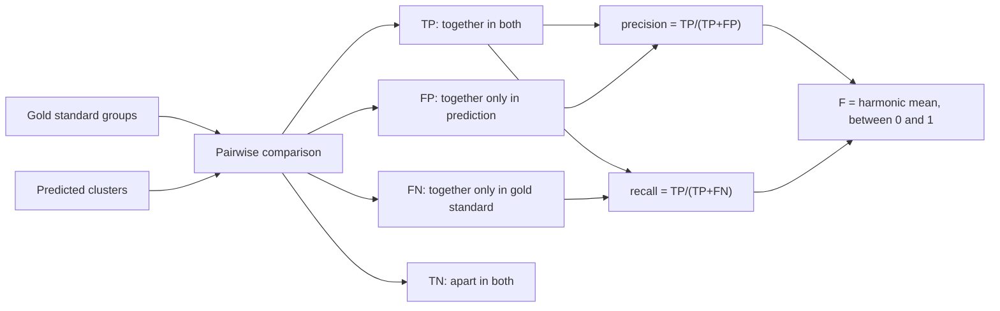

# F-Measure

## Definition

The **F-measure** is the **harmonic mean of precision and recall**, a single number in
`[0,1]` that says how well a set of selected elements matches a set of relevant ones.

```text
precision = TP / (TP + FP)        // how many selected items are relevant
recall    = TP / (TP + FN)        // how many relevant items are selected
F         = 2 · (precision · recall) / (precision + recall)      ∈ [0,1]
```

## Why it matters

It is the standard way to score a [[cluster-analysis|clustering]] against a **gold
standard** (a set of known groups): the higher the F-measure, the better the predicted
groups match the known ones. **1 is best, 0 is worst.** It can also be used for
supervised classifiers, where it complements the [[roc-curve|ROC/AUC]] view.

## Details

**The picture.** The notes draw a rectangle of all elements, a vertical line separating
*relevant* from *not relevant*, and an oval of *selected elements* cutting across it:

- inside the oval and relevant → **TP**
- inside the oval and not relevant → **FP**
- outside the oval and relevant → **FN**
- outside the oval and not relevant → **TN**

**Applied to clustering.** The unit of counting is not an object but a **pair of
objects**:

- **TP** — in the same cluster in the gold standard **and** in the prediction.
- **TN** — not in the same cluster in the gold standard **and** not in the prediction.
- **FN** — in the same cluster in the gold standard **but not** in the prediction.
- **FP** — not in the same cluster in the gold standard **but** in the prediction.

Every unordered pair of objects is classified this way, then precision, recall and `F`
are computed from the four counts. This is worked through in
[[M2E04-k-means-and-transclust]].

**Choosing the density parameter**

- **With a gold standard** — the quality measure is derived directly from it: sweep the
  clustering threshold `t`, compute `F` at each, take the best.
- **Without a gold standard** — plot the number of clusters against cluster size. Let
  `k_t` be the clusters in the peak of that distribution and `u_t` the unspecific
  (singleton/unassigned) items at threshold `t`. The notes give the quality measure as
  the harmonic mean of `k_t` and `1 − u_t`:

  ```text
  Q(t) = 2 · ( k_t · (1 − u_t) ) / ( k_t + (1 − u_t) )
  ```

  `Q(t)` is computed for **each clustering threshold** `t`, plotted against `t`, and the
  maximum of the resulting curve is taken as the **optimal threshold**. The exact meaning
  of `k_t` and `u_t` is only sketched in the notes — see [[open-questions]].

**Missing values.** To speed up pre-computation and to cluster with missing values, set
the **missing similarity values to the threshold** `t` — they then cost nothing in the
[[transclust]] cost function.

## Diagram


Scoring a clustering: every pair of objects contributes one of four outcomes, which combine into precision, recall and F.

## Relations

- [[cluster-analysis]] — the F-measure is its standard external validation.
- [[transclust]] — the threshold `t` whose optimum is chosen by `F` or by `Q(t)`.
- [[k-means]] — the exercise evaluates its result with the F-measure.
- [[statistical-testing]] — supplies the TP/FP/FN/TN vocabulary and the related
  sensitivity/specificity pair.
- [[roc-curve]] — the other summary of a binary decision; ROC sweeps the cutoff,
  `F` fixes it.
- [[peak-calling]] — the module-1 place where precision/recall-style trade-offs appear
  under the name IDR.

## Appears in

- [[M2L04-clustering]]
- [[M2E04-k-means-and-transclust]]

## Sources

- `raw/module2/csb_part2.pdf`, p. 16 — precision, recall, the harmonic mean, the gold
  standard, `Q(t)` and the missing-value trick.
- `raw/module2/csb_part2.pdf`, pp. 18, 20 — the F-measure used to evaluate k-means and
  TransClust results.
