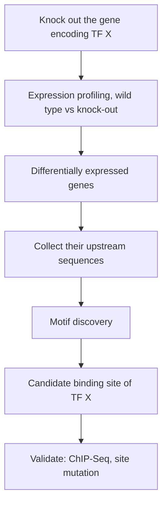

# Gene knock-out

## Definition

A gene knock-out is the deactivation of a gene, either by **replacing it with an inactive
sequence** or by **disrupting its function**. The organism or cell line is then observed
to see what stops working.

## Why it matters

A knock-out is the experiment that creates the input to [[em-motif-discovery|motif
discovery]]. Knocking out a transcription factor and sequencing the transcriptome gives a
list of **differentially expressed genes**; those genes are likely to be controlled by
that factor, and their **upstream sequences are likely to contain its binding sites**.
That set of upstream sequences is exactly the "set of long sequences likely to contain a
short conserved motif" that the [[planted-motif-problem]] assumes as given.

## Details

**Advantages of knocking out a gene**

- It allows the function of a specific gene to be studied: its role in normal development
  and physiology, as well as its role in the pathology of diseases.
- Researchers gain insight into the biological processes the gene is involved in.

**Why knock out a transcription factor in particular**

- The factor's role in [[gene-regulation]] and its effects on downstream biological
  processes become visible.
- The differentially expressed genes it leaves behind define a co-regulated group.
- Their promoters/upstream regions are the search space for the
  [[transcription-factor-binding-site]].

This is the *loss of function* complement to [[chip-seq]], which locates occupied sites
directly: ChIP-Seq says *where the factor sits*, a knock-out says *what stops happening
when it is gone*. The two are routinely combined, because a bound site is not necessarily
a functional one.

## Diagram

The knock-out defines a co-regulated gene group whose upstream sequences become the motif-discovery input.

## Relations

- [[transcription-factor-binding-site]] — what the downstream motif search is looking for.
- [[sequence-motif]] — the pattern the upstream sequences are expected to share.
- [[planted-motif-problem]] — the formal problem the resulting sequence set poses.
- [[gene-regulation]] — the process the knock-out perturbs.
- [[chip-seq]] — the complementary, binding-based experiment.
- [[microarray-expression-analysis]] and [[rna-seq]] — the readouts used to find the
  differentially expressed genes.
- [[enrichment-analysis]] — the usual next step on that differential gene list.
- [[rna-interference]] — knockdown rather than knock-out: reversible, partial, and able to touch essential genes.
- [[small-interfering-rna]] — the effector that makes RNAi knockdown sequence-specific.
- [[crispr-cas9]] — the permanent, DNA-level counterpart that has largely replaced RNAi for therapy.

## Appears in

- [[M2L02-sequence-motifs-and-motif-discovery]]
- [[M2E02-motif-discovery-and-expectation-maximization]]
- [[M2L09-non-coding-rnas]]

## Sources

- `raw/module2/csb_1.pdf`, p. 14 — the knock-out → differential expression → upstream
  sequences → binding sites chain.
- `raw/module2/csb_1.pdf`, p. 23 — exercise definition and advantages.
- `raw/module2/csb_4.pdf`, pp. 3–4 — RNAi screening and the CRISPR–Cas9 versus RNAi comparison.
