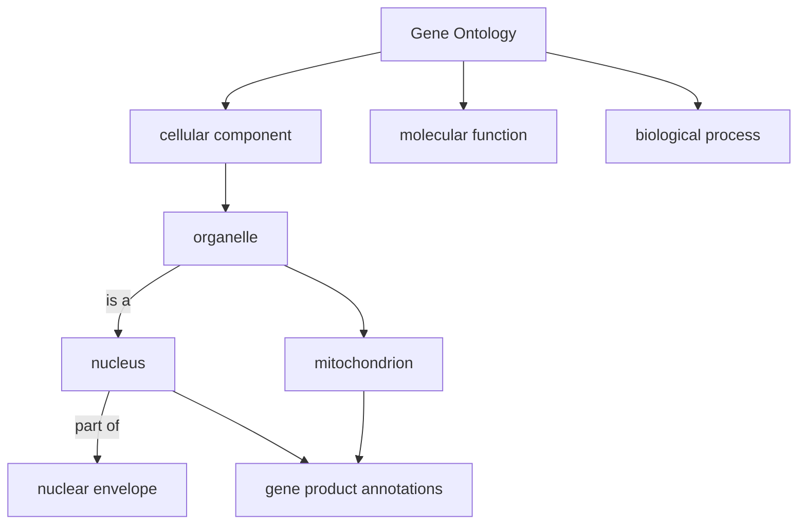

# Gene Ontology

## Definition

The Gene Ontology (GO) is a **structured, controlled vocabulary**: a collection of terms
describing gene products, their definitions, and the logical relationships between them.
It is the standard source of information on [[gene-regulation|gene]] function and hence
the standard source of [[gene-set|gene sets]].

## Why it matters

Gene function is the "specific roles performed by individual genes". Without a controlled
vocabulary, two laboratories annotate the same gene with two incompatible free-text
phrases and no automated analysis is possible. GO fixes the vocabulary, so a computer can
ask "are the genes at the top of my ranked list unusually often annotated with the term
*nucleus*?" — which is exactly what [[enrichment-analysis]] does.

## Details

- **Terms** — each term describes a gene product property, e.g. `nucleus`. Terms carry a
  definition, not only a name.
- **Relationships** — terms are connected by **`is a`** and **`part of`** relations.
  These relations are **not symmetrical**: if *nucleus* `part of` *cell*, the converse
  does not hold.
- **Structure** — GO is represented as a **DAG**, a *directed acyclic graph*. The notes
  explicitly correct "tree" to "directed graph that is acyclic": a term may have several
  parents, which a tree forbids, but no path may return to its own start.
- **Three ontologies** — GO consists of three separate ontologies, which must not be
  mixed when testing:
  1. **cellular component** — where in the cell the product acts;
  2. **molecular function** — what the product does biochemically;
  3. **biological process** — the larger programme it contributes to.
- Because of the DAG, a gene annotated with a specific term is implicitly annotated with
  all of its ancestors. Terms near the root are therefore huge and uninformative, terms
  near the leaves small and specific — the reason enrichment results are usually read at
  an intermediate level of the graph.

## Diagram

GO's three ontologies and the two asymmetric relation types that make it a DAG rather than a tree.

## Relations

- [[gene-set]] — a GO term plus its annotated gene products *is* a gene set.
- [[enrichment-analysis]] — the analysis that consumes GO terms as candidate sets.
- [[gene-set-enrichment-analysis]] — scores GO-derived sets against a ranked gene list.
- [[interaction-network]] — the complementary, topology-based view of the same biology;
  GO labels nodes, the network supplies edges.
- [[hamiltonian-and-eulerian-paths]] — GO is another place in these modules where a
  directed-graph property (acyclicity) carries the whole semantics.

## Appears in

- [[M2L01-enrichment-analysis]]
- [[M2E01-enrichment-analysis-and-keypathwayminer]]

## Sources

- `raw/module2/csb_1.pdf`, p. 2 — gene functions, GO as a structured controlled
  vocabulary, the DAG representation, the two relation types and the three ontologies.
- `raw/module2/csb_1.pdf`, p. 10 — exercise definition, with "tree" struck through in
  favour of "directed acyclic graph".
