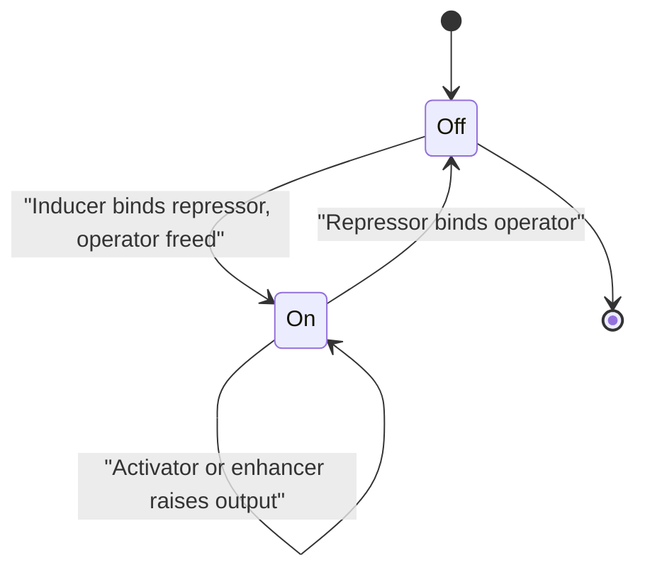
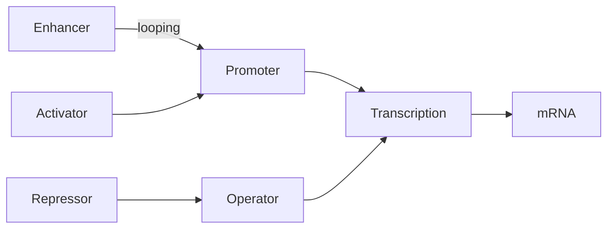

# Gene Regulation

## Definition

Gene regulation (Genregulation) is the set of mechanisms a cell uses to control **which**
genes are expressed, **when**, and **how strongly**, so that a single genome can produce
many different cellular states.

## Why it matters

Every cell of an organism carries the same DNA, so differences between tissues, between
healthy and diseased states, and between growth conditions are differences in regulation.
Measuring those differences is precisely what
[[microarray-expression-analysis|expression arrays]] and [[rna-seq]] do, and locating the
regulators is what [[chip-seq]] does.

## Details

**Prokaryotes — the operon model**

- **Regulator gene** — encodes the repressor protein.
- **Promoter** (Promotor) — RNA-polymerase binding site.
- **Operator** (Operator) — the switch; when the repressor is bound, transcription of the
  downstream genes is blocked.
- **Structural genes** — the genes actually transcribed.
- **Operon** — the functional unit of promoter + operator + structural genes transcribed
  as one mRNA.
- **Inducible operon** (*lac*): off by default, turned on when its substrate appears.
- **Repressible operon** (*trp*): on by default, turned off when the end product
  accumulates.
- **Levels of control**: transcriptional → translational → post-translational.

**Eukaryotes**

- Transcription unit: promoter — RNA-coding sequence — terminator
  (see [[genome-organization]]).
- **Positive regulation** — an **activator** protein increases transcription.
- **Negative regulation** — a **repressor** protein decreases it.
- **Enhancers** are distant sequence elements that boost transcription from a promoter,
  looping to contact it.
- The dominant level in eukaryotes is **transcriptional control**.
- A mutation in a promoter changes which transcription factors bind and therefore the
  transcription level — expression can go up or down (see [[dna-mutation]]).

## Diagram

Transcription as a two-state switch controlled by repressors, inducers and activators.

Positive and negative regulatory inputs converging on the decision to transcribe.

## Relations

- [[central-dogma]] — regulation acts on the transcription step of that flow.
- [[string-matching]] — transcription-factor binding sites are the patterns that exact
  string search looks for in a genome.
- [[genome-organization]] — supplies the promoters, operators and enhancers.
- [[chip-seq]] — the experiment that locates transcription-factor binding sites.
- [[epigenetics]] — a second, heritable layer of regulation on top of this one.
- [[dna-mutation]] — mutations in regulatory elements change expression levels.
- [[transcription-factor-binding-site]] — the DNA words transcription factors recognise;
  their degeneracy sets the level of regulation.
- [[expression-qtl]] — a variant that changes a gene's expression is regulation observed
  genetically.

- [[epigenetics]] — the layer above: chemical marks decide whether a regulatory input can
  reach the DNA at all.
- [[dna-methylation]] — methylation of a promoter or enhancer decreases expression, while
  gene-body methylation accompanies high expression.
- [[histone-modification]] — acetylation opens chromatin for transcription.
- [[chromatin]] — accessibility is the physical precondition for regulation.
- [[cpg-island]] — the promoter feature that decides whether methylation can act.
- [[promoter]] — the element on which activators, repressors, enhancers and methylation
  all converge.
- [[interaction-network]] — "transcription factor X binds the promoter of gene Y" edges
  make up the regulatory network layer.

- [[gene-knockout]] — the perturbation used to find the genes a transcription factor controls.
- [[gene-ontology]] — the controlled vocabulary in which regulatory functions are annotated.
- [[sequence-motif]] — the short conserved patterns through which regulators recognise their targets.
- [[M2E02-motif-discovery-and-expectation-maximization]] — the module-2 exercise on knock-outs and motifs.
- [[microarray-expression-analysis]] — measures the regulatory output genome-wide.
- [[single-cell-analysis-workflow]] — regulatory network inference is one of the gene-level downstream analyses of single-cell data.
- [[non-coding-rna]] — regulation that is carried out by RNA rather than by protein factors.
- [[rna-interference]] — sequence-specific post-transcriptional silencing of gene expression.
- [[microrna]] — endogenous ~22 nt regulators, each able to regulate hundreds of genes.
- [[crispr-cas9]] — the editing tool used to remove a gene outright instead of tuning it.

## Appears in

- [[L01-bioinformatics-and-the-cell]]
- [[L02-gene-expression-and-regulation]]
- [[L05-sequence-comparison-and-networks]]
- [[L06-expression-profiling]]
- [[L08-exact-string-matching]]
- [[L12-binding-sites-and-position-weight-matrices]]
- [[L16-epigenetics]]
- [[E01-cell-biology-and-gene-expression]]
- [[M2L09-non-coding-rnas]]

## Sources

- `raw/module1/gsb_part1.pdf`, pp. 5–6, 10–11.
- `raw/module1/gsb_part2.pdf`, p. 1 — binding patterns as the motivation for string
  search.
- `raw/module1/gsb_3.pdf`, p. 5 — protein–DNA interaction as the realisation of every
  biological function of DNA.
- `raw/module1/gsb_part4.pdf`, pp. 3, 7–8, 12 — the epigenetic regulatory layer:
  acetylation opening chromatin, and methylation of promoters, enhancers and gene bodies.

- `raw/module2/csb_4.pdf`, pp. 1–4 — RNA interference, miRNA biogenesis and CRISPR–Cas9 as routes to altering gene expression.
