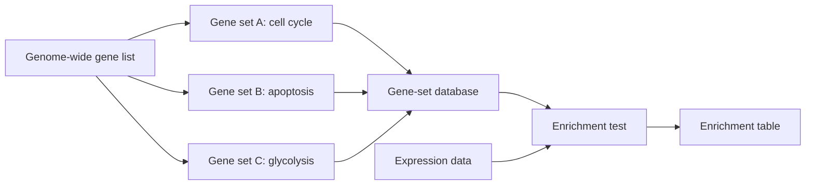

# Gene set

## Definition

A gene set is a group of genes collected under one label because they share a specific
cellular function, process, component or pathway. Breaking cellular function down into
gene sets is what turns a list of differentially expressed genes into a statement about
biology.

## Why it matters

A [[microarray-expression-analysis|microarray]] or [[rna-seq|RNA-Seq]] experiment
produces a ranking of thousands of genes. A single gene at the top of that ranking says
almost nothing; a *group* of functionally related genes near the top says that a process
is active. Gene sets are therefore the unit on which [[enrichment-analysis]] operates:
the set, not the gene, is the thing that is tested.

## Details

The notes give three complementary ways of identifying functional groups in expression
data, in increasing order of structure:

| Representation | What is used | How it is scored |
|---|---|---|
| **Gene sets** | membership only | score the set from the expression of its member genes |
| **Networks** | membership + topology | visual, or identify modules satisfying a joint expression *and* topology requirement |
| **Pathways** | membership + directed topology | visual, or score the pathway exploiting expression *and* topology |

- Every set of genes is associated with a specific **cellular function, process,
  component or pathway**.
- The canonical source of these labels is the [[gene-ontology]], whose terms define the
  sets; curated pathway and gene-set databases are the practical input to an enrichment
  tool.
- A gene set is defined **a priori**, i.e. before the data are seen. That is what makes
  the subsequent test honest: the set was not chosen because it looked enriched.
- The output of a gene-level analysis is a three-way label per gene — **up regulated**,
  **down regulated**, **not significant** — and enrichment asks whether a set is
  over-represented among the up or the down genes.

The pure network view, in which the gene set is not given in advance but discovered as a
connected subnetwork, is the *de novo* alternative pursued by [[keypathwayminer]].

## Diagram

Cellular function is broken into a priori gene sets, which the enrichment test confronts with the expression data.

## Relations

- [[gene-ontology]] — the controlled vocabulary whose terms supply most gene sets.
- [[enrichment-analysis]] — the hub page for testing a gene set against expression data.
- [[fishers-exact-test]] — the threshold-dependent test of set membership overlap.
- [[gene-set-enrichment-analysis]] — the whole-distribution alternative that scores the
  whole ranked list instead of a thresholded subset.
- [[keypathwayminer]] — the *de novo* counterpart that extracts the set from an
  [[interaction-network]] rather than reading it from a database.
- [[microarray-expression-analysis]] and [[rna-seq]] — the assays that produce the
  expression matrix the sets are scored against.
- [[single-cell-analysis-workflow]], [[single-cell-rna-seq]] — marker gene sets are what cell-type annotation is tested against.

## Appears in

- [[M2L01-enrichment-analysis]]
- [[M2E01-enrichment-analysis-and-keypathwayminer]]

## Sources

- `raw/module2/csb_1.pdf`, pp. 1–3 — identification of functional groups, the gene
  set / network / pathway trichotomy, and the definition of gene-set enrichment
  analysis.
