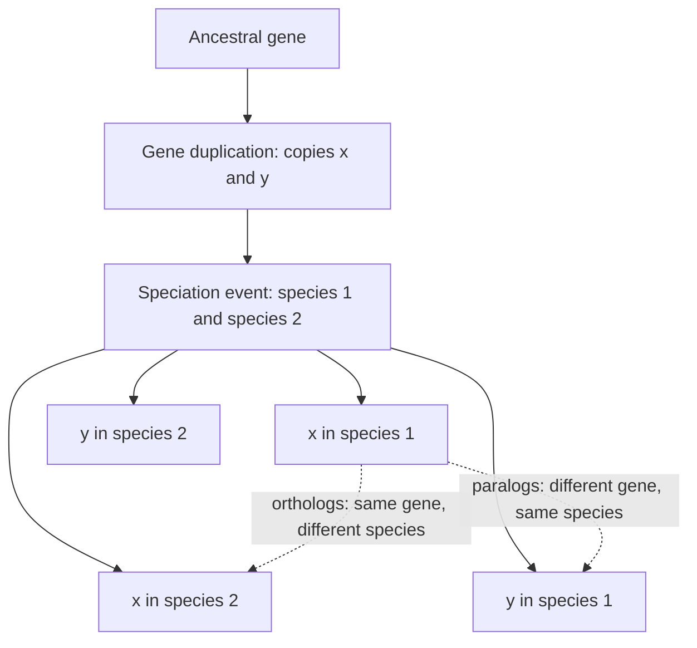

# Gene Tree and Species Tree

## Definition

- A **gene tree** *focuses on the evolution of a specific gene within populations*.
- A **species tree** *depicts the evolutionary relationships between different species*.

⇒ **They are not necessarily the same.**

## Why it matters

Every tree reconstructed from sequence data is, in the first instance, a **gene** tree:
it describes the history of the molecules that were aligned. Treating it as a species
tree is an extra inference, and it is wrong whenever the gene's history and the species'
history diverge — which happens whenever a gene **duplicates**, is **lost**, or is
**transferred horizontally**.

## Details

**The decisive fact**, as the notes put it:

> **A gene may duplicate before or after two species diverge.**

Two events of different kinds are therefore embedded in a gene tree, and they mean
different things:

| Event | In the species tree | In the gene tree | Relationship it creates |
|---|---|---|---|
| **Speciation** | a split | a split | **orthologs** |
| **Gene duplication** | nothing | a split | **paralogs** |

If a duplication happens **before** the speciation, both species inherit both copies,
and the gene tree has two leaves per species; the tree's deepest split then reflects the
*duplication*, not the species split. Comparing the wrong pair — a paralog instead of an
ortholog — then puts the species in the wrong order. The notes' diagram shows exactly
this: the duplication events circled above the **speciation event**, with the species-1
and species-2 lineages below.

**Gene loss** produces the mirror problem: a species that lost one copy appears to have
only the other, and the two copies in the remaining species look like a recent
duplication. Together with **horizontal gene transfer**, this is why the data-selection
criteria of [[phylogenetic-tree-reconstruction]] demand a sequence that **occurs in all
investigated species in a single copy** and shows **no horizontal gene transfer**.

The full vocabulary for the resulting relationships — orthologs, paralogs, in-paralogs,
out-paralogs and co-orthologs — is in [[homology]].

## Diagram

A duplication before speciation puts two copies in each species; only the ortholog pairs track the species tree.

## Relations

- [[homology]] — the vocabulary of orthology and paralogy that this distinction defines.
- [[molecular-evolution]] — duplication, loss and horizontal transfer as processes.
- [[phylogenetic-tree]] — the object both trees are instances of.
- [[phylogenetic-tree-reconstruction]] — its data-selection rules exist precisely to make
  the gene tree a usable proxy for the species tree.
- [[genome-organization]] — gene families and duplicated copies as a feature of genome
  architecture.
- [[dna-mutation]] — duplication is one of its structural classes, here with
  phylogenetic consequences.
- [[blast]] — in practice, how candidate orthologs are identified before any tree is
  built.

## Appears in

- [[M2L08-molecular-evolution-and-phylogeny]]
- [[M2E08-phylogenetics]]

## Sources

- `raw/module2/csb_3.pdf`, p. 26 — gene trees versus species trees, the duplication /
  speciation diagram, and "a gene may duplicate before or after two species diverge".
- `raw/module2/csb_3.pdf`, p. 27 — gene loss and horizontal gene transfer.
- `raw/module2/csb_3.pdf`, p. 36 — the exercise restatement of both definitions and the
  conclusion that they are not necessarily the same.
