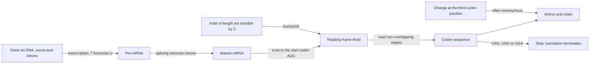

# Genetic code

## Definition

The **genetic code** (genetischer Code) is the rule by which the base sequence of a
mature mRNA is read during translation: the message is partitioned into
**non-overlapping triplets called codons**, and each codon specifies one amino acid or a
stop. Reading begins at the start codon `AUG` and ends at the first in-frame stop codon.

## Why it matters

The code is the last step of the [[central-dogma]], and two of its properties drive
whole chapters of the module. Because it is read **in triplets**, the *length* of an
insertion or deletion decides whether a mutation is local or catastrophic. Because it is
**redundant**, many DNA differences are invisible at the protein level — which is the
reason protein comparison can be more informative than DNA comparison in
[[sequence-alignment]].

## Details

**The reading rules recorded in the notes**

| Element | Value | Meaning |
|---|---|---|
| **Codon** | 3 bases | the unit of reading; codons do not overlap |
| **Start codon** | `AUG` | translation begins here; also codes methionine |
| **Stop codons** | `UAA`, `UAG`, `UGA` | translation terminates, no amino acid is added |

**From DNA to codons**

- Transcription copies the gene; RNA uses **uracil (`U`)** where DNA uses **thymine
  (`T`)**, so a coding DNA stretch `…GAT…` becomes `…GAU…` in the mRNA.
- In eukaryotes the transcript must first be processed: [[splicing]] removes the introns
  and joins the exons, and only the **mature** mRNA is read in codons
  ([[genome-organization]]).
- The ribosome then reads the mature mRNA triplet by triplet from `AUG` until a stop
  codon is reached.

Worked through on the first exercise sheet
([[E01-cell-biology-and-gene-expression]]):

```text
DNA (coding strand):  5'...CAAGAT...G  gtaag....g  GAT...3'
after splicing:           ...CAAGAT...G           GAT...
mRNA:                 5'...CAAGAU...G             GAU...3'
read from AUG in triplets, stop at the first in-frame UAA, UAG or UGA
```

**Reading frame and mutations**

Because the code is read in non-overlapping triplets, an insertion or deletion whose
length is **not a multiple of three** shifts the reading frame and can change everything
downstream of it. An exonic substitution may instead change a single amino acid, or
introduce a **premature stop codon**. See [[dna-mutation]].

**Redundancy**

The code is redundant: changes at the **third codon position** are frequently
**synonymous**, i.e. they leave the encoded amino acid unchanged. Two consequences named
in the notes:

- A DNA-level difference can be invisible in the protein, so DNA and protein comparisons
  of the same gene pair do not give the same answer ([[homology]]).
- Protein sequences can be **more informative** for comparison, since amino acids also
  share biophysical properties that a [[substitution-matrix]] can reward; DNA remains
  more informative for **non-coding** regions, which have no code to be read at all.

**What the code does *not* cover**

DNA synthesis occurs during **replication**, not during transcription or translation — a
distinction the exercise sheet tests explicitly.

## Diagram


The code applies only to mature mRNA, is anchored by `AUG`, and its triplet structure is what makes frameshifts and third-position changes behave so differently.

## Relations

- [[central-dogma]] — the genetic code is the rule used at the translation step.
- [[splicing]] — produces the mature mRNA that the code is applied to.
- [[genome-organization]] — supplies the exon/intron substrate behind that mRNA.
- [[dna-mutation]] — frameshifts, missense changes and premature stop codons are all consequences of the triplet rule.
- [[homology]] — third-position synonymy is why protein and DNA comparison differ.
- [[sequence-alignment]] — the choice between aligning DNA or protein follows from the code's redundancy.
- [[substitution-matrix]] — scores amino-acid exchanges, the level at which redundancy has already been applied.
- [[snp]] — a single-base polymorphism is silent or protein-changing depending on its codon position.
- [[crispr-cas9]] — edits the coding sequence itself rather than its expression.

## Appears in

- [[L01-bioinformatics-and-the-cell]]
- [[L09-sequence-alignment-and-homology]]
- [[E01-cell-biology-and-gene-expression]]

## Sources

- `raw/module1/gsb_part1.pdf`, pp. 2, 10–11 — codons, start and stop codons, the splicing
  and translation exercise, and replication versus transcription.
- `raw/module1/gsb_part2.pdf`, p. 12 — redundancy, third-codon-position synonymy, and
  protein versus DNA comparison.
- Consolidated from [[central-dogma]], [[homology]], [[sequence-alignment]] and
  [[E01-cell-biology-and-gene-expression]]; see those pages for the original `raw/` page
  references.

> [!note] Gap
> The amino-acid sequence written under the spliced mRNA example on p. 11 of
> `gsb_part1.pdf` is not legible; only the start codon `AUG` and the presence of a stop
> codon could be transcribed, so no codon table is reproduced here. See
> [[open-questions]].
- `raw/module2/csb_4.pdf`, pp. 3–4 — programmed insertion of DNA after a Cas9 cut.
