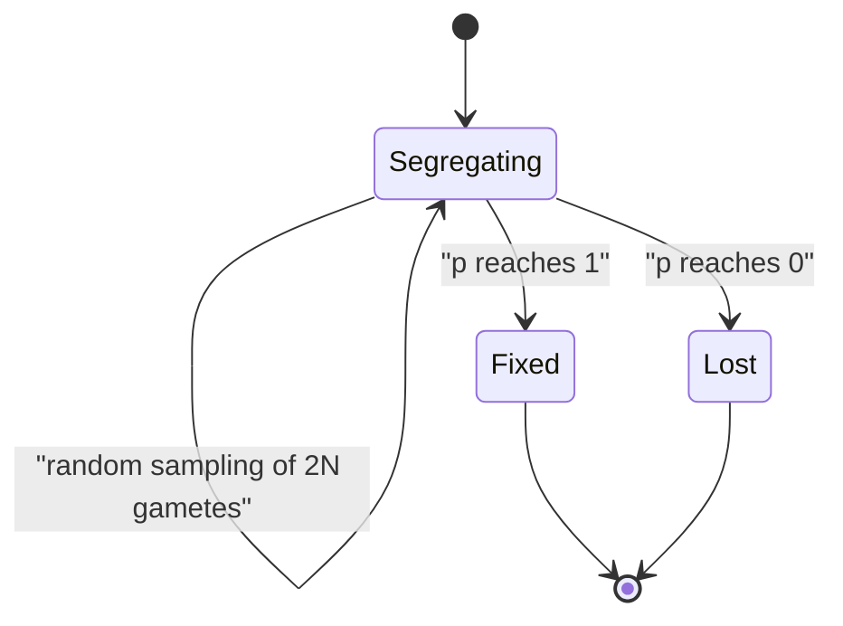

# Genetic Drift

## Definition

**Genetic drift** is the change of allele frequency between generations in a **finite**
population caused by **random sampling alone** — without selection, mutation or
migration.

## Why it matters

Drift is the null expectation for "something changed": in a small population an allele
frequency moves from one generation to the next for no biological reason at all. It
explains why rare variants are lost, why alleles become fixed, and why two isolated
subpopulations diverge — the origin of the population structure that confounds
[[genome-wide-association-study|GWAS]].

## Details

**Where it comes from**

In the [[wright-fisher-model]] the next generation is a random sample of `2N` gametes
from an effectively infinite gamete pool with allele frequency `p`. The number of `A`
alleles in the next generation is therefore binomially distributed:

```text
P{ n_A' = k } = B(2N, p)(k) = C(2N, k) · p^k · (1 - p)^(2N - k)
```

**States of a locus**

- `0 < p < 1` — the locus is **segregating** (both alleles present).
- `p = 1` — allele `A` is **fixed**.
- `p = 0` — allele `A` is **lost**.

Fixation and loss are absorbing: without mutation or migration, a locus that reaches
them never leaves.

**How fast does it drift?**

For the binomial `B(n, p)`: mean `np`, variance `np(1−p)`, standard deviation
`√(np(1−p))`. With `n = 2N` gametes, the frequency in the next generation is

```text
p' = ( 2Np ± √( 2N·p·(1-p) ) ) / 2N  =  p ± √( p·(1-p) ) / √(2N)
```

So the expected step size scales with `1/√(2N)`: as `N → ∞` the effect becomes smaller
and the frequency becomes effectively constant. In small populations the variance of the
allele frequencies grows generation by generation, and the frequencies of isolated
populations **drift apart**.

## Diagram


Without mutation or migration, drift is a random walk with two absorbing states.

## Relations

- [[wright-fisher-model]] — the model that derives drift as binomial sampling.
- [[population-genetics]] — drift is one of the four forces changing allele frequencies.
- [[hardy-weinberg-equilibrium]] — explicitly assumes an infinite population, i.e.
  **no** drift.
- [[probability-distribution]] — the binomial distribution supplies mean and variance.
- [[molecular-evolution]] — the neutral theory makes drift the main engine of sequence divergence.
- [[molecular-clock]] — if most accepted substitutions are neutral, their fixation rate is the mutation rate, which is what makes a clock plausible.

## Appears in

- [[L14-population-genetics]]
- [[E11-population-genetics-and-multiple-testing]]
- [[M2L08-molecular-evolution-and-phylogeny]] — drift is the neutral process behind the substitutions module-2 phylogeny counts.

## Sources

- `raw/module1/gsb_3.pdf`, pp. 21–22.
