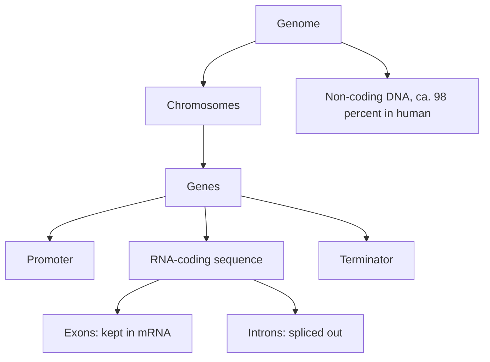

# Genome Organization

## Definition

Genome organization describes how an organism's total DNA is partitioned into
chromosomes, how genes are laid out within them, and how coding and non-coding sequence
are distributed — the structural facts that determine what a sequencing or assembly
experiment is up against.

## Why it matters

Genome size, chromosome count, repeat content and the coding fraction directly set the
difficulty of [[shotgun-sequencing]], [[next-generation-sequencing]] and assembly
([[L04-genome-assembly]]). They also explain why eukaryotic analysis needs spliced
alignment while bacterial analysis does not.

## Details

**Prokaryote vs eukaryote**

| | Prokaryote | Eukaryote |
|---|---|---|
| Nucleus | no | yes |
| Size | 0.1–5 µm | 10–100 µm |
| Organisation | unicellular | mostly multicellular |
| DNA form | circular | linear |
| Chromosomes | none (a nucleoid) | yes |

**Human numbers from the notes**

- 46 chromosomes, ≈ 3 Gbp of sequence, ≈ 20 000–25 000 protein-coding genes.
- ≈ 98 % non-coding, ≈ 2 % protein-coding; only ≈ 7–9 % estimated to be functional.
- An average chromosome ≈ 130 Mbp carrying ≈ 300 genes; an average gene spans
  1148 bp to 37.7 kb.
- Total DNA per cell ≈ 3 m, packed into a nucleus of ≈ 6 µm — a cell is 10–30 µm.

**Bacterial contrast**: *E. coli* has 4.6 Mbp on one chromosome with ≈ 3200 genes and
only ≈ 2 % non-coding DNA — gene-dense, almost no introns.

**Exons and introns**

- **Exons** are retained in mature mRNA; **introns** (Introns) are spliced out.
- A eukaryotic transcription unit reads: promoter — RNA-coding sequence (exons and
  introns) — terminator.
- Intron boundaries are marked in the notes by lower-case sequence between upper-case
  exons, e.g. `5'…CAAGAT…G gtaag….g GAT…3'` → mRNA `CAAGAU…G GAU…`.

## Diagram

Hierarchy from genome to the internal parts of a single eukaryotic gene.

## Relations

- [[central-dogma]] — splicing of this structure produces mature mRNA.
- [[homology]] — gene duplication within this layout creates paralogous gene families.
- [[boyer-moore-string-search]] — repetitive sequence is the worst case for suffix-based
  string search.
- [[gene-regulation]] — promoters, operators and enhancers are parts of this layout.
- [[dna-mutation]] — rearranges exactly these elements.
- [[epigenetics]] — the chromatin packing layer that makes 3 m fit into 6 µm.
- [[shotgun-sequencing]] and [[next-generation-sequencing]] — their difficulty is set by
  this layout.
- [[blast]] — paralogous and repetitive sequence in this layout produces spurious hits.
- [[population-genetics]] — the same genome seen as a population object: 22 autosome
  pairs plus XY/XX, diploid inheritance, and loci carrying alleles.

- [[chromatin]] — the DNA–protein complex that performs the packing, down to the
  nucleosome.
- [[cpg-island]] — one of the non-uniform compositional features of the genome.
- [[splicing]] — the step that removes the introns of this layout from the transcript.
- [[genetic-code]] — the exon sequence laid out here is what the triplet code is read
  from.
- [[promoter]] — the first element of a eukaryotic transcription unit.
- [[rna-seq]] — the exon/intron structure described here is why its reads need spliced
  alignment.
- [[microarray-expression-analysis]] — probe design depends on this exon structure.
- [[gene-tree-and-species-tree]] — gene families and duplicated copies are what make a gene tree diverge from the species tree.
- [[non-coding-rna]] — a large fraction of the genome is transcribed without ever coding for protein.

## Appears in

- [[L01-bioinformatics-and-the-cell]]
- [[L03-sequencing-and-genomics]]
- [[L06-expression-profiling]]
- [[L14-population-genetics]]
- [[L16-epigenetics]]
- [[E01-cell-biology-and-gene-expression]]

## Sources

- `raw/module1/gsb_part1.pdf`, pp. 2–3, 7, 10–11.
- `raw/module1/gsb_part2.pdf`, pp. 10, 18 — repeats as a string-search worst case and
  gene duplication in the globin family.
- `raw/module1/gsb_3.pdf`, p. 20 — chromosome sets, diploidy and the 2 % coding fraction.
- `raw/module1/gsb_part4.pdf`, pp. 1–2, 8 — nucleosomes and higher-order folding, and the
  uneven distribution of CpG dinucleotides.

- `raw/module2/csb_4.pdf`, p. 1 — the mRNA / ncRNA classification of transcripts.
