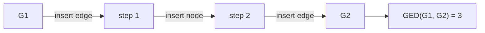

# Graph edit distance

## Definition

The graph edit distance (GED) with respect to edges is the **number of edges that must be
inserted or deleted to make `G₁` isomorphic to `G₂`** under a given node mapping `f`:

```text
GED(f) = | { (u,v)   ∈ E₁ : (f(u),  f(v))   ∉ E₂ } |
       + | { (u',v') ∈ E₂ : (f⁻¹(u'), f⁻¹(v')) ∉ E₁ } |
```

The first term counts edges of `G₁` with no image in `G₂`; the second counts edges of
`G₂` with no preimage in `G₁`. Both are *indels* in the sense of
[[sequence-alignment]] — the transformation of `G₁` into `G₂` is described "with indels".

## Why it matters

[[network-alignment]] can be phrased in two dual ways: **maximise what is shared**
(the MCES fitness `F(f)`, used by [[cytomcs]]) or **minimise what is not** (the GED,
used by [[gedevo]]). The second formulation is symmetric — it penalises missing edges in
*both* directions — where the MCES count only ever looks at edges of the smaller network.

## Details

- `GED(f) = 0` exactly when the mapping is an isomorphism; compare the condition
  `F(f) = |E₁| = |E₂|` in [[network-alignment]].
- The distance depends on the mapping `f`, so finding *the* graph edit distance between
  two networks means minimising over all mappings — which is NP-hard, hence
  [[gedevo]]'s [[evolutionary-algorithm]].
- A **node-level** version of the same count is used inside GEDEVO as `pairGED_f(u,v)`:
  the **relative number of indel edges incident to `u` or `v`** when mapping `u` to `v`.
  That localised GED is half of the `pairScore` that guides offspring construction.

## Diagram


The exercise example of p. 18: three edit operations turn G1 into G2, so the graph edit distance is 3.

## Relations

- [[network-alignment]] — the problem GED is one objective for.
- [[gedevo]] — minimises GED with an evolutionary algorithm.
- [[cytomcs]] — maximises the dual quantity, conserved edges.
- [[graphlet-degree-signature-distance]] — the other half of GEDEVO's `pairScore`,
  measuring local neighbourhood dissimilarity rather than edge mismatch.
- [[sequence-alignment]] — edit distance on strings is the direct ancestor of this idea;
  insertions and deletions, one dimension up.
- [[algorithmic-complexity]] — minimising GED over all mappings is NP-hard.

## Appears in

- [[M2L10-network-alignment]]
- [[M2E10-network-alignment]]

## Sources

- `raw/module2/csb_4.pdf`, p. 15 — the GED definition and formula.
- `raw/module2/csb_4.pdf`, p. 16 — `pairGED` as the local version.
- `raw/module2/csb_4.pdf`, p. 18 — the worked `GED(G1,G2) = 3` example.
