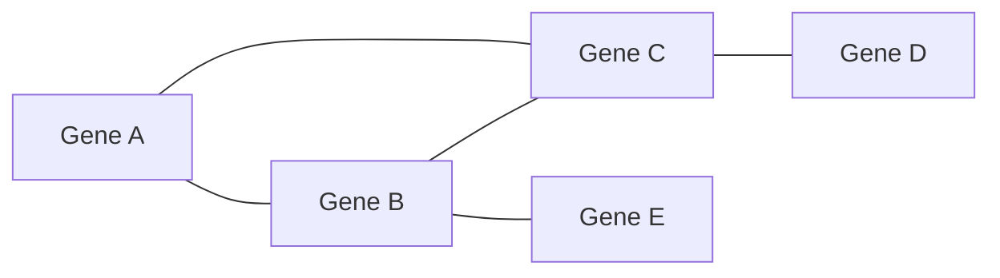
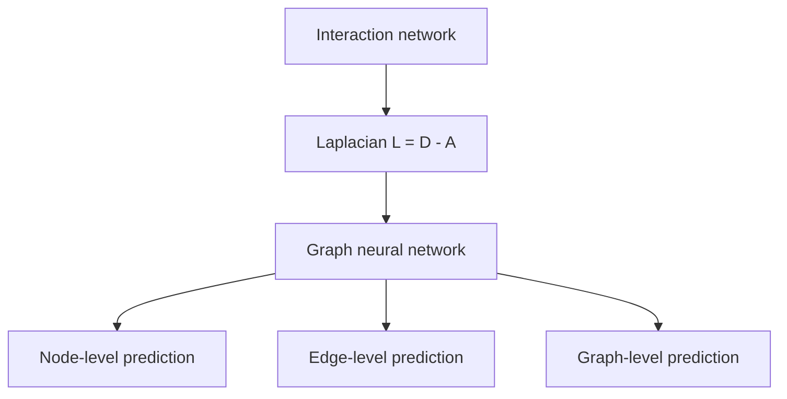

# Graph Neural Network

## Definition

A **graph neural network (GNN)** is a [[deep-learning]] architecture whose connections
follow the edges of a graph rather than a grid or a sequence, so that each node's
representation is built from its neighbours'.

## Why it matters

The notes give the motivation in one line:

> **Biological networks are graphs.**

Every network-based method in module 2 — [[keypathwayminer]], [[grandforest]],
[[bicon]] — reaches the same conclusion from a different direction: the
[[interaction-network]] is prior knowledge, and restricting a model to respect it turns
an underdetermined search into a tractable one. A GNN is the deep-learning version of
that constraint, with the connection pattern **bound to the local connection to
connected neighbours** instead of being fully connected.

## Details

**The three prediction tasks** named in the notes:

| Task | Question |
|---|---|
| **Node-level prediction** | what is this node? — e.g. is this gene disease-associated? |
| **Edge-level prediction** | should these two nodes be connected? — link prediction in an interactome |
| **Graph-level prediction** | what is this whole graph? — e.g. classify a molecule |

**The Laplacian.** The notes record the one formula that makes a graph differentiable:

```text
L = D − A          // Laplacian = degree matrix − adjacency matrix
```

`A` is the adjacency matrix of the [[interaction-network]] and `D` the diagonal matrix of
node degrees. `L` is the discrete analogue of a second derivative on the graph: applied
to a vector of node values it returns, for each node, how far that node's value is from
the average of its neighbours. That is exactly the quantity a convolution on a graph
needs, which is why spectral GNNs are built from `L`.

> The notes name the tasks and the Laplacian but do not develop the message-passing
> update or the spectral derivation. See [[open-questions]].

## Diagram


A GNN propagates each node's features to its neighbours along exactly these edges, instead of connecting every node to every other.


The adjacency and degree matrices of a biological network give the Laplacian, from which a GNN is built, serving three prediction tasks.

## Relations

- [[interaction-network]] — the graph a biological GNN runs on.
- [[deep-learning]], [[neural-network]] — the family and the fully connected baseline.
- [[convolutional-neural-network]] — the same idea on a grid: local connections and
  shared weights; a graph convolution generalises it to irregular neighbourhoods.
- [[grandforest]] — the non-deep answer to the same question: constrain the learner to
  connected subnetworks of the interactome.
- [[keypathwayminer]], [[bicon]] — the other network-constrained searches in module 2.
- [[de-bruijn-graph]], [[hamiltonian-and-eulerian-paths]] — the module-1 reminder that
  the representation of a biological problem as a graph is itself the decisive modelling
  step.
- [[recurrent-neural-network]] — the sibling architecture, for sequential rather than
  relational structure.
- [[umap]] — both operate on a k-nearest-neighbour graph of the data.

## Appears in

- [[M2L06-deep-learning]]

## Sources

- `raw/module2/csb_3.pdf`, p. 8 — simple neural networks on graphs: motivation
  ("biological networks are graphs", local connection to connected neighbours),
  node-level, edge-level and graph-level prediction, and the Laplacian as
  `degree matrix − adjacency matrix`.
