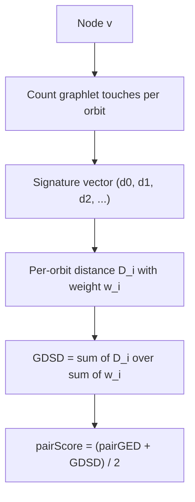

# Graphlet degree signature distance

## Definition

The graphlet degree signature distance (GDSD) is **a topological measure of how dissimilar
the local neighbourhoods of two nodes are**. It generalises the node degree: instead of
counting edges at a node, it counts how often the node sits at each **orbit** of each
small subgraph pattern, and compares the resulting vectors.

## Why it matters

Two nodes in two different species' PPI networks cannot be compared by name. GDSD gives a
purely topological answer to "do these two proteins sit in similar surroundings?", and it
is half of the `pairScore` that [[gedevo]] uses when it builds offspring during
[[network-alignment]]. It is the topological counterpart to the sequence-based
[[substitution-matrix]] score of module 1.

## Details

### Graphlets and orbits

- A **graphlet** is a **small, connected, non-isomorphic, induced subgraph**.
- Within a graphlet, nodes may occupy structurally distinct positions; each such position
  is an **orbit**. The simplest graphlet `G₀` is a single edge, with one orbit (0); the
  three-node path `G₁` has two orbits (1 and 2), and so on.
- The **graphlet degree** `dᵢ^v` is **the number of times node `v` touches a graphlet at
  orbit `i`**. The vector `(d₀^v, d₁^v, …)` over all orbits is the node's **signature**;
  `d₀^v` is just the ordinary node degree.

### The distance

Per orbit `i`:

```text
                    | log(dᵢ^u + 1) − log(dᵢ^v + 1) |
Dᵢ(u,v) = wᵢ  ×  ──────────────────────────────────────
                      log( max(dᵢ^u, dᵢ^v) + 2 )
```

Aggregated over all orbits:

```text
             Σᵢ Dᵢ(u,v)
GDSD(u,v) = ─────────────
               Σᵢ wᵢ
```

- The **logarithms** compress counts that differ by orders of magnitude between hubs and
  leaves.
- The `+1` and `+2` keep the expression defined when a count is zero.
- The **weights `wᵢ` adjust for redundancy due to some orbits being part of others** — a
  node that touches a triangle necessarily also touches edges, so the orbit counts are not
  independent and would otherwise be counted several times.
- `GDSD(u,v) = 0` means the two signatures are identical over all orbits.

### Where it is used

In [[gedevo]], for `u ∈ V₁`, `v ∈ V₂` with `u = f(v)`:

```text
                   pairGED_f(u,v) + GDSD(u,v)
pairScore_f(u,v) = ──────────────────────────
                               2
```

so a node pair is judged half by how many edges the mapping breaks
([[graph-edit-distance]]) and half by how different their neighbourhoods look.

## Diagram


From orbit counts to a node signature to the pair score GEDEVO optimises locally.

## Relations

- [[gedevo]] — the algorithm that consumes GDSD in its `pairScore`.
- [[graph-edit-distance]] — the other half of that score.
- [[network-alignment]] — the problem both serve.
- [[interaction-network]] — the networks whose node neighbourhoods are compared.
- [[substitution-matrix]] — the sequence-level analogue: a score for "how
  interchangeable are these two units?".
- [[evolutionary-distance]] — another place where a raw count is log-transformed before
  being used as a distance.

## Appears in

- [[M2L10-network-alignment]]
- [[M2E10-network-alignment]]

## Sources

- `raw/module2/csb_4.pdf`, p. 16 — graphlet, orbit, graphlet degree, the `Dᵢ` and `GDSD`
  formulas, the weights, and the `pairScore` they enter.
- `raw/module2/csb_4.pdf`, p. 19 — the exercise signature table and the restated formulas.
