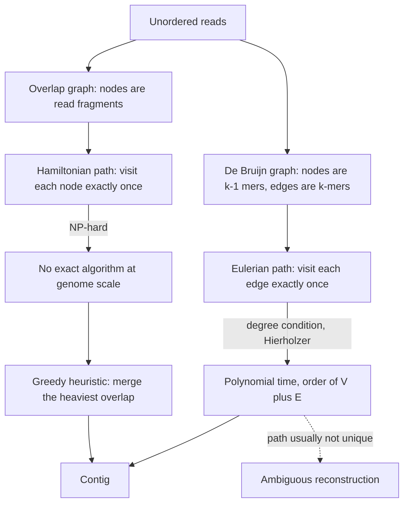

# Hamiltonian and Eulerian paths

## Definition

A **Hamiltonian path** through a graph visits each **node** exactly once; an **Eulerian
path** visits each **edge** exactly once. Both are candidate formulations of genome
assembly, but finding a Hamiltonian path is **NP-hard**, whereas an Eulerian path can be
found in **polynomial time**.

## Why it matters

[[L04-genome-assembly]] reformulates assembly as a graph problem, and the choice of
formulation decides whether the problem is tractable at all. Reads as nodes
(an **overlap graph**) demands a Hamiltonian path; *k*-mers as edges (a
[[de-bruijn-graph]]) demands an Eulerian path. That single change of representation —
from visiting nodes to visiting edges — is what makes short-read assembly computationally
feasible, and it is the course's canonical illustration of the polynomial/exponential
boundary of [[algorithmic-complexity]].

## Details

**The two graph formulations of assembly**

- **Overlap graph**: nodes are sequence fragments (reads), edges are overlaps between
  them, weighted by the length of the longest suffix–prefix match. Every read must end up
  in the reconstruction exactly once ⇒ visit every **node** once ⇒ Hamiltonian path.
- **De Bruijn graph**: nodes are (k−1)-mers and each edge is a *k*-mer observed in the
  reads, an edge running from `u` to `v` when `v` results from `u` by shifting one
  character left and appending a new character. Every observed *k*-mer must be used
  exactly once ⇒ visit every **edge** once ⇒ Eulerian path.

**Comparison**

| | **Hamiltonian path** | **Eulerian path** |
|---|---|---|
| What is visited exactly once | every **node** | every **edge** |
| Graph it is posed on | overlap graph (nodes = read fragments) | [[de-bruijn-graph]] (nodes = (k−1)-mers, edges = *k*-mers) |
| Complexity | **NP-hard** | **polynomial time**, `O(\|V\| + \|E\|)` by Hierholzer |
| Assembler using it | [[greedy-assembly]] — the exact formulation it heuristically approximates | [[de-bruijn-assembly]] |
| Pairwise alignment needed? | yes — all-against-all overlaps, `O(n² · k)` | no explicit alignment computation, hence fast |
| Uniqueness of the solution | — | usually **not unique**: many traversals fit the same *k*-mer set |

Because the Hamiltonian formulation is NP-hard, [[greedy-assembly]] does not solve it: it
takes the heaviest overlap edge available, merges, and repeats — a locally optimal
heuristic whose dominant failure mode is **repeat regions**, which it collapses or
misorders.

**Degree conditions and Hierholzer's algorithm**

[[de-bruijn-assembly]] states the existence condition directly inside its Eulerian-path
routine: *an Eulerian path exists if at most one vertex has `outdeg − indeg = 1` and at
most one has `indeg − outdeg = 1`*. The traversal starts at the vertex with
`outdeg − indeg = 1`, or else at any vertex with `outdeg > 0`.

```text
EULERIAN-PATH(V, E):
  // Hierholzer: an Eulerian path exists if at most one vertex has
  // outdeg - indeg = 1 and at most one has indeg - outdeg = 1
  s ← vertex with outdeg - indeg = 1, else any vertex with outdeg > 0
  stack ← [s]; path ← []
  while stack not empty:
    u ← TOP(stack)
    if u has an unused outgoing edge e = (u, v):
      MARK-USED(e)
      PUSH(stack, v)
    else:
      PUSH(path, POP(stack))
  return REVERSE(path)
```

Hierholzer's algorithm runs in `O(|V| + |E|)`. No comparable procedure exists for the
Hamiltonian case — there is no degree condition to check and no polynomial traversal.

**Reading the path back out**

Along an Eulerian path through a de Bruijn graph the first node contributes its whole
(k−1)-mer and every further step contributes exactly one base. The worked 4-mer example
of [[E03-de-bruijn-assembly]] walks
`GAC → ACG → CGG → GGC → GCG → CGT → GTG → TGA → GAC → ACG → CGT` and spells out
`GACGGCGTGACGT`; note that the node `ACG` is revisited — permitted, since it is the
*edges* that may not repeat.

**Trade-off recorded in the notes for the Eulerian route**: (+) no explicit alignment
computation, so it is fast; (+) far less complex, polynomial time; (−) the Eulerian path
is usually **not unique**, so the reconstruction is ambiguous and the graph artifacts —
spurs, bubbles, cycles and frayed ropes — must be interpreted before and during the
traversal.

## Diagram


The two formulations of assembly, their complexity consequences, and the ambiguity that is the price of the Eulerian route.

## Relations

- [[de-bruijn-graph]] — the structure on which the Eulerian formulation is posed; its edges are the *k*-mers to be traversed once each.
- [[de-bruijn-assembly]] — the assembler that finds the Eulerian path, including the degree condition and Hierholzer's algorithm.
- [[greedy-assembly]] — the overlap-graph assembler whose exact underlying formulation is the NP-hard Hamiltonian path.
- [[algorithmic-complexity]] — supplies the polynomial-versus-exponential hierarchy that makes the contrast decisive.
- [[shotgun-sequencing]] — produces the unordered fragments that become nodes or *k*-mers.
- [[next-generation-sequencing]] — the short reads and their repeat coverage behaviour that break the Hamiltonian route.
- [[dna-mutation]] — repeats, duplications and variants are what create the cycles and bubbles encountered along a traversal.
- [[sequence-alignment]] — the overlap edges of the Hamiltonian formulation are computed with free-end-gap alignments; the Eulerian route avoids this step entirely.
- [[travelling-salesman-problem]] — the weighted, closed version of the Hamiltonian
  problem: a Hamiltonian **cycle** of minimum total length. Module 2 reaches the same
  NP-hard wall from the optimisation side and answers it with
  [[ant-colony-optimization]] rather than by reformulating the graph.
- [[gene-ontology]] — another directed graph in these notes, but acyclic: a DAG, so it
  admits no cycle at all.
- [[transclust]] — another graph problem whose hardness forces heuristics instead of exact search.
- [[phylogenetic-tree]] — another super-exponential space over a graph, resolved the same way: build greedily instead of enumerating.
- [[graph-neural-network]] — learning on graphs rather than searching them.
- [[network-alignment]] — another graph problem whose hardness forces heuristics rather than exact solutions.

## Appears in

- [[L04-genome-assembly]]
- [[L07-algorithms-and-complexity]]
- [[E02-greedy-assembly]]
- [[E03-de-bruijn-assembly]]
- [[M2L01-enrichment-analysis]]

## Sources

- `raw/module1/gsb_part1.pdf`, pp. 15–16, 19–23 — the graph formulation of assembly, the Hamiltonian/Eulerian contrast, the de Bruijn construction and the worked traversal.
- `raw/module2/csb_1.pdf`, pp. 9, 11 — the travelling salesman problem as the example
  application of ant colony optimization.
- Consolidated from [[de-bruijn-graph]], [[de-bruijn-assembly]], [[greedy-assembly]] and [[L04-genome-assembly]]; see those pages for the original `raw/` page references.

- `raw/module2/csb_4.pdf`, pp. 11–12 — NP-hardness of network alignment.
