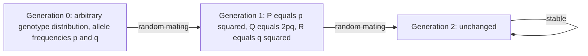

# Hardy–Weinberg Equilibrium

## Definition

For two alleles `A` and `a` with allele frequencies `p` and `q = 1 − p`, the genotype
frequencies `P`, `Q`, `R` of the genotypes `AA`, `Aa`, `aa` are in **Hardy–Weinberg
equilibrium (HWE)** if

```text
P = p²        Q = 2pq        R = q²
```

The **Hardy–Weinberg principle** states that these frequencies are reached after a single
generation of random mating and then stay constant.

## Why it matters

HWE is the null model of [[population-genetics]]: it says what the genotype distribution
looks like when **nothing** is happening. A locus that deviates from HWE in a sample is
either under some evolutionary force or — much more commonly in practice — genotyped
badly, which is why a HWE test is a standard quality-control filter before a
[[genome-wide-association-study]].

## Details

**Assumptions**

- Diploid organisms with sexual reproduction.
- Allele frequencies identical for males and females.
- The locus has exactly two different alleles.
- Non-overlapping generations.
- Random mating.
- Large — formally infinite — population, i.e. **no [[genetic-drift]]**.
- No migration, no mutation, no selection.

**Derivation with a Punnett square**

Male gametes carry `A` with probability `p` and `a` with probability `q`; the same holds
for female gametes. Combining them:

| | `A` (p) | `a` (q) |
|---|---|---|
| **`A` (p)** | `AA` : p² | `Aa` : pq |
| **`a` (q)** | `aA` : pq | `aa` : q² |

After one change of generations (Generationswechsel):

```text
P' = p²        Q' = 2pq        R' = q²
```

**Back from genotype to allele frequencies**

```text
P(A) = P(AA) + ½ · P(Aa)
P(a) = P(aa) + ½ · P(aA)
```

**Properties**

- HWE is **stable**: once reached, the distribution reproduces itself.
- It is reached **in one generation**, and two *different* starting genotype
  distributions with the same allele frequencies converge to the *same* HWE.
- This holds **only** under the HW assumptions above.
- In the absence of selection, mutation, drift or other forces, the allele frequencies
  `p` and `q` themselves are constant between generations.

**More than two alleles**

For three alleles `A₁, A₂, A₃` with frequencies `p, q, r` the same square gives six
genotypes:

```text
A1A1 = p²     A1A2 = 2pq     A1A3 = 2pr
A2A2 = q²     A2A3 = 2qr     A3A3 = r²
```

**Sex-specific allele frequencies**

If males and females start with different genotype distributions, one generation of
random mating equalises the **allele** frequencies between the sexes, and the generation
after that reaches HWE — two generations in total.

## Diagram


One generation of random mating is enough; afterwards the distribution reproduces itself.

## Relations

- [[population-genetics]] — HWE is its null model.
- [[genetic-drift]] — the force excluded by the infinite-population assumption.
- [[wright-fisher-model]] — the finite-population counterpart, where frequencies move.
- [[genome-wide-association-study]] — HWE deviation is a routine QC filter on SNPs.
- [[probability-distribution]] — the square is a two-term multiplication of
  probabilities.
- [[snp]] — deviation from HWE at a SNP is a routine genotyping-quality filter.
- [[haplotype-phasing]] — the genotype frequencies derived here underlie the ambiguity of
  the heterozygous sites it has to resolve.

## Appears in

- [[L14-population-genetics]]
- [[E11-population-genetics-and-multiple-testing]]

## Sources

- `raw/module1/gsb_3.pdf`, pp. 24–25, 31.
