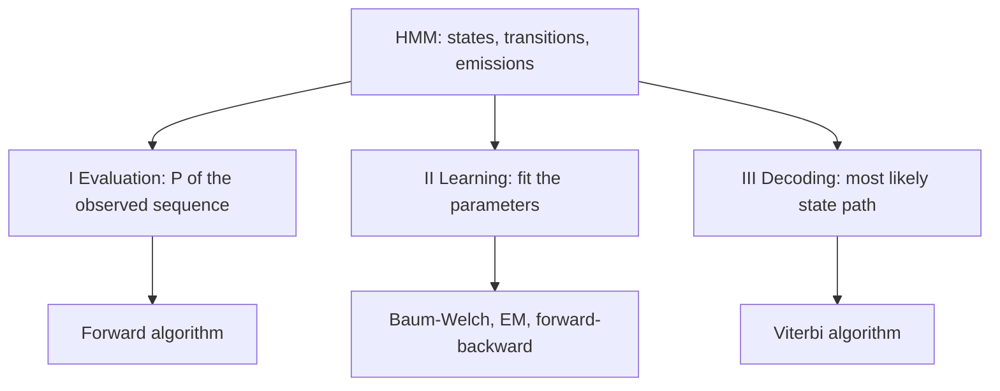
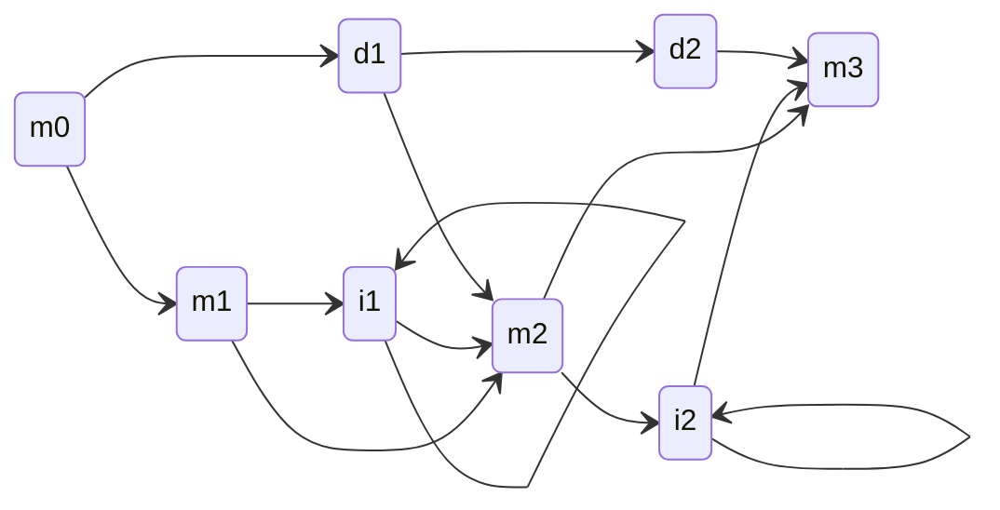

# Hidden Markov model

## Definition

A hidden Markov model (HMM, Hidden-Markov-Modell) is a **generalization of a
[[markov-chain]]** in which the states themselves are **not observed**. Two kinds of
probability are involved:

- **states of the model** (the **hidden** state) — connected by **transition**
  probabilities `P(transition)`, written `T(r | q)`: the probability of moving to state
  `r` from state `q`;
- **observable events** (the **observable** state) — produced by **emission**
  probabilities `P(emission)`, written `P(x | q)`: the probability that letter `x` is
  emitted in state `q`.

As in a plain Markov chain, the transition probability **depends only on the previous
state**.

### Two emission conventions (Moore vs Mealy)

The notes use **two different conventions** for where the emission probability lives, and
the clash is visible across this wiki, so it is stated here once and referred to from the
algorithm pages:

| Convention | Emission written | Where it appears in the notes |
|---|---|---|
| **Emission on the state** (Moore-type) | `P(x \| q)` — state `q` emits letter `x` | `gsb_part4.pdf` pp. 14–15, the definition above, and the pseudocode of [[viterbi-algorithm]], [[forward-algorithm]] and [[baum-welch-algorithm]] |
| **Emission on the transition** (Mealy-type) | `P(x \| q → r)` — the *move* from `q` to `r` emits `x` | `gsb_part4.pdf` p. 20, the exercise model worked through in [[E13-markov-chains-and-viterbi]] |

**Which is standard:** the **state-emission** form is the standard HMM definition in
bioinformatics (Durbin et al.; profile HMMs; HMMER) and is the one used for every
pseudocode block on this wiki. The transition-emission form is equally expressive — any
Mealy-type HMM can be converted to a Moore-type one by splitting each state into one copy
per incoming transition — but it changes the recursion by one factor:

```text
state emission:       V[ℓ,i] ← P(x[i] | ℓ)      · max_k ( V[k,i-1] · T(ℓ | k) )
transition emission:  V[ℓ,i] ←                    max_k ( V[k,i-1] · T(ℓ | k) · P(x[i] | k → ℓ) )
```

Neither reading is wrong; the arithmetic of the first trellis column on p. 20 only works
under the transition-emission reading, so that exercise is kept in its own convention and
flagged on the page. See [[open-questions]].

## Why it matters

The example given in the notes is **determination of coding versus non-coding regions in
DNA**, i.e. **gene prediction**: the sequence of bases is observed, the label
"coding / intergenic / start-stop" is hidden, and the model recovers the labels. The
other application is **protein sequence modelling** through profile HMMs, the basis of
family databases and the tool **HMMER**.

## Details

### The three assumptions

| Assumption | Statement |
|---|---|
| **Markov assumption** | the next state depends only on the current state |
| **Stationary assumption** | state transition probabilities are independent of time |
| **Output independence assumption** | the current observation is independent of previous observations |

### The three problems

The notes organise everything around three canonical problems:

**I) Evaluation** — *given a model and an output sequence, what is the probability that
the model generated that output?* The answer requires summing over **all possible paths**,
done efficiently by the [[forward-algorithm]]:

```
P(x₁ … x_L, q₀ … q_{N+1} | model) = T(q_{N+1} | q_N) · ∏_{i=1}^{N} T(q_i | q_{i-1}) · P(x_i | q_i)
P(x₁ … x_L | model) = Σ over all paths of the above
```

**II) Learning** — *given a model and a set of observed sequences, how do we set the
model's parameters so that it has a high probability of generating those sequences?* This
allows all probabilities in an HMM to be determined from an ensemble of training data;
solved by the [[baum-welch-algorithm]] (the EM / forward–backward algorithm).

**III) Decoding** — *given a model and an output sequence, what is the most likely state
sequence through the model that generated the output?* This gives a way to match up an
observed sequence with the states in the model; solved by the [[viterbi-algorithm]].


The three HMM problems and the algorithm that solves each.

### Model scoring

`P(seq's | model)` is **the probability of a set of training sequences `s(1), …, s(n)`**
— the quantity that learning maximises, usually reported as a **negative log likelihood**
`NLL-score = −log P(seq's | model)`. The full treatment of maximum likelihood, the NLL
score and its maximum-a-posteriori variant is on [[baum-welch-algorithm]].

### Profile HMMs

For **protein sequence generation** the notes draw the standard profile architecture,
derived from a multiple sequence alignment ([[sequence-alignment]]):

- `m` = **match state** — a position in the protein, i.e. a column of the MSA;
- `i` = **insert state** — extra residues not present in the model, with a self-loop so
  insertions of any length are possible;
- `d` = **delete state** — a silent state that skips a match column.

The sketch has match states `m₀ → m₁ → m₂ → m₃` with `M = 2` and a labelled transition
`T(m₃ | m₂)`, insert states between them and delete states above them.


Profile HMM architecture: a chain of match states with parallel insert states carrying self-loops and delete states that bypass a column.

### A gene-finding HMM

The decoding example of p. 17 uses two states, `H` and `L`, each emitting `A`, `C`, `G`
and `T` with different probabilities, with transitions in both directions and self-loops.
The relevant hidden labels in the biological version are **intergenic**, **start/stop**
and **coding** states, and the **model can be used to predict the region of coding DNA
from a given sequence**.

### Advantages and disadvantages

| Advantages | Disadvantages |
|---|---|
| statistics — a proper probabilistic framework | state independence — the assumptions are often violated |
| transparency — states have an interpretation | local maxima — EM training is not guaranteed to find the global optimum |
| modularity — architectures can be composed | over-fitting — many parameters, few data |
| prior knowledge can be put into the topology and the initialisation | speed |

### Good solutions for

multiple sequence alignment (MSA), sequence clustering, protein classification, and
protein domain identification. The named tool is **HMMER**.

## Relations

- [[markov-chain]] — the observed-state special case the HMM generalizes.
- [[forward-algorithm]] — solves the evaluation problem.
- [[viterbi-algorithm]] — solves the decoding problem.
- [[baum-welch-algorithm]] — solves the learning problem.
- [[sequence-alignment]] — profile HMMs are built from, and used to build, multiple
  alignments.
- [[position-weight-matrix]] — a simpler, gapless motif model with no state structure.
- [[blast]] — the heuristic alternative for database search; HMMER searches with a
  profile instead of a single query.
- [[probability-distribution]] — emissions and transitions are discrete distributions.
- [[dynamic-programming]] — the table-filling pattern behind the forward and Viterbi
  trellis recursions.

- [[expectation-maximization]] — the general framework of which [[baum-welch-algorithm]] is the HMM instance.
- [[information-content]] — entropy of an emission distribution, the same quantity used to score motif columns.
- [[cpg-island]] — the classic hidden-state application, also given in module 2 as an EM example.
- [[recurrent-neural-network]] — the deep-learning successor for sequence modelling; attention replaces the fixed state transition.
- [[jukes-cantor-model]] — the substitution models of phylogeny are the same state-transition machinery with observable states.
- [[neural-network]] — both are parameterised models fitted by iterative optimisation rather than counting.
- [[maximum-likelihood]] — the criterion by which the model's transition and emission probabilities are set during learning.

## Appears in

- [[L17-markov-chains-and-hidden-markov-models]]
- [[E13-markov-chains-and-viterbi]]
- [[M2L02-sequence-motifs-and-motif-discovery]] — the module-2 motif lecture contrasts the PWM's independent columns with HMM state dependence.

## Sources

- `raw/module1/gsb_part4.pdf`, p. 14 (definition, probability types, evaluation),
  p. 15 (profile HMM architecture, assumptions), p. 16 (learning), p. 17 (decoding,
  gene prediction, HMMER), p. 18 (summary, advantages, disadvantages, applications).

