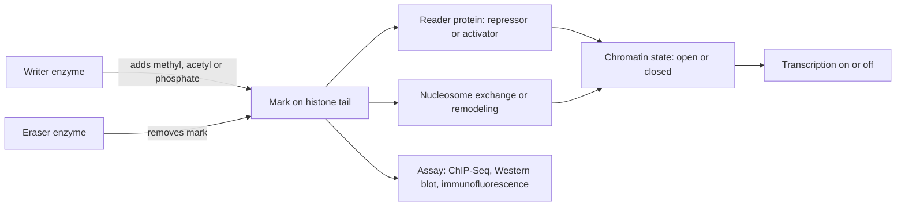

# Histone modification

## Definition

A histone modification (Histonmodifikation) is any **covalent addition of a chemical
group** to a histone protein — most commonly **methylation**, **acetylation** or
**phosphorylation** of a residue in a histone tail. The marks are established and removed
while the histones sit in nucleosomes, or by exchanging the histones themselves.

## Why it matters

Histone modifications are associated with **chromatin structure**: they decide whether a
region of [[chromatin]] is open or closed, and therefore whether it can be transcribed.
They are the second mark type of [[epigenetics]] alongside [[dna-methylation]], and the
main readout of [[chip-seq]].

## Details

### Nomenclature

The name encodes histone, residue, position and mark, as drilled in the exercise:

| Mark | Reading |
|---|---|
| `H3K4me1` | Histone 3 **mono**methylated at lysine 4 |
| `H3K9me3` | Histone 3 **tri**methylated at lysine 9 |
| `H4K20me2` | Histone 4 **di**methylated at lysine 20 |
| `H3K4Ac` | Histone 3 **acetylated** at lysine 4 |

`K` is the one-letter code for lysine; the number is the residue position in the tail;
`me1/me2/me3` is the number of methyl groups and `Ac` denotes acetylation.

### Writers, erasers, readers

- Modifications are **controlled by specific enzymes in forward and reverse reaction** —
  every mark can be written and removed again.
- **Effect of altered acetylation**: opening or closing of chromatin for transcription.
- **Readers** of histone modifications:
  - marks **recruit proteins** to chromatin;
  - demethylases often **read other marks** in order to be targeted correctly;
  - **repressors and activators recognize** the marks.

> [!note] Added beyond lecture notes
> Source: general domain knowledge (Strahl & Allis, *Nature* 403:41, 2000, "the language
> of covalent histone modifications"; Bannister & Kouzarides, *Cell Research* 21:381,
> 2011; ENCODE/Roadmap chromatin-state annotations). Not from the UHH handwritten notes.
>
> **The histone code.** The notes give the nomenclature and the write/erase/read cycle but
> never say *which* mark means *what*. The working hypothesis of the field is that
> combinations of tail marks form a **code** that is read by effector proteins and
> translated into a chromatin state — so a mark is a signal, not a switch, and its meaning
> depends on the residue, the degree of methylation and the genomic context.
>
> | Mark | Where it sits | What it signals |
> |---|---|---|
> | `H3K4me3` | promoters of active genes | **active / poised promoter**, sharp peak over the TSS |
> | `H3K4me1` | distal elements | **enhancer**, primed or active |
> | `H3K27ac` | enhancers and promoters | the element is **active**, not merely primed |
> | `H3K36me3` | bodies of transcribed genes | **transcriptional elongation**, co-transcriptional |
> | `H3K27me3` | developmental gene clusters | **Polycomb repression**, *facultative* heterochromatin |
> | `H3K9me3` | repeats, pericentromeres | **constitutive heterochromatin**, permanent silencing |
>
> The last two rows are the reason a ChIP-Seq experiment for a repressive mark produces
> **broad domains** while `H3K4me3` produces narrow peaks — the distinction
> [[chip-seq]] and [[peak-calling]] already draw between narrow and broad callers.
>
> **Bivalent domains.** In embryonic stem cells many developmental promoters carry
> `H3K4me3` *and* `H3K27me3` at the same time: repressed but poised for rapid activation.
> Differentiation resolves the bivalency to one mark or the other, which is one concrete
> mechanism for the tissue-specific expression [[epigenetics]] starts from.
>
> **Which enzymes.** The notes say only "specific enzymes in forward and reverse
> reaction". The families are:
>
> | Role | Acetylation | Methylation |
> |---|---|---|
> | Writer | **HATs** — p300/CBP, GCN5 | **KMTs** (SET domain) — MLL/KMT2 for H3K4, **EZH2** in **PRC2** for H3K27, SUV39H1 for H3K9 |
> | Eraser | **HDACs** | **KDMs** — LSD1, the JmjC family |
> | Reader | **bromodomain** (e.g. BRD4) | **chromodomain** (HP1 at H3K9me3, CBX in PRC1), **PHD finger** (at H3K4me3) |
>
> **Why acetylation opens chromatin.** The notes assert the effect; the mechanism is
> electrostatic. Lysine carries a positive charge that grips the negatively charged DNA
> backbone. Acetylation **neutralises** that charge, loosening the histone–DNA contact,
> and in addition creates a bromodomain docking site that recruits remodellers and
> coactivators. Deacetylation by an HDAC restores the charge and the grip — which is why
> HDAC inhibitors act as general de-repressors ([[chromatin]]).
>
> **Polycomb and Trithorax.** The two antagonistic complex families are the canonical
> example of the code being maintained through division: **PRC2** writes `H3K27me3` and
> **PRC1** reads it and ubiquitinates H2AK119, while **Trithorax/MLL** complexes write
> `H3K4me3` at the same loci in the active state. PRC2 also *reads* its own product, which
> gives a read-write feedback loop — the standard answer to the inheritance problem the
> notes raise below, though it remains only a partial one.

### Nucleosome exchange — regulating histone density

Three mechanisms (p. 3):

1. Histones are assembled by **general histone chaperones** into newly formed
   nucleosomes.
2. Single modified histones of **dimers or tetramers** can be exchanged by **specific
   chaperones** against unmodified histones or **histone variants**.
3. Nucleosomes can be **moved along the DNA** to release or hide certain DNA sequences
   for recognition — **nucleosome remodeling**.

### Nucleosome assembly

- Deposition of histones in chromatin is catalyzed by specific enzymes
  (**histone chaperones**), which guide histone complexes to a part of the DNA.
- Important for **DNA replication** and **DNA repair**.
- The notes raise this explicitly as an open problem: *how are histone modifications
  inherited when a new nucleosome is formed, given that the new nucleosome is
  unmodified?*
- **Histone variants**: transcription is linked to changes in the nucleosome and histone
  composition, not only to the marks.

### Methods for analysis

| Question | Method |
|---|---|
| Are modified histones present in the cells? | **Western blot**, **indirect immunofluorescence** |
| Which genomic regions carry the mark, qualitatively and quantitatively? | **[[chip-seq]]** (chromatin immunoprecipitation), analysed region by region |

The notes gloss ChIP in German as *"Technik um Bindungsstellen von TFs auf der DNA zu
detektieren"* — a technique to detect binding sites of transcription factors on the DNA.
The mapped reads are then turned into regions by [[peak-calling]].

## Diagram

The write–erase–read cycle of a histone mark and the two routes by which it reaches chromatin state.

## Relations

- [[chromatin]] — the structure whose condensation these marks control.
- [[epigenetics]] — histone modification is one of its two chemical mark types.
- [[dna-methylation]] — the other mark type; the two act together to silence promoters.
- [[chip-seq]] — the genome-wide assay for a given mark.
- [[peak-calling]] — turns ChIP-Seq reads into the broad domains typical of histone marks.
- [[gene-regulation]] — acetylation opening chromatin is a prerequisite for activators to
  act.
- [[atac-seq]] — nucleosome positioning, which these marks help set, determines what the
  Tn5 transposase can reach.

## Appears in

- [[L16-epigenetics]]
- [[E12-epigenetics-and-peak-calling]]

## Sources

- `raw/module1/gsb_part4.pdf`, pp. 3–4 (modifications, readers, nucleosome exchange,
  assembly, analysis methods), p. 11 (nomenclature exercise).
