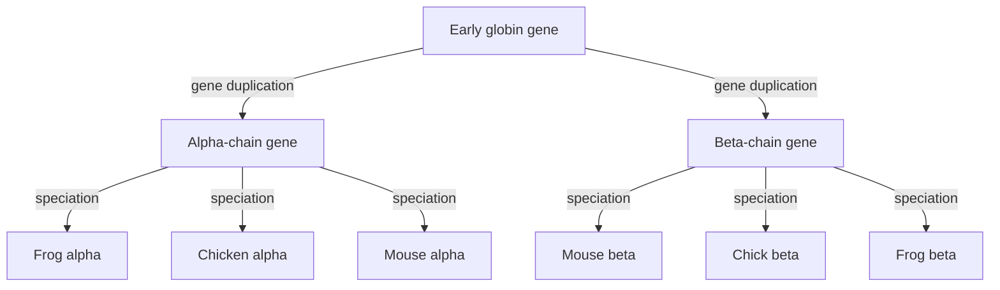

# Homology

## Definition

Two sequences (or two proteins) are **homologous** when they share a **common ancestor**.
Homology is a statement about history, not about a percentage: it is either true or
false, and it is *inferred* from similarity rather than measured directly.

## Why it matters

Almost every functional annotation in biology is transferred by homology: a newly
sequenced gene is assigned a function because it is homologous to a characterised gene
elsewhere. The inference chain runs
**alignment score → similarity → statistical significance → homology → shared function**,
and every step can fail. [[sequence-alignment]] supplies the score,
[[blast]] supplies the significance, and this page supplies the vocabulary.

## Details

**Homologue types**

| Term | Origin | Relationship |
|---|---|---|
| **Orthologs** | speciation | homologous sequences in **different species** that arose from a common ancestral gene when the species split; they may or may not have a similar function |
| **Paralogs** | gene duplication | homologous sequences **within one species** that arose by duplication of an ancestral gene |

Both are homologs; the distinction is *which event* separated them.

**Measuring the evidence**

| Term | Meaning |
|---|---|
| **Identity** | the extent to which two sequences are invariant — the same residue at the same position |
| **Conservation** | changes at a position that preserve the physico-chemical properties of the original residue (e.g. one hydrophobic residue for another) |
| **Similarity** | identity **plus** conservation |

Conservation is why protein comparison is often more informative than DNA comparison:
amino acids share biophysical properties, so a scoring scheme can reward a *chemically
equivalent* substitution ([[substitution-matrix]]). At DNA level, third-codon-position
changes are frequently synonymous ([[central-dogma]]) and therefore invisible in the
protein.

**Worked example from the notes — the globin gene family**

An early globin gene underwent a **gene duplication**, producing an α-chain gene and a
β-chain gene. Each was then carried through speciation into frog, chicken and mouse.
Consequently:

- frog α, chicken α and mouse α are **orthologs** of each other;
- any α-chain gene and any β-chain gene are **paralogs**;
- all six genes together are **homologs**.

### Module 2: the finer hierarchy

[[M2L08-molecular-evolution-and-phylogeny]] and its exercise refine *paralog* by asking
**when** the duplication happened relative to the speciation of interest:

| Term | Definition |
|---|---|
| **In-paralogs** | paralogs produced by a duplication **after** the speciation — i.e. within one lineage |
| **Out-paralogs** | paralogs produced by a duplication **before** the speciation — they predate the split |
| **Co-orthologs** | a set of in-paralogs in one species that are **jointly orthologous** to a single gene in the other species |

In the globin example above, α and β are **out-paralogs** with respect to the
frog/chicken/mouse splits, because their duplication predates all of them. Had the mouse
α gene duplicated again after mice diverged, the two mouse copies would be
**in-paralogs** and together **co-orthologs** of chicken α.

This distinction is not pedantry: it is exactly the criterion that decides which
sequences may legitimately be placed on one tree. See [[gene-tree-and-species-tree]] and
the data-selection step of [[phylogenetic-tree-reconstruction]].

## Diagram

Duplication creates paralogs (alpha versus beta), speciation creates orthologs (frog versus chicken versus mouse); all leaves are homologs.

## Relations

- [[sequence-alignment]] — how similarity is quantified in the first place.
- [[needleman-wunsch]], [[smith-waterman]] — the algorithms producing the alignment.
- [[substitution-matrix]] — encodes conservation as a score.
- [[blast]] — decides whether an observed similarity is more than chance.
- [[dna-mutation]] — the events that make homologous sequences diverge.
- [[genome-organization]] — gene duplication is a source of gene families and repeats.
- [[genetic-code]] — its redundancy at the third codon position is why protein and DNA
  comparison of the same pair disagree.

- [[sequence-motif]] — conserved short patterns are the local, functional counterpart of global homology.
- [[gene-tree-and-species-tree]] — duplication before or after speciation is what separates in-paralogs from out-paralogs.
- [[molecular-evolution]], [[phylogenetic-tree]], [[phylogenetic-tree-reconstruction]] — only homologous, single-copy, horizontally untransferred sequences may be placed on a tree.
- [[M2E08-phylogenetics]] — the full hierarchy, worked through on a family-history tree.
- [[microrna]] — a miRNA family is defined by an identical seed, the smallest useful unit of homology here.
- [[mirna-target-prediction]] — conservation of a binding site across species is one of its four features.
- [[network-alignment]] — aligning PPI networks of different species identifies orthologous genes.
- [[gedevo]] — can be seeded with BLAST hits, mixing sequence homology into topological alignment.

## Appears in

- [[L09-sequence-alignment-and-homology]]
- [[E07-alignment-and-homology]]
- [[M2L10-network-alignment]]

## Sources

- `raw/module1/gsb_part2.pdf`, pp. 11, 12, 18.

- `raw/module2/csb_3.pdf`, p. 35 — in-paralogs, out-paralogs and co-orthologs.
- `raw/module2/csb_4.pdf`, pp. 4, 11, 16 — conservation as a prediction feature and orthology detection by network alignment.
