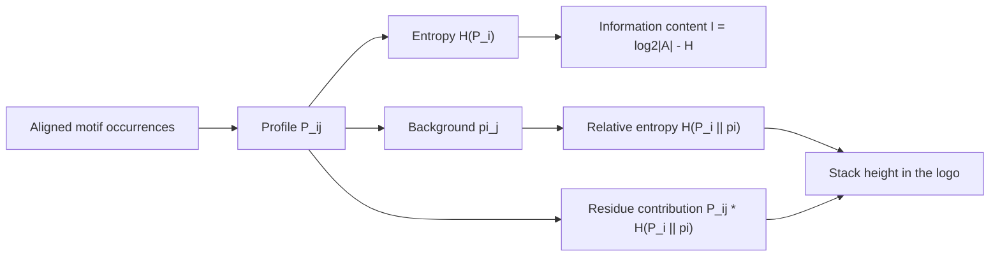

# Information content

## Definition

For a profile column `P_i` — a probability distribution over the alphabet at position `i`
of a motif — the **entropy** `H(P_i)` measures how random that column is, and the
**information content** `I(P_i) = log₂|A| − H(P_i)` measures how much the column
departs from complete randomness. **Relative entropy** `H(P_i ‖ π)` measures the
difference between the column and a background distribution `π`.

## Why it matters

A motif column in which every residue occurs equally often tells you nothing; a column
with a single residue tells you everything. Information content is the number that makes
that intuition quantitative, and it is the quantity drawn as the stack height of a
[[sequence-logo]]. It is also what separates a real [[sequence-motif]] from a stretch of
background.

## Details

Let `P_ij` be the probability of residue `j` at position `i` of a **profile**, with
`i ∈ [1, L]` for a motif of length `L` and `j` ranging over the alphabet `A` (the notes
use amino acids, `|A| = 20`; for DNA `|A| = 4`).

**Entropy / uncertainty of a column**

```
H(P_i) = − Σ_{j ∈ A} P_ij · log₂ P_ij
```

- `H(P_i) = 0` ⟺ only one residue is found at that position (fully conserved).
- `H(P_i)` is **maximal** ⟺ all residues have equal frequency (no information);
  the maximum is `log₂|A|` — 2 bits for DNA, `log₂ 20 ≈ 4.32` bits for protein.

**Information content of a position**

```
I(P_i) = log₂|A| − H(P_i)
```

i.e. the entropy you *would* have had, minus the entropy you actually have.

**Background frequencies**

`π_j` is obtained by counting residue occurrences either in **all known proteins**, or
only in the **proteins of the superfamily under consideration**. The second choice is
the more honest one when the motif is sought inside a family that already has a skewed
composition — the same argument that makes a [[position-weight-matrix]] a *log-odds*
score rather than a plain log-probability.

**Relative entropy**

```
H(P_i ‖ π) = − Σ_{j ∈ A} P_ij · log₂ (P_ij / π_j)
```

(as written in the notes; see *Pitfalls* below).

**Contribution of a residue**

```
contribution(j at i) = P_ij · H(P_i ‖ π)
```

These two numbers — the relative entropy of a column and the contribution of each residue
within it — are exactly what a logo draws as its **stack height** and its **letter
heights**. Using relative entropy rather than plain information content is what makes the
picture comparable across organisms with different base composition: an all-`A` column in
an AT-rich genome is less surprising than in a GC-rich one. The full treatment of the
drawing rules, including the colouring, is on [[sequence-logo]].

## Pitfalls

- The notes write relative entropy with a **leading minus sign**. The standard
  Kullback–Leibler divergence is `+ Σ P_ij log₂(P_ij/π_j)`, which is the non-negative
  quantity needed for a stack height. The sign is recorded in [[open-questions]].
- `0 · log₂ 0` is taken as `0`; in practice zero counts are removed by pseudo-counts
  before the logarithm is taken, exactly as in [[position-weight-matrix]].

## Diagram


From an alignment to the two numbers a sequence logo draws: stack height and letter height.

## Relations

- [[sequence-logo]] — the picture whose axes are these quantities.
- [[position-weight-matrix]] — uses the same `P_ij` and `π_j`, combined as log-odds
  rather than as entropy.
- [[sequence-motif]] — the object being measured.
- [[probability-distribution]] — each profile column *is* a discrete distribution.
- [[substitution-matrix]] — log-odds against a background frequency is the same device
  used for residue substitutions.
- [[hidden-markov-model]] — profile HMMs generalise the profile `P_ij` by adding
  insert and delete states.
- [[E09-binding-sites-pwm-and-pca]] — the module-1 exercise that names the sequence
  logo without constructing it; this page supplies the missing machinery.
- [[em-motif-discovery]] — the profile it learns is exactly the `P_ij` whose per-column
  information content is measured here.
- [[node-impurity]] — entropy impurity in a decision tree is this same Shannon entropy, applied to a class distribution instead of a column of an alignment.
- [[decision-tree]] — splits are chosen by information gain, i.e. by the drop in entropy.
- [[t-sne]] — minimises the Kullback–Leibler divergence, the same relative entropy that sets letter heights in a [[sequence-logo]].
- [[umap]] — minimises a fuzzy set cross entropy, from the same information-theoretic family.
- [[mutual-information]] — built from the same entropies; `I(X;Y)` is the overlap of `H(X)` and `H(Y)`.

## Appears in

- [[M2L02-sequence-motifs-and-motif-discovery]]
- [[M2E02-motif-discovery-and-expectation-maximization]]
- [[M2L03-machine-learning-and-classification]]
- [[L12-binding-sites-and-position-weight-matrices]] — the module-1 lecture whose column
  frequencies this measure turns into a conservation score.

## Sources

- `raw/module2/csb_1.pdf`, p. 16 — profile definition, entropy, information content,
  background frequencies, relative entropy and residue contributions.
- `raw/module2/csb_1.pdf`, p. 24 — exercise definition of entropy versus relative
  entropy.

- `raw/module2/csb_4.pdf`, p. 6 — the entropy Venn diagram and conditional mutual information.
