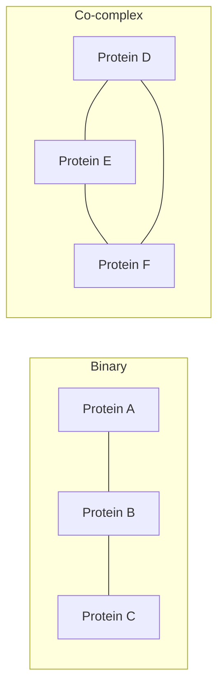

# Interaction Network

## Definition

An interaction network is a graph whose nodes are biological entities — typically
proteins or genes — and whose edges represent a physical or functional interaction
between them.

## Why it matters

It is the third level of biological information listed in
[[L01-bioinformatics-and-the-cell]], and the level at which *systems* biology operates:
phenotypes usually emerge from the wiring of many components rather than from any single
gene.

## Details

- **Binary interactions** — evidence that two specific partners interact directly
  (pairwise assays). Edges are unambiguous.
- **Co-complex associations** — evidence that a set of proteins belongs to the same
  purified complex. The true pairwise contacts inside the complex are unknown, so the
  data must be converted into edges by a model (e.g. "spoke" or "matrix" expansion).
- The distinction matters because the two experiment types yield networks with very
  different edge densities and error profiles.
- Regulatory edges — "transcription factor X binds the promoter of gene Y" — are
  measured by [[chip-seq]] and interpreted through [[gene-regulation]].

## Diagram

Binary assays give individual edges; co-complex data give fully connected groups whose internal contacts are unresolved.

## Relations

- [[chip-seq]] — supplies protein–DNA edges for regulatory networks.
- [[gene-regulation]] — the biological meaning of regulatory edges.
- [[de-bruijn-graph]] — a different use of graphs in the same module, on sequence rather
  than on molecules.
- [[keypathwayminer]] — module 2 searches exactly this graph for maximal connected
  subnetworks that are differentially expressed in nearly all patients.
- [[ant-colony-optimization]] — the metaheuristic that performs that search.
- [[enrichment-analysis]] — networks are one of the three ways of defining a functional
  group, alongside gene sets and pathways.
- [[gene-set]] — the alternative, set-based functional grouping; a network is the
  topology-aware counterpart.
- [[gene-ontology]] — the a priori vocabulary a network search deliberately does
  without.
- [[grandforest]] — grows its [[random-forest]] along the edges of this network, so every [[decision-tree]] path is a connected walk.
- [[bicon]] — constrains a bi-clustering so the selected genes induce a connected subnetwork.
- [[transclust]] — treats a weighted graph as a clustering problem rather than as a display.
- [[cluster-analysis]] — graph-based clustering is one of its five families, and this is the graph it runs on.
- [[endophenotype]] — what the network-constrained searches of module 2 discover.
- [[graph-neural-network]] — learning directly on a biological network rather than searching it; see [[M2L06-deep-learning]].
- [[single-cell-analysis-workflow]] — regulatory networks inferred from single-cell expression.
- [[umap]] — turns point data into a neighbourhood graph before embedding it.
- [[rna-interference]] — RNAi screen hits are interpreted by mapping them onto networks.
- [[competing-endogenous-rna]] — a network whose edges are indirect, mediated by shared miRNAs.
- [[sponge]] — constructs a genome-wide ceRNA network from expression data.
- [[network-alignment]] — comparing two networks node by node instead of analysing one.
- [[cytomcs]] — multiple global alignment of several interaction networks.
- [[gedevo]] — pairwise alignment minimising graph edit distance.
- [[graphlet-degree-signature-distance]] — measures how dissimilar the local neighbourhoods of two network nodes are.
- [[deep-learning]] — graph neural networks take interaction networks as their input domain.
- [[microarray-expression-analysis]] — co-expression across arrays is one way such networks are built.
- [[rna-seq]] — co-expression measured by RNA-Seq is one source of network edges.

## Module 2: the network as a search space

Module 1 treated an interaction network as something to *build* and *look at*. Module 2
turns it into the object of a combinatorial search. In **de novo network enrichment**,
expression data is reduced to a binary indicator matrix over the nodes, and the task is
to extract **maximal connected subnetworks** that are differentially expressed in almost
all samples — with a tolerance for a few exceptional genes (`K`) and a few exceptional
cases (`L`). The two models, **INEs** and **GLONE**, differ only in whether `L` is a
per-node or a global budget. See [[keypathwayminer]].

The practical consequence is that the usual network caveats — hub bias from
better-studied proteins, false-positive edges, incomplete coverage — now propagate
directly into the discovered gene sets rather than merely into a picture.

## Appears in

- [[L01-bioinformatics-and-the-cell]]
- [[L05-sequence-comparison-and-networks]]
- [[M2L01-enrichment-analysis]]
- [[M2E01-enrichment-analysis-and-keypathwayminer]]
- [[M2L04-clustering]]
- [[M2L05-network-based-disease-modules]]
- [[M2L09-non-coding-rnas]]
- [[M2L10-network-alignment]]

## Sources

- `raw/module1/gsb_part1.pdf`, pp. 1, 9.
- `raw/module2/csb_1.pdf`, pp. 8–9, 12–13 — networks as one of the three functional
  groupings, and the INEs/GLONE models that search them.

- `raw/module2/csb_4.pdf`, pp. 9, 11–17 — ceRNA networks and the alignment of biological networks across species.
