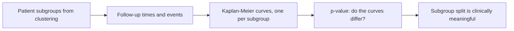

# Kaplan–Meier Plot

## Definition

A **Kaplan–Meier plot** is a graphical representation that **visualizes the probability
of an event occurring over time**. It is most often used to analyse **survival times**.

- **y-axis** — the probability of the event of interest **not** occurring.
- **x-axis** — time passed.

The curve therefore starts at 1 and falls in steps, one step at each observed event.

## Why it matters

It is the clinical pay-off of the module's network methods. A discovered
[[endophenotype]] is only interesting if the patient subgroups differ in outcome, and the
Kaplan–Meier curve plus its p-value is the evidence. Both [[grandforest]] and
[[bicon]] end their pipelines with one.

## Details

- [[grandforest]] **computes Kaplan–Meier plots and p-values** as part of its
  unsupervised survival analysis.
- [[bicon]]'s survival analysis uses a Kaplan–Meier plot to show the **difference in
  survival rate between the bi-clusters**.
- The p-value accompanying the curves is a [[statistical-testing|test decision]] on
  whether the two curves differ by more than chance.

## Diagram

From discovered subgroups to a clinical validation of the split.

## Relations

- [[endophenotype]] — the Kaplan–Meier plot is how a candidate endophenotype is
  validated.
- [[grandforest]] — computes these plots and their p-values in unsupervised mode.
- [[bicon]] — compares the survival of its two bi-clusters this way.
- [[statistical-testing]] — the accompanying p-value is an ordinary test decision.
- [[cluster-analysis]] — supplies the subgroups whose curves are compared.

## Appears in

- [[M2L05-network-based-disease-modules]]
- [[M2E05-grandforest-and-bicon]]

## Sources

- `raw/module2/csb_part2.pdf`, p. 22 — the survival-probability curve sketched for
  GrandForest.
- `raw/module2/csb_part2.pdf`, p. 24 — the definition and the two axes.
- `raw/module2/csb_part2.pdf`, p. 25 — the Kaplan–Meier plot in BiCoN's survival
  analysis.
