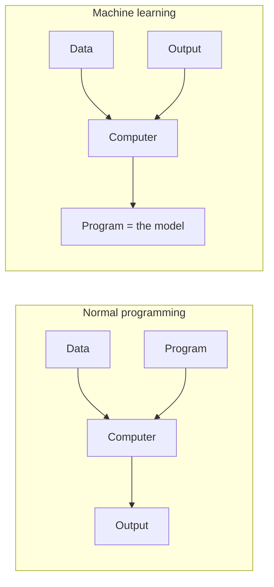
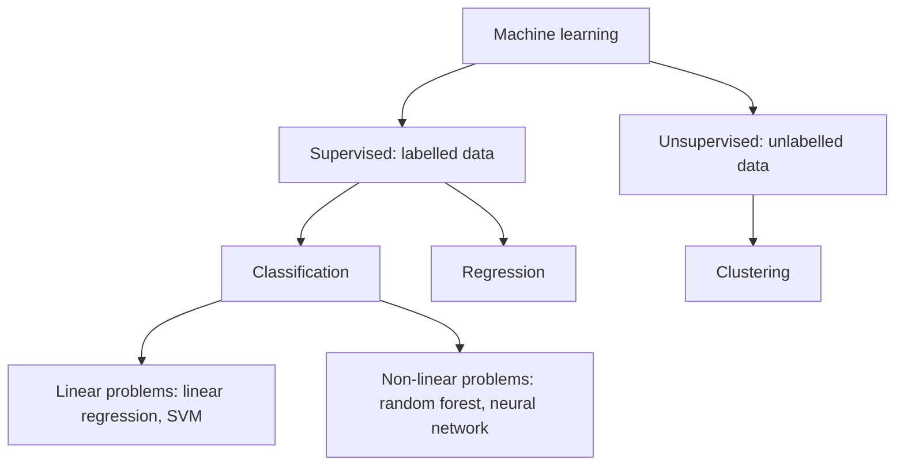

# Machine Learning

## Definition

**Machine learning** inverts the direction of normal programming. In normal programming
the computer is given **data and a program** and returns an **output**; in machine
learning it is given **data and the output** and returns a **program** — the model.

## Why it matters

Every downstream module-2 method — [[decision-tree]], [[random-forest]],
[[support-vector-machine]], [[k-means]], [[grandforest]], [[bicon]] — is an instance of
this inversion. Once the course stops *measuring* biology and starts *predicting* from
it, the object being fitted is a program, and the whole apparatus of
[[overfitting]] control, [[cross-validation]] and [[roc-curve|ROC/AUC]] evaluation
becomes necessary.

## Details

**Normal programming versus machine learning**

```text
normal programming:  data + program  →  computer  →  output
machine learning:    data + output   →  computer  →  program
```

**What is learning?** For **binary classification**, learning means *changing the
coordinates of a hyperplane* until it separates the two classes. The notes draw this as
a scatter of `x`-points and `o`-points with a line being rotated between them — the same
picture that returns as the separator of the [[support-vector-machine]].

**Linear versus non-linear problems**

| | Description | Examples from the notes |
|---|---|---|
| **Linear problems** | Data points **can be separated by a linear function** | Linear regression, SVM |
| **Non-linear problems** | A **complex separation function** is needed | Random forest, neural network (NN) |

**Supervised versus unsupervised analysis**

- **Supervised analysis** — the input has features **and** corresponding output labels
  (*labelled data*). Classification and regression. The classifiers of
  [[M2L03-machine-learning-and-classification]] are all supervised.
- **Unsupervised analysis** — the model has to figure out the labels itself (*unlabelled
  data*). This is [[cluster-analysis]], the subject of [[M2L04-clustering]].

[[grandforest]] is notable for running in **both** modes.

## Diagram


Machine learning swaps the program and the output: the program is what comes out.


The split of machine learning into supervised and unsupervised, and of supervised classification into linear and non-linear problems.

## Relations

- [[overfitting]] — the central failure mode of any fitted model, and the reason the data
  is split in the first place.
- [[cross-validation]] — how the quality of a learned program is estimated honestly.
- [[bootstrapping]] — the resampling alternative to cross-validation.
- [[roc-curve]] — how a trained binary classifier is scored across all cutoffs.
- [[statistical-testing]] — supplies TP/FP/TN/FN, sensitivity, specificity and accuracy,
  the quantities a classifier is measured with.
- [[decision-tree]], [[random-forest]], [[support-vector-machine]] — the three supervised
  models taught in module 2.
- [[cluster-analysis]], [[k-means]], [[transclust]] — the unsupervised side.
- [[principal-component-analysis]] — the module-1 unsupervised projection that precedes
  clustering in the same pipelines.
- [[expectation-maximization]] — iterative parameter estimation with latent variables;
  the same "fit a model, re-estimate, repeat" loop as [[k-means]].
- [[deep-learning]] — the same curve-fitting frame `f(X) = β₀ + β₁X₁ + …`, composed many times; developed in [[M2L06-deep-learning]].
- [[neural-network]] — the model class; [[autoencoder]] is its unsupervised instance.
- [[mirna-target-prediction]] — learns 'good' binding-site patterns from experimental PAR-CLIP examples.
- [[endophenotype]] — endophenotypes are the labels a clinical classifier is trained against.
- [[node-impurity]] — the split criterion of tree-based supervised learners.

## Appears in

- [[M2L03-machine-learning-and-classification]]
- [[M2L04-clustering]]
- [[M2L05-network-based-disease-modules]]
- [[M2E03-machine-learning-and-classification]]
- [[M2E05-grandforest-and-bicon]]
- [[M2L09-non-coding-rnas]]

## Sources

- `raw/module2/csb_part2.pdf`, p. 1 — normal programming versus machine learning, binary
  classification as moving a hyperplane, linear versus non-linear problems.
- `raw/module2/csb_part2.pdf`, p. 12 — unsupervised learning versus supervised
  classification/regression.
- `raw/module2/csb_part2.pdf`, p. 24 — the supervised/unsupervised definitions as given
  in the exercise.

- `raw/module2/csb_4.pdf`, p. 5 — feature extraction, feature selection, scoring and independent testing.
