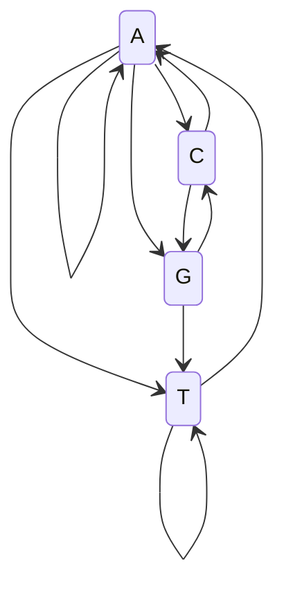

# Markov chain

## Definition

A Markov chain (Markow-Kette) is a **stochastic process for modeling state changes by
knowing a limited history**. The system occupies one of finitely many states
`Q = {q₁, …, q_n}`; at each time step it moves to a new state with a probability that
depends only on the last few states — for a **first-order** chain, only on the current
one.

## Why it matters

Markov chains are the machinery underneath the [[hidden-markov-model]], which the course
uses for gene prediction, protein-family models and sequence classification. They are
also the natural model for a DNA sequence read left to right: the probability of the next
base depends on the preceding base, which is exactly what a dinucleotide frequency table
encodes.

## Details

### Properties

The notes list four:

- **memoryless** — the future depends on the present, not on the path taken to it;
- **homogeneous** — the transition probabilities are the same everywhere in the chain;
- **time-discrete / stationary process** — steps are indexed by integers and the
  dynamics do not change over time;
- described by a **transition matrix**.

### Formal definition

- Random variables: `Y = (X_t)`, with `X_t ∈ Q = {q₁, …, q_n}` (a `q` is a **state**).
- **First-order Markov chain**:

  ```
  P(X_{t+1} = q_{j,t+1} | X_t = q_{j,t})
  ```

  the next state is conditioned on the current state alone.
- **Transition probabilities**:

  ```
  p_ij(t) = T(X_{t+1} = q_j | X_t = q_i)
  ```
- These probabilities form the **transition matrix** `TM`, whose row `i` holds the
  distribution of the successor of state `i`; every row sums to 1.
- **n-th order** chain — the history is longer but still bounded:

  ```
  P(X_{t+1} = q_{j,t+1} | X_t = q_{j,t}, …, X_{t-n+1} = q_{j,t-n+1})
  ```

### Estimating the matrix from data

Given the dinucleotide probabilities `P(XY)` of a genome, the first-order transition
probabilities follow from the definition of conditional probability — this is exactly the
exercise on p. 19:

```
P(Y | X) = P(XY) / P(X)        with  P(X) = Σ_Y P(XY)
```

The probability of a whole sequence `Z = x₁x₂ … x_ℓ` is then the chain of conditionals:

```
P(Z) = P(x_ℓ | x_{ℓ-1}) · … · P(x₂ | x₁) · P(x₁)
```

### Worked numbers from the exercise

With the dinucleotide table of the exercise,
`P(A) = P(AA) + P(AT) + P(AC) + P(AG) = 0.33`, and likewise `P(T) = 0.29`,
`P(C) = 0.23`, `P(G) = 0.18`. Two entries of the transition matrix are then

```
P(A | A) = P(AA) / P(A) = 0.27
P(A | T) = P(TA) / P(T) = 0.31
```

See [[E13-markov-chains-and-viterbi]] for the full working.

## Diagram


A first-order Markov chain over the DNA alphabet; each arrow carries a transition probability and the arrows leaving a state sum to 1.

## Relations

- [[hidden-markov-model]] — the generalization in which the states are not observed.
- [[probability-distribution]] — each row of the transition matrix is a discrete
  distribution over the states.
- [[viterbi-algorithm]] — decodes the most probable state path once the chain is hidden.
- [[forward-algorithm]] — sums over all state paths of a hidden chain.
- [[position-weight-matrix]] — the alternative, position-specific and context-free motif
  model; a Markov chain models dependence between neighbouring positions instead.
- [[baum-welch-algorithm]] — estimates the transition matrix from training sequences when
  the chain is hidden.

- [[gibbs-sampling]] — the motif sampler is itself a Markov chain, over vectors of motif placements.
- [[jukes-cantor-model]], [[kimura-two-parameter-model]] — substitution models are continuous-time Markov chains on the four bases, with the "depends only on the current state" assumption stated explicitly.
- [[evolutionary-distance]], [[molecular-clock]] — a single time-homogeneous rate matrix is exactly what a molecular clock assumes.
- [[recurrent-neural-network]] — the neural alternative for sequential data, with a learned rather than tabulated state.

## Appears in

- [[L17-markov-chains-and-hidden-markov-models]]
- [[E13-markov-chains-and-viterbi]]
- [[M2L08-molecular-evolution-and-phylogeny]] — substitution models in module 2 are continuous-time Markov chains over nucleotides.

## Sources

- `raw/module1/gsb_part4.pdf`, p. 13 (idea, properties, formal definition, orders),
  p. 19 (estimating the transition matrix from dinucleotide probabilities).

