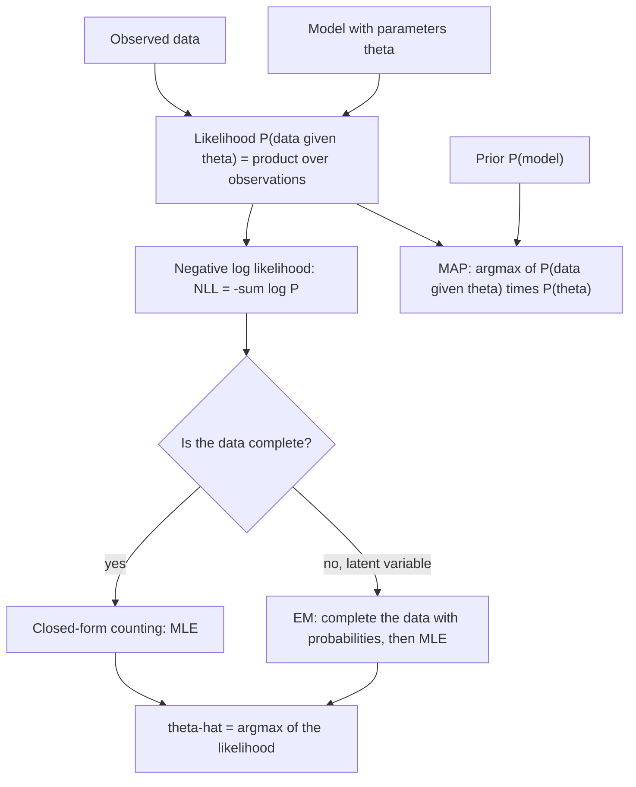

# Maximum Likelihood

## Definition

**Maximum likelihood (ML)** is the principle of choosing, among all candidate models or
parameter settings, the one that makes the **observed data most probable**. Written for a
set of training sequences, module 1 states it as

```
P(seq's | model) = ∏_{j=1}^{n} P(s(j) | model)  →  max
```

and reports the optimum through the **negative log likelihood**,
`NLL-score = −log P(seq's | model)`, which is minimised rather than maximised.

## Why it matters

ML is the scoring rule shared by the two modules' probabilistic machinery. It is what
[[baum-welch-algorithm]] climbs when it trains a [[hidden-markov-model]], what
[[expectation-maximization]] maximises in its M-step, and — in module 2 — the name the
phylogeny lecture gives to a further tree-reconstruction criterion listed alongside
[[neighbor-joining]] and [[maximum-parsimony]]. It is therefore the clearest
**module 1 ↔ module 2 bridge**: the same objective appears once over sequences given a
model, and once over trees given a substitution model.

It also fixes what "best" means for a model. Where [[maximum-parsimony]] asks for the
*fewest changes* and has **no explicit model of evolution**, ML asks for the *most
probable data under an explicit model*. The difference between the two criteria is the
difference between counting and modelling.

## Details

### The likelihood and its logarithm

The likelihood of a model is the probability it assigns to the data. Because the data are
independent, that probability is a **product** over the observations, which underflows
quickly and is awkward to compare. Taking `−log` turns the product into a sum and the
maximisation into a minimisation:

```
NLL-score = −log P(seq's | model) = −Σ_{j=1}^{n} log P(s(j) | model)
```

Smaller NLL is a better model. The same logarithm trick appears for the same numerical
reason in the [[viterbi-algorithm]], where the notes instruct to *use log to work with
sums instead of products*.

### Maximum likelihood versus maximum a posteriori

Module 1 pairs ML with **maximum a posteriori (MAP)** estimation. Bayes' rule turns the
question around from "how probable are the data under this model" to "how probable is
this model given the data":

```
P(model | seq's) = P(seq's | model) · P(model) / P(seq's)
```

`P(seq's)` does not depend on the model, so the best model maximises

```
P(seq's | model) · P(model)  →  max
```

i.e. ML weighted by a **prior** on the model. ML is the special case of MAP with a flat
prior. In [[expectation-maximization]] the same cancellation appears one level down: with
equal priors on the two coins, Bayes reduces to
`wA = L_A / (L_A + L_B)`, a pure likelihood ratio.

### How the optimum is actually found

ML names the objective, not the algorithm. Three routes appear in these modules:

| Situation | Route | Where |
|---|---|---|
| Complete data | closed-form counting (MLE) | the complete-information coin case, [[position-weight-matrix]] |
| Missing/latent data | iterative EM | [[expectation-maximization]], [[baum-welch-algorithm]], [[em-motif-discovery]] |
| Hidden paths to be summed out | forward recursion supplies `P(x | model)` | [[forward-algorithm]] |

With complete data the maximiser is a ratio of counts. With a latent variable — which
coin, which motif position, which hidden state path — there is no closed form, and EM is
used: complete the data with probabilities, then apply MLE to the weighted counts, and
repeat. Each EM iteration **increases the likelihood monotonically**, but only to a
**local** maximum; the resulting estimate is a local, not a global, ML solution. This is
precisely the "local maxima" disadvantage the HMM lecture lists.

### Maximum likelihood in phylogeny

Module 2's method-comparison table names **maximum likelihood** in *both* columns: as a
further **distance-based** method next to UPGMA, Neighbor-Joining and minimal evolution,
and as a further **alignment-based** method next to Maximum Parsimony. The notes do not
develop it; what they do establish is the ingredient it needs — an explicit substitution
model such as [[jukes-cantor-model]] or [[kimura-two-parameter-model]], which supplies
the `P(data | tree, model)` that parsimony deliberately does without. The parsimony page
and the Neighbor-Joining page both record ML as named-but-undeveloped.

> Scope note: everything above is what the handwritten notes state. The notes name
> maximum likelihood as a phylogenetic method but do not give its tree-scoring recursion,
> and this page does not supply one.

## Diagram



Likelihood is turned into a negative log score and then maximised either by direct counting or, when a latent variable hides part of the data, by iterating EM; adding a prior turns the same objective into MAP.

## Relations

- [[baum-welch-algorithm]] — the HMM learning algorithm whose objective *is* maximum
  likelihood, reported as the NLL score.
- [[expectation-maximization]] — the general scheme for reaching an ML estimate when the
  data are incomplete; its M-step is an MLE on weighted counts.
- [[hidden-markov-model]] — the model whose transition and emission probabilities are set
  by maximising the likelihood of the training sequences.
- [[forward-algorithm]] — computes the `P(x | model)` term that the likelihood is a
  product of, by summing over all hidden paths.
- [[viterbi-algorithm]] — maximises the probability of a single *path* rather than of the
  data, and uses the same log transform for the same numerical reason.
- [[em-motif-discovery]] — an ML estimation in which the latent variable is the motif
  position.
- [[position-weight-matrix]] — the complete-data case, where the ML estimate is just a
  normalised count table.
- [[maximum-parsimony]] — the contrasting criterion: fewest character-state changes, with
  no explicit model of evolution, where ML scores the data under one.
- [[neighbor-joining]] — the distance-based method alongside which the notes name maximum
  likelihood as a further distance-based option.
- [[phylogenetic-tree-reconstruction]] — step 3 of the pipeline, where maximum likelihood
  appears in both the distance-based and the alignment-based column.
- [[jukes-cantor-model]], [[kimura-two-parameter-model]] — the explicit substitution
  models that would supply the `P(data | tree, model)` a likelihood tree score needs.
- [[statistical-testing]] — likelihood is the shared currency of likelihood-based testing
  and of model selection.
- [[probability-distribution]] — the likelihood is evaluated under a distribution, such as
  the binomial in the coin example.

## Appears in

- [[L17-markov-chains-and-hidden-markov-models]] — stated for the HMM learning problem,
  together with the NLL score and MAP.
- [[M2L08-molecular-evolution-and-phylogeny]] — named as a further tree-reconstruction
  method, not developed.

## Sources

- `raw/module1/gsb_part4.pdf`, p. 16 — maximum likelihood
  `P(seq's|model) = ∏_j P(s(j)|model) → max`, the `NLL-score = −log P(seq's|model)`, and
  MAP via `P(model|seq's) = P(seq's|model)·P(model)/P(seq's)`.
- `raw/module1/gsb_part4.pdf`, p. 18 — the local-maxima and over-fitting caveats of the
  likelihood-based training.
- `raw/module2/csb_1.pdf`, p. 18 — maximum likelihood estimation on complete data and the
  "use probabilities for data completion and use MLE" statement of EM.
- `raw/module2/csb_3.pdf`, p. 30 — maximum likelihood named in both the distance-based and
  the alignment-based column of the method-comparison table.
