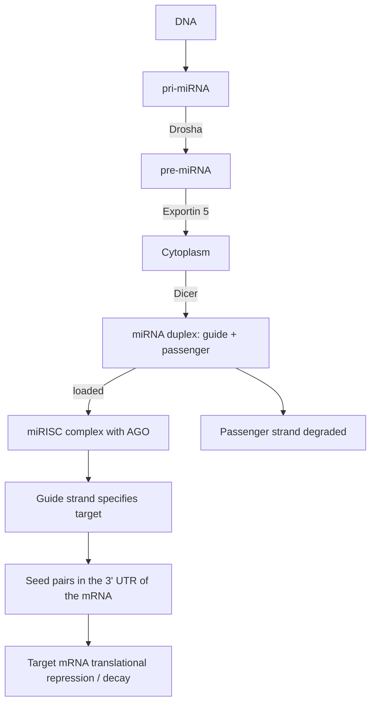

# MicroRNA

## Definition

A microRNA (miRNA) is a **19–22 nucleotide** endogenous [[non-coding-rna]] that acts as a
**key regulator of gene expression**: loaded into an Argonaute-containing effector
complex, it guides that complex to the 3′ UTR of target mRNAs through a short **seed**
match and represses them. **Each miRNA can potentially regulate hundreds of genes.**

## Why it matters

A single miRNA is a one-to-many regulator, so one 22-nucleotide molecule can retune a
whole programme of expression. miRNAs **play a major role in diseases and are
increasingly recognised as biomarkers and therapeutic targets** — which makes the
question *which genes does this miRNA actually regulate?* a clinical one, not merely a
curiosity. Because the seed is so short, the answer cannot be read off the sequence
alone; see [[mirna-target-prediction]].

## Details

### Biogenesis — the origin of a miRNA

The notes trace the full route:

1. A miRNA gene is transcribed from **DNA** into a **pri-miRNA**.
2. **Drosha** processes the pri-miRNA into a hairpin **pre-miRNA** (still in the
   nucleus).
3. **Exportin 5** transports the pre-miRNA to the cytoplasm.
4. **Dicer** cuts the hairpin into a **miRNA duplex** consisting of a **guide** strand
   and a **passenger** strand.
5. The duplex is **loaded** into the **miRISC complex**, which contains an **Argonaute
   (AGO)** protein. The **guide strand specifies the target**; the **passenger** strand
   is discarded.
6. The loaded complex finds an mRNA — which has a **CDS** and a **UTR** — and the miRNA
   pairs with a **seed** site in the UTR.
7. Result: **target mRNA translational repression / decay**.

This is the **miRNA-mediated silencing reaction**.

### Seed pairing

The miRNA does not need full complementarity. Recognition is carried by the **seed**, a
short stretch near the miRNA's 5′ end that pairs with the 3′ UTR of the target. A seed
match is in effect a very short [[sequence-motif]], and it inherits the same problem that
a short [[transcription-factor-binding-site]] has: it occurs by chance everywhere.

### miRBase and miRNA families

- **miRBase** is the reference database of miRNAs.
- A **miRNA family** is a group of **miRNAs with an identical seed sequence**. Members of
  one family are therefore expected to hit largely the same targets, and a prediction made
  for one is a prediction made for all of them.

### Target prediction features

Computational prediction is needed — the notes name **miRanda** as the example tool — and
it is built on four features:

1. **miRNA seed pairing**
2. **Conservation of miRNA binding sites** (see [[homology]])
3. **Hybridization energy**
4. **Accessibility of binding sites**

### Tissue specificity

Because **miRNAs are short**, sequence-based predictions lead to a **high false-positive
rate**. The notes give the main biological reason:

> miRNA and target gene may not be expressed at the same time in the same place.

So **tissue-specific expression data can be used to remove false positives** — a
prediction is only credible where both partners are actually present. This filter
reappears as step 1 of [[sponge]].

## Diagram

miRNA biogenesis and the silencing reaction, as drawn on p. 2.

## Relations

- [[non-coding-rna]] — the class miRNA belongs to.
- [[rna-interference]] — the process it carries out.
- [[small-interfering-rna]] — the sibling species: perfect complementarity, cleavage,
  higher specificity.
- [[mirna-target-prediction]] — the computational problem created by the short seed.
- [[competing-endogenous-rna]] — what happens when several mRNAs share one miRNA.
- [[sponge]] — infers a genome-wide ceRNA network from miRNA and gene expression.
- [[sequence-motif]] — the seed match is one, and inherits the degeneracy problem.
- [[transcription-factor-binding-site]] — the transcriptional analogue: short,
  degenerate, hard to find.
- [[crispr-cas9]] — the guide-RNA principle again, this time engineered.
- [[rna-seq]] — how miRNA and gene expression are measured in the first place.
- [[gene-regulation]] — miRNA is its post-transcriptional layer.
- [[sensitivity-correlation]] — the statistic that turns shared miRNA regulation into a measurable, testable quantity.

## Appears in

- [[M2L09-non-coding-rnas]]
- [[M2E09-non-coding-rnas-and-sponge]]

## Sources

- `raw/module2/csb_4.pdf`, p. 1 — length, key-regulator role, hundreds of targets.
- `raw/module2/csb_4.pdf`, p. 2 — biogenesis: Drosha, Exportin 5, Dicer, miRISC/AGO,
  guide and passenger strands.
- `raw/module2/csb_4.pdf`, p. 4 — miRNA in disease, the four prediction features,
  miRanda, tissue specificity and false positives.
- `raw/module2/csb_4.pdf`, p. 10 — miRBase and the miRNA-family definition (exercise).
