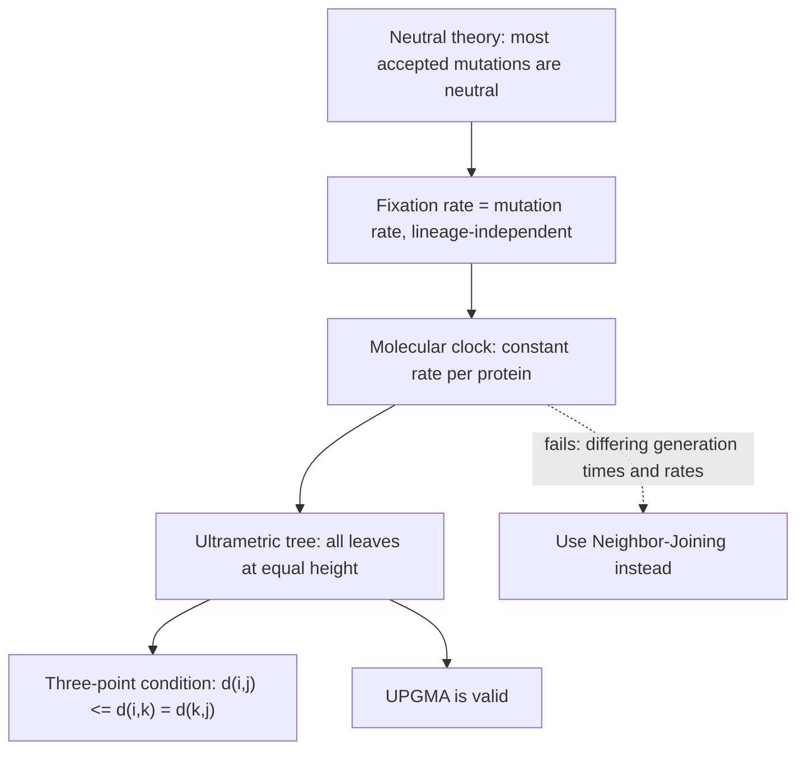

# Molecular Clock

## Definition

The **molecular clock** hypothesis states that

> **for every given protein, the rate of molecular evolution is approximately constant in
> all evolutionary lineages.**

## Why it matters

A clock turns a *distance* into a *date*. Without it, a tree's branch lengths measure
only *amount of change*; with it, they measure *time*, and all present-day taxa must lie
at the same distance from the root. That is precisely the definition of an
**ultrametric tree**, and it is the assumption [[upgma]] stands or falls on.

## Details

### Where it comes from

The clock is the expected consequence of the **neutral theory**: if most accepted
substitutions are selectively neutral ([[genetic-drift]]), their fixation rate is set by
the mutation rate alone, which is a property of the molecule and the machinery copying
it, not of the lineage.

### What it licenses

| Assumed | Tree type | Method |
|---|---|---|
| clock holds | **rooted ultrametric** — all leaves equidistant from the root | [[upgma]] |
| clock does **not** hold | **unrooted additive** — branch lengths free | [[neighbor-joining]] |

### The three-point condition

The notes give the algebraic form of ultrametricity, equivalent to the molecular clock
property (MCP):

```text
MCP  ⟺  ultrametric  ⟺  for all i, j, k:   d_ij  ≤  d_ik  =  d_kj
```

Read as: of the three pairwise distances among any three taxa, **the two larger ones are
equal**. The two taxa that split last are the close pair; both are equally far from the
third, because the clock has been running the same length of time on both lineages
since the split.

Compare the weaker **four-point condition** that an additive (non-clock) tree satisfies —
the property [[neighbor-joining]] exploits instead.

### When it fails

The notes attach a warning to the whole model family: *"note: not always applies to real
data"*. Rates differ between lineages with different generation times, population sizes
and repair efficiencies. Where the clock fails, UPGMA's output is not merely imprecise
but topologically wrong — it will group two fast-evolving lineages because they are both
far from everything, a failure mode NJ is explicitly designed to avoid.

## Diagram


The neutral theory implies a clock, the clock implies ultrametricity, and ultrametricity is what UPGMA requires.

## Relations

- [[upgma]] — assumes the clock; produces the ultrametric tree it implies.
- [[neighbor-joining]] — explicitly does **not** assume it.
- [[phylogenetic-tree]] — ultrametric versus additive trees.
- [[molecular-evolution]] — the clock is one of its two stated principles.
- [[genetic-drift]] — the neutral theory the clock rests on.
- [[evolutionary-distance]] — what the clock converts into time.
- [[markov-chain]] — the constant-rate substitution process is itself a time-homogeneous
  Markov process, which is what makes a single rate matrix `Q` sufficient.
- [[jukes-cantor-model]] — the corrected distance is what the clock converts into time.
- [[phylogenetic-tree-reconstruction]] — whether the clock holds decides between UPGMA and neighbor-joining.

## Appears in

- [[M2L08-molecular-evolution-and-phylogeny]]
- [[M2E08-phylogenetics]]

## Sources

- `raw/module2/csb_3.pdf`, p. 26 — the neutral theory and the molecular clock
  hypothesis.
- `raw/module2/csb_3.pdf`, p. 31 — the molecular clock assumption in UPGMA, the
  ultrametric tree, and the three-point condition `d_ij ≤ d_ik = d_kj`.
- `raw/module2/csb_3.pdf`, p. 32 — Neighbor-Joining as the method that drops the clock
  assumption.
